# BÁO CÁO CÔNG VIỆC

## Hệ thống phân tán phân tích luồng bình luận sau ra mắt điện thoại

**Ngày báo cáo:** 21/10/2026  
**Nguồn dữ liệu:** YouTube Data API v3  
**Phạm vi:** Bình luận tiếng Việt trên YouTube, gồm comment gốc và reply

## 1. Tóm tắt

Hệ thống được xây dựng để theo dõi phản hồi của người dùng sau khi một hãng điện
thoại ra mắt mẫu máy mới tại Việt Nam. Thay vì đọc thủ công hàng trăm video và
hàng nghìn bình luận, hệ thống thu thập dữ liệu liên tục, xử lý theo luồng,
loại spam trước khi thống kê, phân tích cảm xúc theo từng khía cạnh và phát
hiện các dấu hiệu bất thường.

Đầu ra chính là dashboard so sánh mẫu máy chính với mẫu đối thủ theo thời gian,
bao gồm:

- Tỷ lệ khen, chê và trung tính theo từng khía cạnh.
- Tỷ lệ bình luận spam/quảng cáo/seeding đã bị loại.
- Xu hướng tăng bất thường của các lời chê.
- Danh sách cảnh báo kèm các comment minh họa để đội ngũ CSKH, PR và kỹ thuật
  kiểm tra.

## 2. Phát biểu bài toán

Trong vài tuần đầu sau ngày ra mắt, các video review, unbox và so sánh điện
thoại xuất hiện liên tục. Lượng bình luận tăng nhanh, có nhiều reply và có thể
chứa spam, quảng cáo hoặc seeding. Nếu tính trực tiếp trên dữ liệu thô, các
bình luận này làm sai lệch tỷ lệ cảm xúc và đánh giá về sản phẩm.

Hệ thống cần trả lời ba câu hỏi nghiệp vụ:

1. Người dùng đang khen hoặc chê khía cạnh nào của mẫu máy chính so với mẫu đối
   thủ? Kết quả dùng để lựa chọn thông điệp marketing.
2. Lời chê về khía cạnh nào đang tăng bất thường theo thời gian? Kết quả dùng
   để CSKH và PR phản hồi sớm, đồng thời giúp kỹ thuật ưu tiên bản sửa lỗi.
3. Bao nhiêu phần trăm bình luận là spam, quảng cáo hoặc seeding? Các bình luận
   này phải được loại trước khi tính mọi số liệu về khía cạnh và cảm xúc.

### 2.1. Đầu vào

- Dữ liệu bình luận từ YouTube Data API v3.
- Comment gốc và reply; reply có thêm ngữ cảnh `parent_text`.
- Metadata gồm video, mẫu máy, thời gian đăng, số like và số reply.
- Dữ liệu lịch sử JSONL để replay khi demo hoặc kiểm thử.

### 2.2. Đầu ra

- Bản ghi comment đã được chuẩn hóa và gán nhãn spam, khía cạnh, cảm xúc.
- Các số liệu tổng hợp theo `model`, khía cạnh và cửa sổ thời gian.
- Cảnh báo bất thường có khía cạnh, thời gian, mức độ và comment minh họa.
- API phục vụ dashboard theo thời gian gần thực.

### 2.3. Ngoài phạm vi

- Không xử lý hình ảnh, âm thanh hoặc nội dung video.
- Không thu thập các nền tảng khác ngoài YouTube.
- Không phân tích comment không phải tiếng Việt.
- Không lưu tên thật của tác giả; chỉ lưu mã băm ẩn danh.

## 3. Kiến trúc hệ thống

Sơ đồ kiến trúc chính được lưu tại
[`docs/architecture.mmd`](docs/architecture.mmd). Sơ đồ được tổ chức thành
bốn tầng: thu thập, xử lý luồng, lưu trữ và phục vụ/hiển thị.



_Hình 1. Kiến trúc hệ thống được dựng từ_
_[`docs/architecture.mmd`](docs/architecture.mmd)._ 

### 3.1. Tầng thu thập dữ liệu

Python Crawler gọi YouTube Data API, lấy comment theo trang, giữ nguyên dữ liệu
raw và phát sự kiện vào Kafka topic `raw_comments`. Kafka partition theo
`video_id` để các comment của cùng video có tính ổn định khi phân phối. Cơ chế
upsert theo `comment_id` giúp chạy lại hoặc replay không tạo bản ghi trùng.

Khi bảo vệ hoặc đo hệ thống, script Replay phát lại dữ liệu lịch sử với hệ số
tốc độ tùy chọn. `fetched_at` vẫn được giữ để phân biệt thời điểm dữ liệu được
YouTube trả về với thời điểm replay.

### 3.2. Tầng xử lý luồng

Spark Structured Streaming đọc micro-batch từ `raw_comments` và thực hiện:

1. Kiểm tra schema, kiểu dữ liệu và các trường bắt buộc.
2. Deduplicate theo `comment_id`.
3. Chuẩn hóa văn bản, xử lý teencode/emoji và tách mệnh đề.
4. Chạy mô hình spam trước; comment spam không được đưa vào các thống kê
   nghiệp vụ tiếp theo.
5. Với comment hợp lệ, dự đoán một hoặc nhiều khía cạnh và cảm xúc
   `positive`, `negative` hoặc `neutral`.
6. Tính aggregate theo cửa sổ trượt.
7. So sánh mức chê hiện tại với baseline lịch sử và phát cảnh báo vào topic
   `alerts` khi có bất thường.

Một cấu hình tham khảo cho cảnh báo là cửa sổ 1 giờ, bước trượt 10 phút; cảnh
 báo được kích hoạt khi tỷ lệ hoặc số lượng tiêu cực vượt baseline 24 giờ trước
 theo ngưỡng trung bình cộng hai độ lệch chuẩn. Ngưỡng cuối cùng cần được hiệu
 chỉnh trên dữ liệu thực tế.

### 3.3. Tầng lưu trữ

MongoDB gồm ba collection chính:

- `comments`: chi tiết comment và các nhãn dự đoán.
- `aggregates`: số liệu đã tổng hợp để dashboard truy vấn nhanh.
- `alerts`: lịch sử cảnh báo, điểm bất thường và comment minh họa.

Các sink phải idempotent theo `comment_id` hoặc khóa cửa sổ và phiên bản sự kiện,
để replay không làm tăng số liệu nhiều lần.

### 3.4. Tầng phục vụ và hiển thị

FastAPI cung cấp REST API cho comment, aggregate và cảnh báo. Streamlit gọi API
định kỳ để hiển thị biểu đồ xu hướng, so sánh hai mẫu máy và danh sách cảnh báo
mới nhất. Mỗi cảnh báo cần có link hoặc định danh video/comment để người vận
hành kiểm tra lại ngữ cảnh gốc.

## 4. Schema dữ liệu comment

Schema nghiệp vụ được chốt theo khung dưới đây. `comment_id` là khóa chính ở
phía consumer và MongoDB; các bản ghi được ghi bằng upsert.

| Trường | Kiểu | Ý nghĩa và lưu ý |
|---|---|---|
| `comment_id` | string | ID YouTube của comment/reply; khóa upsert |
| `video_id` | string | Video chứa comment; khóa partition Kafka |
| `parent_id` | string/null | ID comment gốc nếu là reply; comment gốc là `null` |
| `parent_text` | string/null | Nội dung comment gốc, chỉ có ở reply |
| `model` | string | `main`, `rival` hoặc `both`; mặc định theo video |
| `source` | string | Nguồn dữ liệu, hiện là `youtube` |
| `text` | string | Nội dung chữ thuần lấy từ `textDisplay` |
| `text_norm` | string | Nội dung sau chuẩn hóa; crawler có thể để rỗng |
| `author_hash` | string | SHA-256 của `salt + channel ID`; không lưu tên thật |
| `published_at` | datetime UTC | Thời điểm đăng; event time cho cửa sổ Spark |
| `like_count` | int | Số like tại thời điểm `fetched_at` |
| `reply_count` | int/null | Tổng reply; chỉ có ở comment gốc |
| `fetched_at` | datetime UTC | Thời điểm API trả dữ liệu |
| `ingested_at` | datetime UTC | Thời điểm bản ghi vào Kafka; replay có thể ghi lại |
| `schema_version` | int | Phiên bản schema, hiện là `2` |

Ví dụ message:

```json
{
  "comment_id": "UgxA1b2C3d4E5f6G7h4AaABAg.9xYz",
  "video_id": "aB3dE5fG7hI",
  "parent_id": "UgxA1b2C3d4E5f6G7h4AaABAg",
  "parent_text": "pin tụt như rơi",
  "model": "main",
  "source": "youtube",
  "text": "@An chuẩn luôn bác",
  "text_norm": "",
  "author_hash": "9f86d081884c7d65...",
  "published_at": "2026-10-05T03:15:00Z",
  "like_count": 2,
  "reply_count": null,
  "fetched_at": "2026-10-17T15:58:28Z",
  "ingested_at": "2026-10-17T15:58:30Z",
  "schema_version": 2
}
```

Hợp đồng JSON Schema được lưu tại
[`contracts/comment-event.schema.json`](contracts/comment-event.schema.json).
Trong code ingest, schema v2 còn hỗ trợ tên model cụ thể theo cấu hình chiến
dịch; quan hệ `main`/`rival` được quản lý trong metadata mẫu máy. Báo cáo
nghiệp vụ vẫn quy đổi về hai nhóm `main` và `rival` khi so sánh.

## 5. Mô hình phân tích

### 5.1. Tiền xử lý

- Chuẩn hóa chữ thường, dấu câu, khoảng trắng và emoji.
- Chuyển đổi một số teencode và tạo `text_norm`.
- Tách comment thành các mệnh đề dựa trên dấu câu và từ nối như “nhưng”, “mà”.
- Giữ `parent_text` để mô hình hiểu ngữ cảnh của reply.
- Dùng `published_at` làm event time, không dùng `ingested_at` để tính xu hướng.

### 5.2. Lọc spam

Spam classifier là bước cổng đầu tiên:

```text
comment
  -> spam classifier
      -> spam/quảng cáo/seeding: loại khỏi aggregate nghiệp vụ
      -> không spam: chuyển sang aspect và sentiment
```

Dashboard cần hiển thị riêng:

```text
tỷ lệ spam = số comment bị phân loại spam / tổng số comment đã kiểm tra
```

Tỷ lệ khen/chê theo khía cạnh chỉ tính trên tập comment không spam. Điều này
tránh việc một chiến dịch seeding hoặc quảng cáo làm sai kết luận về sản phẩm.

### 5.3. Phân loại khía cạnh và cảm xúc

Hệ thống dùng mô hình đa nhãn cho khía cạnh vì một comment có thể nhắc nhiều
đặc điểm. Bộ khía cạnh ban đầu gồm:

1. Pin.
2. Màn hình.
3. Hiệu năng.
4. Camera.
5. Thiết kế và độ bền.
6. Phần mềm.
7. Phần cứng khác.
8. Giá.
9. Bảo hành và hậu mãi.

Với mỗi khía cạnh, sentiment được gán là tích cực, tiêu cực hoặc trung tính.
Một comment có thể tạo nhiều dòng phân tích sau khi tách mệnh đề, nhưng bản ghi
raw vẫn chỉ có một `comment_id`.

Mô hình baseline có thể dùng TF-IDF kết hợp Linear SVM, Logistic Regression
hoặc Naive Bayes. Dữ liệu YouTube raw chưa gán nhãn không được dùng trực tiếp để
train. Dataset bên ngoài dùng cho EDA, gán nhãn và huấn luyện Teacher; một mẫu
YouTube được gán nhãn riêng dùng để đánh giá khác miền. Chi tiết nằm tại
[`docs/ml-training.md`](docs/ml-training.md).

### 5.4. Phát hiện bất thường

Với từng cặp `(model, aspect)`, hệ thống theo dõi:

- Tổng số comment hợp lệ.
- Số comment tiêu cực.
- Tỷ lệ tiêu cực.
- Số lượng và tỷ lệ spam.
- Cửa sổ thời gian và baseline tương ứng.

Một cảnh báo hợp lệ phải chứa ít nhất:

- `alert_id`, `created_at`, `window_start`, `window_end`.
- Mẫu máy và khía cạnh bị ảnh hưởng.
- Chỉ số hiện tại, baseline, ngưỡng và mức độ cảnh báo.
- Một hoặc nhiều `comment_id` minh họa.

## 6. Các hạng mục công việc đã thực hiện

| Hạng mục | Kết quả |
|---|---|
| Chốt bài toán và phạm vi | Đã xác định YouTube, comment tiếng Việt và ba câu hỏi nghiệp vụ |
| Thiết kế kiến trúc | Đã có sơ đồ bốn tầng trong `docs/architecture.mmd` |
| Thiết kế đường ống | Đã mô tả Crawler → Kafka → Spark → MongoDB → FastAPI/Streamlit |
| Crawler và Replay | Đã có module ingest, lưu archive JSONL, quản lý quota và replay |
| Hợp đồng dữ liệu | Đã định nghĩa schema comment và JSON Schema contract |
| Dedupe và riêng tư | Upsert theo `comment_id`, ẩn danh tác giả bằng `author_hash` |
| Tài liệu ML | Đã tách dữ liệu train bên ngoài khỏi raw YouTube và mô tả Teacher/Student |
| Tầng processing | Đã xác định ranh giới validation, normalization, inference và aggregation |
| Tầng serving | Đã xác định MongoDB sink, FastAPI API và Streamlit dashboard |
| Báo cáo | Hoàn thiện tài liệu này để trình bày bài toán, mô hình và dữ liệu |

Các hạng mục cần tiếp tục hoàn thiện khi triển khai đầy đủ gồm model artifact và
metric trên tập test độc lập, job Spark production, endpoint FastAPI,
dashboard Streamlit, integration test end-to-end và hiệu chỉnh ngưỡng cảnh báo
trên dữ liệu thật.

## 7. Tiêu chí đánh giá

### 7.1. Chất lượng mô hình

- Spam: precision, recall, F1 theo lớp `spam`/`not_spam`.
- Aspect: micro-F1, macro-F1 và F1 theo từng khía cạnh.
- Sentiment: macro-F1 và confusion matrix theo từng mẫu máy.
- Đánh giá riêng trên dữ liệu YouTube đã gán nhãn để đo khả năng chuyển miền.

### 7.2. Chất lượng hệ thống

- Không tạo bản ghi trùng khi retry hoặc replay.
- Đo được độ trễ từ `ingested_at` đến khi có kết quả và cảnh báo.
- Dashboard hiển thị đúng event time và không tính comment spam vào tỷ lệ
  nghiệp vụ.
- Cảnh báo có comment minh họa và truy ngược được về video.
- Có thể tiếp tục crawl sau khi dừng giữa chừng mà không mất page token.

## 8. Kết luận

Thiết kế hiện tại đáp ứng đúng luồng nghiệp vụ: thu thập comment YouTube,
chuẩn hóa và lọc spam trước, phân tích khía cạnh/cảm xúc, phát hiện bất thường,
lưu trữ có khả năng replay và cung cấp dữ liệu cho dashboard. Kiến trúc Kafka
và Spark cho phép mở rộng khi số lượng video và comment tăng; MongoDB,
FastAPI và Streamlit tách biệt phần lưu trữ với phần hiển thị. Việc sử dụng
`author_hash`, schema version và upsert theo `comment_id` giúp hệ thống giữ
được tính riêng tư, khả năng tương thích và tính lặp lại trong quá trình demo
cũng như vận hành.
