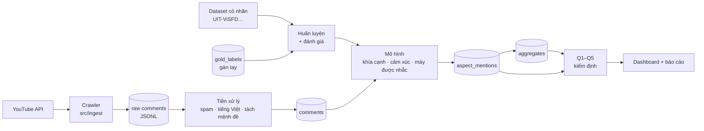

# Phân tích bình luận sau ra mắt điện thoại tại Việt Nam

> Mục đích: Bức tranh toàn cảnh của dự án: bài toán, trạng thái hiện tại, kế hoạch và bản đồ tài liệu; cập nhật lần cuối: 2026-10-28.

Đồ án môn Khoa học dữ liệu, nhóm 11 người. Đọc file này trước, sau đó đọc [Kế hoạch & phân công](docs/roadmap.md).

## 1. Bài toán

Một hãng điện thoại vừa ra mắt **máy X** tại Việt Nam và muốn biết người dùng đánh giá X thế nào so với đời trước và các đối thủ. Dự án thu thập bình luận tiếng Việt trên YouTube (video review, unbox, so sánh), tách thành mệnh đề, gán nhãn **khía cạnh – cảm xúc – máy được nhắc**, rồi trả lời 5 câu hỏi nghiệp vụ:

| # | Câu hỏi | Chi tiết |
|---|---|---|
| Q1 | X được đón nhận tốt hay dở? | Net sentiment theo tuần, so với đời trước và đối thủ |
| Q2 | Ưu điểm và nhược điểm của X là gì? | Tỷ lệ khen/chê theo khía cạnh, kèm bình luận thật |
| Q3 | So với đối thủ, X mạnh/yếu ở đâu? | Ma trận khía cạnh × máy, bình luận so sánh trực tiếp |
| Q4 | Đời trước bị chê gì, đời này đã sửa chưa? | Tỷ lệ chê từng khía cạnh, đời trước → X |
| Q5 | Lỗi gì cần sửa, ưu tiên cái nào? | Lỗi do người đã dùng máy báo, số lần nhắc và xu hướng |

Đặc tả đầy đủ (công thức, kiểm định, điều kiện kết luận): [docs/EDA_requirement.md](docs/EDA_requirement.md).

### Phạm vi

- **Nguồn:** YouTube (chính). Nguồn bổ sung đang khảo sát, xem [Công việc 15](docs/roadmap.md#công-việc-15-bổ-sung-nguồn-dữ-liệu-ngoài-youtube).
- **Bốn máy so sánh:** X, đời trước của X (P), hai đối thủ cùng phân khúc ra mắt cùng thời điểm (R1, R2). Danh sách chốt ở Công việc 2.
- **Cửa sổ:** 4 tuần đầu kể từ `launch_date` của từng máy (khớp với dữ liệu đã crawl, `window_weeks: 4` trong [config/pipeline.yaml](config/pipeline.yaml)).
- **9 khía cạnh (đã chốt ở Công việc 4, mã trong [docs/data-model.md](docs/data-model.md#danh-mục-mã)):** Pin & sạc, Màn hình, Hiệu năng (gồm nhiệt độ), Camera, Thiết kế & độ bền, Phần mềm, Phần cứng khác, Giá, Bảo hành & hậu mãi.
- **Ngoài phạm vi:** hình ảnh/âm thanh/nội dung video; bình luận không phải tiếng Việt; tên thật của người bình luận (chỉ lưu `author_hash`).

## 2. Trạng thái hiện tại

| Thành phần | Trạng thái | Ghi chú |
|---|---|---|
| Crawler YouTube | ✅ Xong | [src/ingest](src/ingest/README.md): quota, resume, chống trùng, replay |
| Dữ liệu raw | ✅ Có | ~226 nghìn bình luận, 51 model, 2014–2026. Không nằm trong git (xem mục 5) |
| Tiền xử lý (lọc spam, tách mệnh đề) | ⚠️ Có kết quả, **thiếu code trong repo** | Công việc 6 |
| EDA + dashboard | ⚠️ **Bản nháp** | Để hình dung đầu ra. Nhãn khía cạnh/cảm xúc là luật từ khóa, **số liệu chỉ để minh họa** |
| Nhãn (gold labels) | ❌ Chưa có | Công việc 1, 5 |
| Mô hình ML | ❌ Chưa có | Công việc 7–11 |
| Cơ sở dữ liệu | ❌ Mới có thiết kế | [docs/data-model.md](docs/data-model.md), Công việc 3 |
| Trả lời Q1–Q5 bằng mô hình | ❌ Chưa | Công việc 12 |
| Streaming (Kafka/Spark) | ⏸ Tùy chọn | Chỉ làm nếu còn thời gian, xem [docs/pipeline.md](docs/pipeline.md) |
| Tests | ❌ Chưa có | [tests/README.md](tests/README.md) |

## 3. Luồng dữ liệu



Đơn vị phân tích là **mệnh đề × khía cạnh** (`aspect_mentions`), không phải cả bình luận. Máy được tính là **máy được nhắc trong mệnh đề** (`target_model`), không phải máy của video.

## 4. Bản đồ tài liệu

| Tài liệu | Đọc khi |
|---|---|
| [docs/roadmap.md](docs/roadmap.md) | Muốn biết mình làm gì, phụ thuộc ai, hạn khi nào |
| [docs/EDA_requirement.md](docs/EDA_requirement.md) | Làm phân tích Q1–Q5, dashboard, báo cáo |
| [docs/data-model.md](docs/data-model.md) | Làm DB, ghi/đọc dữ liệu giữa các nhóm |
| [contracts/](contracts/) | Kiểm tra định dạng bản ghi (JSON Schema) |
| [docs/ml-training.md](docs/ml-training.md) | Gán nhãn, huấn luyện, đánh giá mô hình |
| [docs/pipeline.md](docs/pipeline.md) | Hiểu các bước xử lý và phần streaming tùy chọn |
| [src/ingest/README.md](src/ingest/README.md) | Chạy crawler, replay |
| [Bao_cao_21_10.md](Bao_cao_21_10.md) | Cần bản báo cáo tổng hợp để nộp/trình bày (bản 21/10, cập nhật 28/10) |
| [docs/architecture.mmd](docs/architecture.mmd) | Sửa sơ đồ kiến trúc (render lại `architecture.svg` theo lệnh ghi trong file) |

## 5. Bắt đầu

1. Clone repo, tạo branch riêng: `git checkout -b <tên>/<công-việc>`.
2. Dữ liệu không nằm trong git. Tải `clean_data.jsonl` từ thư mục chung của nhóm (**link: ___**), đặt vào `data/clean_data.jsonl` ở gốc repo. Kiểm tra số dòng và checksum khớp với bảng phiên bản dữ liệu trong thư mục chung.
3. Đọc công việc của mình trong [docs/roadmap.md](docs/roadmap.md) và các tài liệu nó trỏ tới.
4. Làm xong thì mở PR vào `main`, không push thẳng.

## 6. Cấu trúc thư mục

```text
config/            cấu hình crawler: danh mục máy, kênh, quota
contracts/         JSON Schema: comment-event, aspect-mention
docs/              đặc tả, kế hoạch, thiết kế dữ liệu, ML, pipeline
runbooks/          kịch bản sự cố cho phần streaming (tùy chọn)
src/ingest/        crawler YouTube + replay
src/processing/    tiền xử lý, mô hình, notebook EDA
src/serving/       dashboard (hiện là bản nháp tĩnh)
tests/             kiểm thử
```
