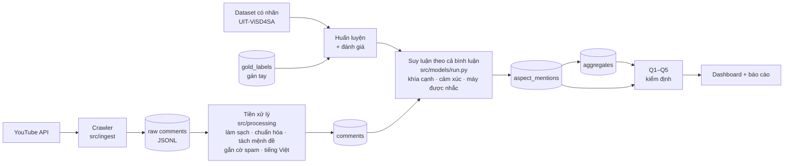

# Phân tích bình luận sau ra mắt điện thoại tại Việt Nam

> Mục đích: Bức tranh toàn cảnh của dự án: bài toán, trạng thái hiện tại, luồng dữ liệu, chỗ tìm tài liệu và cấu trúc thư mục; cập nhật lần cuối: 2026-11-26.

Đồ án môn Khoa học dữ liệu, nhóm 11 người. Đọc file này trước, sau đó đọc [Kế hoạch dự án](docs/0-chung/ke-hoach.md).

## 1. Bài toán

Một hãng điện thoại vừa ra mắt **máy X** tại Việt Nam và muốn biết người dùng đánh giá X thế nào so với đời trước và các đối thủ. Dự án thu thập bình luận tiếng Việt trên YouTube (video review, unbox, so sánh), gán cho mỗi bình luận các nhãn **khía cạnh – cảm xúc – máy được nhắc**, rồi trả lời 5 câu hỏi nghiệp vụ:

| # | Câu hỏi | Chi tiết |
|---|---|---|
| Q1 | X được đón nhận tốt hay dở? | Net sentiment theo tuần, so với đời trước và đối thủ |
| Q2 | Ưu điểm và nhược điểm của X là gì? | Tỷ lệ khen/chê theo khía cạnh, kèm bình luận thật |
| Q3 | So với đối thủ, X mạnh/yếu ở đâu? | Ma trận khía cạnh × máy, bình luận so sánh trực tiếp |
| Q4 | Đời trước bị chê gì, đời này đã sửa chưa? | Tỷ lệ chê từng khía cạnh, đời trước → X |
| Q5 | Lỗi gì cần sửa, ưu tiên cái nào? | Lỗi do người đã dùng máy báo, số lần nhắc và xu hướng |

Mục đích, mục tiêu và chi tiết từng câu hỏi (đo bằng gì, khi nào được kết luận, câu Q6 về tài khoản ảo đang đề xuất): [docs/0-chung/muc-tieu.md](docs/0-chung/muc-tieu.md).

### Phạm vi

- **Nguồn:** YouTube (chính). Nguồn bổ sung đang khảo sát, xem [Công việc 15](docs/0-chung/ke-hoach.md#công-việc-15-bổ-sung-nguồn-dữ-liệu-ngoài-youtube).
- **Máy:** không chọn bộ 4 máy (trưởng nhóm quyết 26/11). Dòng máy nào có trong dữ liệu thì phân tích. Cách đặt lại Q1–Q5: [kế hoạch tổng thể mục 5](docs/0-chung/ke-hoach-tong-the.md#5-q1q6-khi-không-có-bộ-4-máy-đề-xuất) (đề xuất).
- **Cửa sổ:** 4 tuần đầu kể từ `launch_date` của từng máy (khớp với dữ liệu đã crawl, `window_weeks: 4` trong [config/pipeline.yaml](config/pipeline.yaml)).
- **Bộ nhãn (chốt 26/11):** 6 chiều, 41 nhãn, trong đó 11 khía cạnh: pin và sạc, màn hình, hiệu năng (gồm nóng máy), camera, thiết kế, độ bền, phần mềm, phần cứng khác (gồm âm thanh), giá, mua bán, bảo hành và sửa chữa ([đặc tả bộ nhãn mục 8](docs/3-gan-nhan/dac-ta-bo-nhan.md#8-bộ-nhãn-chốt-b8-2611)). Contract và [thiết kế dữ liệu](docs/0-chung/thiet-ke-du-lieu.md) còn theo 9 khía cạnh cũ, sửa ở bước 0.4 của [kế hoạch tổng thể](docs/0-chung/ke-hoach-tong-the.md).
- **Ngoài phạm vi:** hình ảnh/âm thanh/nội dung video; bình luận không phải tiếng Việt; tên thật của người bình luận (chỉ lưu `author_hash`).

## 2. Trạng thái hiện tại

Tiến độ từng công việc, việc cần làm tiếp và các quyết định đang chờ nằm ở **[Kế hoạch dự án](docs/0-chung/ke-hoach.md)**. Đây là nơi duy nhất ghi tiến độ, nên README không giữ bảng trạng thái riêng.

Hiện chạy **theo lô, mỗi ngày một lần**: lệnh `python -m src.run` chạy tiền xử lý → suy luận → aggregates, Q1–Q5. Streaming (Kafka/Spark) để sau ([docs/0-chung/luong-xu-ly.md](docs/0-chung/luong-xu-ly.md)).

## 3. Luồng dữ liệu



Đơn vị phân tích là **cả bình luận**, đếm theo (bình luận, máy, khía cạnh) (chốt 20/11, [muc-tieu.md mục 4](docs/0-chung/muc-tieu.md#4-phạm-vi)). Máy được tính là **máy được nhắc** (`target_model`, xét cả bình luận), không phải máy của video. Mệnh đề chỉ dùng để chỉ câu làm bằng chứng.

## 4. Tài liệu

Mục lục đầy đủ, xếp theo tầng xử lý, kèm quy tắc đặt tên: **[docs/README.md](docs/README.md)**. Hay dùng nhất:

| Tài liệu | Đọc khi |
|---|---|
| [docs/0-chung/ke-hoach.md](docs/0-chung/ke-hoach.md) | Muốn biết dự án đang ở đâu, làm gì tiếp, mình nhận việc gì, phụ thuộc ai |
| [docs/0-chung/cai-dat.md](docs/0-chung/cai-dat.md) | Dựng môi trường, đặt dữ liệu |
| [docs/0-chung/ban-do-code.md](docs/0-chung/ban-do-code.md) | Không biết một file code để làm gì, hay muốn sửa một thứ mà không biết sửa ở đâu |
| [AGENTS.md](AGENTS.md) | Dùng trợ lý AI (Claude, ChatGPT, Copilot…) để làm việc trong repo: luật AI phải theo |
| [docs/3-gan-nhan/huong-dan-gan-nhan-chinh-thuc.md](docs/3-gan-nhan/huong-dan-gan-nhan-chinh-thuc.md) | Tham gia gán nhãn (định nghĩa nhãn ở [đặc tả bộ nhãn](docs/3-gan-nhan/dac-ta-bo-nhan.md)) |
| [docs/0-chung/ke-hoach-tong-the.md](docs/0-chung/ke-hoach-tong-the.md) | Muốn biết lộ trình từ giờ tới báo cáo cuối (đề xuất 26/11) |

## 5. Bắt đầu

1. Clone repo, tạo branch riêng: `git checkout -b <tên>/<công-việc>`.
2. Dữ liệu không nằm trong git. Xin trưởng nhóm bộ dữ liệu crawl bản v4 (**link: ___**) và đặt đúng chỗ crawler ghi ra: `src/ingest/data/raw/comments.jsonl` (bắt buộc), `src/ingest/data/raw/videos.jsonl` và `src/ingest/data/state.db` (để tra video). Kiểm số dòng và checksum theo [docs/1-thu-thap/dac-ta.md mục 7](docs/1-thu-thap/dac-ta.md#7-phiên-bản-dữ-liệu).
3. Đọc [kế hoạch](docs/0-chung/ke-hoach.md): tìm dòng công việc của mình ở mục 4.1, yêu cầu chi tiết ở mục 6, rồi các tài liệu nó trỏ tới.
4. Làm xong thì mở PR vào `main`, không push thẳng.

## 6. Cấu trúc thư mục

Giải thích từng file: [docs/0-chung/ban-do-code.md](docs/0-chung/ban-do-code.md).

```text
config/          pipeline.yaml (crawler, danh mục máy), analysis.yaml (bộ máy cho Q1–Q5)
contracts/       JSON Schema: comment-event (v3), aspect-mention (v2)
docs/            tài liệu, mỗi tầng một thư mục (0-chung, 1-thu-thap … 6-luu-tru); mục lục ở docs/README.md
src/ingest/      tầng 1: crawler YouTube; dữ liệu ở src/ingest/data/ (ngoài git)
src/run.py       lệnh chạy cả chuỗi theo lô: tiền xử lý → suy luận → aggregates, Q1–Q5
src/processing/  tầng 2: làm sạch, chuẩn hóa, tách mệnh đề, gắn cờ, lệnh chạy ra data/processed/
src/labeling/    tầng 3: lấy mẫu, phiếu gán, so hai người gán (kappa), phân bố nhãn có khoảng tin cậy
src/models/      tầng 4: bước suy luận (run.py), luật mốc khía cạnh (aspect/keywords.py), cảm xúc (sentiment/rules.py), máy được nhắc, dataset ngoài
src/analysis/    tầng 5: aggregates, Q1–Q5
src/storage/     tầng 6: MongoDB
notebooks/       mỗi bước một notebook: 1_raw_audit, 2_1_clean, 2_2_normalize, 2_3_clauses, 3_aspect_keywords, 3_label_distribution
tests/           test tầng 2, 3, 4, 5
data/            dữ liệu đã xử lý, nhãn, đầu ra (ngoài git)
```
