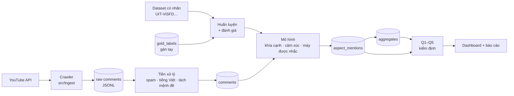

# Phân tích bình luận sau ra mắt điện thoại tại Việt Nam

> Mục đích: Bức tranh toàn cảnh của dự án: bài toán, trạng thái hiện tại, kế hoạch và bản đồ tài liệu; cập nhật lần cuối: 2026-11-11.

Đồ án môn Khoa học dữ liệu, nhóm 11 người. Đọc file này trước, sau đó đọc [Kế hoạch & phân công](docs/ke-hoach/roadmap.md).

## 1. Bài toán

Một hãng điện thoại vừa ra mắt **máy X** tại Việt Nam và muốn biết người dùng đánh giá X thế nào so với đời trước và các đối thủ. Dự án thu thập bình luận tiếng Việt trên YouTube (video review, unbox, so sánh), tách thành mệnh đề, gán nhãn **khía cạnh – cảm xúc – máy được nhắc**, rồi trả lời 5 câu hỏi nghiệp vụ:

| # | Câu hỏi | Chi tiết |
|---|---|---|
| Q1 | X được đón nhận tốt hay dở? | Net sentiment theo tuần, so với đời trước và đối thủ |
| Q2 | Ưu điểm và nhược điểm của X là gì? | Tỷ lệ khen/chê theo khía cạnh, kèm bình luận thật |
| Q3 | So với đối thủ, X mạnh/yếu ở đâu? | Ma trận khía cạnh × máy, bình luận so sánh trực tiếp |
| Q4 | Đời trước bị chê gì, đời này đã sửa chưa? | Tỷ lệ chê từng khía cạnh, đời trước → X |
| Q5 | Lỗi gì cần sửa, ưu tiên cái nào? | Lỗi do người đã dùng máy báo, số lần nhắc và xu hướng |

Mục đích, mục tiêu và chi tiết từng câu hỏi (đo bằng gì, khi nào được kết luận, câu Q6 về tài khoản ảo đang đề xuất): [docs/spec/muc-tieu.md](docs/spec/muc-tieu.md).

### Phạm vi

- **Nguồn:** YouTube (chính). Nguồn bổ sung đang khảo sát, xem [Công việc 15](docs/ke-hoach/roadmap.md#công-việc-15-bổ-sung-nguồn-dữ-liệu-ngoài-youtube).
- **Bốn máy so sánh:** X, đời trước của X (P), hai đối thủ cùng phân khúc ra mắt cùng thời điểm (R1, R2). Danh sách chốt ở Công việc 2.
- **Cửa sổ:** 4 tuần đầu kể từ `launch_date` của từng máy (khớp với dữ liệu đã crawl, `window_weeks: 4` trong [config/pipeline.yaml](config/pipeline.yaml)).
- **9 khía cạnh (đã chốt ở Công việc 4, mã trong [docs/spec/data-model.md](docs/spec/data-model.md#danh-mục-mã)):** Pin & sạc, Màn hình, Hiệu năng (gồm nhiệt độ), Camera, Thiết kế & độ bền, Phần mềm, Phần cứng khác, Giá, Bảo hành & hậu mãi.
- **Ngoài phạm vi:** hình ảnh/âm thanh/nội dung video; bình luận không phải tiếng Việt; tên thật của người bình luận (chỉ lưu `author_hash`).

## 2. Trạng thái hiện tại

Tiến độ từng công việc, việc cần làm tiếp và các quyết định đang chờ nằm ở **[Sổ tay dự án](docs/ke-hoach/so-tay.md)**. Đây là nơi duy nhất ghi tiến độ, nên README không giữ bảng trạng thái riêng.

Streaming (Kafka/Spark) là phần tùy chọn, chỉ làm nếu còn thời gian ([docs/spec/pipeline.md](docs/spec/pipeline.md)).

## 3. Luồng dữ liệu



Đơn vị phân tích là **mệnh đề × khía cạnh** (`aspect_mentions`), không phải cả bình luận. Máy được tính là **máy được nhắc trong mệnh đề** (`target_model`), không phải máy của video.

## 4. Bản đồ tài liệu

| Tài liệu | Đọc khi |
|---|---|
| [docs/ke-hoach/so-tay.md](docs/ke-hoach/so-tay.md) | Muốn biết dự án đang ở đâu, việc nào kẹt, làm gì tiếp |
| [docs/huong-dan/ban-do-code.md](docs/huong-dan/ban-do-code.md) | Không biết một file code để làm gì, hay muốn sửa một thứ mà không biết sửa ở đâu |
| [docs/ke-hoach/roadmap.md](docs/ke-hoach/roadmap.md) | Muốn biết mình làm gì, phụ thuộc ai, hạn khi nào |
| [docs/huong-dan/cai-dat.md](docs/huong-dan/cai-dat.md) | Dựng môi trường, đặt dữ liệu, kiểm tra cài đặt |
| [docs/spec/muc-tieu.md](docs/spec/muc-tieu.md) | Muốn biết đề tài nhằm mục đích gì, phải giao ra gì, phải trả lời những câu hỏi nào |
| [docs/spec/thu-thap.md](docs/spec/thu-thap.md) | Muốn biết crawler lấy video, bình luận nào, dữ liệu nằm ở đâu, đang dùng phiên bản nào |
| [docs/spec/data-model.md](docs/spec/data-model.md) | Làm DB, ghi/đọc dữ liệu giữa các nhóm |
| [src/analysis/README.md](src/analysis/README.md) | Chạy Công việc 12: tính aggregates và trả lời Q1–Q5 từ nhãn đã có |
| [contracts/](contracts/) | Kiểm tra định dạng bản ghi (JSON Schema) |
| [docs/spec/ml-training.md](docs/spec/ml-training.md) | Gán nhãn, huấn luyện, đánh giá mô hình |
| [docs/spec/pipeline.md](docs/spec/pipeline.md) | Hiểu các bước xử lý và phần streaming tùy chọn |
| [src/ingest/README.md](src/ingest/README.md) | Chạy crawler, replay |
| [docs/spec/architecture.mmd](docs/spec/architecture.mmd) | Sửa sơ đồ kiến trúc (render lại `architecture.svg` theo lệnh ghi trong file) |

## 5. Bắt đầu

1. Clone repo, tạo branch riêng: `git checkout -b <tên>/<công-việc>`.
2. Dữ liệu không nằm trong git. Xin trưởng nhóm bộ dữ liệu crawl bản v4 (**link: ___**) và đặt đúng chỗ crawler ghi ra: `src/ingest/data/raw/comments.jsonl` (bắt buộc), `src/ingest/data/raw/videos.jsonl` và `src/ingest/data/state.db` (để tra video). Kiểm số dòng và checksum theo [docs/spec/thu-thap.md mục 7](docs/spec/thu-thap.md#7-phiên-bản-dữ-liệu).
3. Đọc [sổ tay](docs/ke-hoach/so-tay.md) để biết công việc của mình đang tới đâu, rồi đọc yêu cầu trong [docs/ke-hoach/roadmap.md](docs/ke-hoach/roadmap.md) và các tài liệu nó trỏ tới.
4. Làm xong thì mở PR vào `main`, không push thẳng.

## 6. Cấu trúc thư mục

Giải thích từng file: [docs/huong-dan/ban-do-code.md](docs/huong-dan/ban-do-code.md).

```text
config/pipeline.yaml     cấu hình crawler: danh mục máy, kênh, cửa sổ thời gian, hạn mức API
contracts/               JSON Schema: comment-event (v3), aspect-mention (v2)
docs/spec/               đặc tả: mục tiêu và câu hỏi, thu thập, mô hình dữ liệu, ML, pipeline, kiến trúc
docs/huong-dan/          hướng dẫn: cài đặt, bản đồ code, crawl 2 máy, sự cố streaming
docs/ke-hoach/           roadmap 15 công việc, sổ tay tiến độ
src/ingest/              crawler YouTube (crawler/), kiểm tra dữ liệu (check_data.py); dữ liệu ở data/ (ngoài git)
tests/                   kế hoạch kiểm thử (chưa có test)
```
