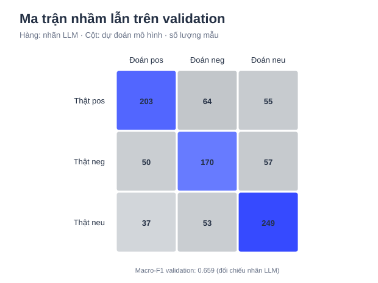
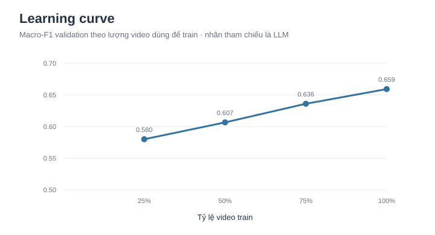
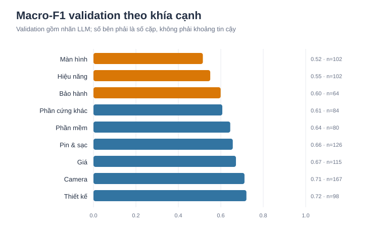
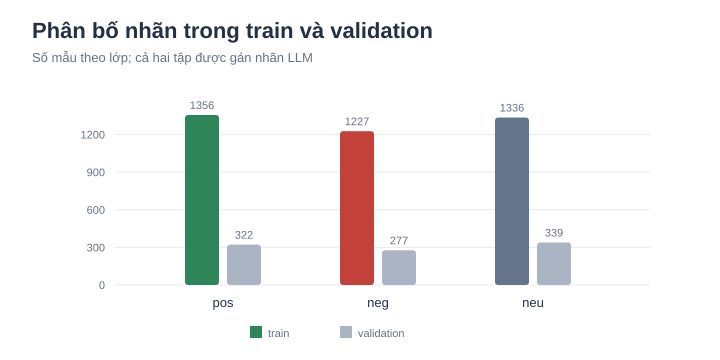

# Công việc 9: Mô hình cảm xúc theo khía cạnh cho bình luận điện thoại

*Dự án: hệ thống phân tích luồng bình luận sau ra mắt điện thoại tại Việt Nam · Lập bản đầu: 2026-11-06 · Rà soát/cập nhật: 2026-11-08 · Người thực hiện: Nguyễn Trung Kiên*

## 1. Tóm tắt

**Đã làm gì.** Tạo bộ dữ liệu (mệnh đề, khía cạnh, cảm xúc) từ `clean_data.jsonl` bằng cách dùng LLM (Gemini `gemini-3.5-flash-lite`) gán nhãn theo guideline v0.3, rồi huấn luyện mô hình baseline TF-IDF + Logistic Regression dự đoán cảm xúc `pos`, `neg`, `neu` cho từng cặp (mệnh đề, khía cạnh).

**Kết quả.** Đã gán 9.853 mệnh đề, thu được 5.445 cặp sau khi lọc (3.919 cặp train, 938 cặp val, 588 cặp `uncertain` tách riêng). Mô hình đạt macro-F1 **0,659** trên val (baseline lớp đa số 0,170) và 0,654 khi cross-validation theo video. Trong audit bằng Claude, khía cạnh Gemini đồng thuận ở 103/120 cặp (86%); trên 103 cặp đó, Gemini đồng thuận sentiment ở 84/103 (82%) và mô hình ở 68/103 (66%). Các số này là đối chiếu LLM, chưa phải đánh giá trên nhãn người.

**Hạn chế chính.** Không có tập test do hai người gán; nhãn là nhãn LLM, guideline chưa được nhóm hiệu chỉnh; lượt audit độc lập cũng do AI thực hiện; mô hình TF-IDF yếu ở phủ định và hàm ý, và không dùng bình luận cha. Điểm trên val đo độ khớp với nhãn LLM, không phải độ đúng thật.

## 2. Bài toán và phạm vi

- Đầu vào: một mệnh đề tiếng Việt và một khía cạnh trong 9 mã của `data-model.md`: `BATTERY`, `DISPLAY`, `PERFORMANCE`, `CAMERA`, `DESIGN`, `SOFTWARE`, `HARDWARE_OTHER`, `PRICE`, `WARRANTY`.
- Đầu ra: `pos` (khen), `neg` (chê), `neu` (câu hỏi, mô tả, không rõ thái độ).
- Đơn vị phân tích là cặp (mệnh đề, khía cạnh), không chấm cả bình luận. Mô hình này **không** tự phát hiện khía cạnh (đó là Công việc 8).

## 3. Dữ liệu và gán nhãn

### 3.1 Dữ liệu đầu vào

`clean_data.jsonl`: 225.968 bình luận (SHA-256 `a1d29fc1e4a1e57bc34a5d398a072930771da1591b332106f11802d78ad3db30`), trong đó 14.341 bị gắn cờ spam. Từ 211.627 bình luận không spam tách được 444.969 mệnh đề (`clauses.jsonl`, SHA-256 `fa49125d8464d426d5981a914bfc6935e3ff4eb8f1b130ba3dd2e9b25c1a8d5f`). Lưu ý: số dòng này khác bản chuẩn v1.0 trong README của nhóm (109.344 dòng); nhóm cần thống nhất phiên bản dữ liệu.

### 3.2 Gán nhãn bằng LLM

- Model: `gemini-3.5-flash-lite` qua Gemini API (gói miễn phí), `temperature = 0`, 30 mệnh đề mỗi lượt gọi, kèm bình luận cha (cắt 600 ký tự) khi có.
- Guideline `docs/labeling-guideline.md` v0.3 (SHA-256 `1f5570950a02fe49f892140b22a3397af55ac6a7e385a6a81bb531bd18aecc8d`), do một người soạn và chỉnh sau hai vòng thử 200 mệnh đề (v0.1 đến v0.3) để giảm gán thừa khía cạnh, xử lý câu mong muốn là `neg`, bỏ qua phụ kiện và từ đệm.
- Prompt `task9-prompt-v1`; đầu ra JSON được kiểm tra tự động (mã khía cạnh và cảm xúc hợp lệ, không lặp khía cạnh). Mọi nhãn có `label_source = "llm"`; model, prompt, tham số và thời điểm lưu trong `llm_run_meta.jsonl`.

| Nguồn mẫu | Số mệnh đề |
| --- | --- |
| Ngẫu nhiên, rải đều theo video (tối đa 6 mỗi video) | 7.253 |
| Lọc từ khóa `WARRANTY` | 600 |
| Lọc từ khóa `HARDWARE_OTHER`, `SOFTWARE`, `BATTERY` | 1.200 |
| Lọc từ khóa `DISPLAY`, `CAMERA` | 800 |
| **Tổng** | **9.853** |

Khoảng 26% mệnh đề được chọn theo từ khóa để bù khía cạnh hiếm, nên tỉ lệ các khía cạnh trong bộ dữ liệu **không phản ánh tần suất thật** và không dùng để kết luận khía cạnh nào được bàn nhiều.

### 3.3 Làm sạch và chia tập

- Trong 9.853 mệnh đề có 4.961 mệnh đề có khía cạnh và 4.892 mệnh đề không có khía cạnh nào.
- Theo quy tắc lọc của tập hiện tại, bỏ 66 mệnh đề được LLM gán từ 3 khía cạnh trở lên (215 cặp); đây là bộ lọc heuristic, không phải kết luận người gán đã xác nhận cả 66 mệnh đề sai.
- Tách riêng 588 cặp LLM đánh `uncertain`, không dùng để huấn luyện.
- Chia train/val theo `video_id` bằng hàm băm (20% video vào val, seed 42): 1.233 video train, 308 video val; đã kiểm tra không có video ở cả hai tập.

| Khía cạnh | Train pos / neg / neu | Val pos / neg / neu |
| --- | --- | --- |
| BATTERY | 148 / 176 / 135 | 51 / 31 / 44 |
| DISPLAY | 147 / 162 / 124 | 32 / 41 / 29 |
| PERFORMANCE | 218 / 156 / 141 | 50 / 29 / 23 |
| CAMERA | 216 / 148 / 167 | 67 / 51 / 49 |
| DESIGN | 218 / 199 / 99 | 37 / 35 / 26 |
| SOFTWARE | 142 / 106 / 128 | 32 / 23 / 25 |
| HARDWARE\_OTHER | 101 / 111 / 157 | 22 / 22 / 40 |
| PRICE | 109 / 117 / 229 | 18 / 28 / 69 |
| WARRANTY | 57 / 52 / 156 | 13 / 17 / 34 |
| **Tổng** | **1.356 / 1.227 / 1.336 (3.919)** | **322 / 277 / 339 (938)** |

### 3.4 Chất lượng nhãn LLM

- **Audit 120 cặp trên tập val bằng Claude (một LLM độc lập; không phải người gán)**, không cho Claude xem nhãn Gemini và có cung cấp bình luận cha: Claude đồng ý với khía cạnh của Gemini ở 103/120 cặp (85,8%). Trên 103 cặp khía cạnh được xác nhận, sentiment Gemini khớp Claude ở 84/103 (81,6%; macro-F1 0,82). Đây là mức đồng thuận giữa hai LLM, không phải độ chính xác theo nhãn gold của con người. Theo lớp, Gemini khớp Claude ở 26/26 cặp `pos`, 28/38 `neg` và 30/39 `neu`; các bất đồng thường gặp là `neg`/`neu` và `neu`/`pos`.
- Các vòng thử v0.1–v0.3 được dùng để chỉnh guideline; không gộp kết quả của chúng vào audit hiện tại vì khác prompt/phiên bản và chưa có nhãn gold.

## 4. Mô hình và thiết lập

- **Biểu diễn:** chuỗi `ASP_<mã khía cạnh> <mệnh đề>`; đặc trưng TF-IDF theo từ (1 đến 2 từ, `min_df = 2`) ghép TF-IDF theo ký tự (`char_wb`, 2 đến 5 ký tự, `min_df = 2`), `sublinear_tf`, chữ thường. Dùng ký tự giúp bắt được teencode và viết thiếu dấu.
- **Bộ phân loại:** Logistic Regression, `class_weight = balanced`, `max_iter = 2000`.
- **Chọn tham số:** C thuộc {0,3; 1; 3; 10} bằng cross-validation 5 fold chia theo `video_id` trên train; chọn **C = 1**.
- **Baseline đã chạy:** luôn đoán lớp đa số trong train (`pos`). Đây là baseline tham chiếu đơn giản. Đặc tả `docs/ml-training.md` còn yêu cầu so sánh với luật sentiment `rule-v0`; repo hiện chưa có phần luật sentiment có thể tái chạy được, nên so sánh này vẫn còn thiếu và cần bổ sung hoặc được nhóm chốt thay thế.
- **Chống rò rỉ:** chia theo video; val không dùng để chọn C; nhãn LLM chưa được coi là gold và chưa dùng làm tập test.

## 5. Kết quả

### 5.1 Trên tập val (so với nhãn LLM)

| Chỉ số | Giá trị |
| --- | --- |
| Macro-F1 val | **0,659** |
| Macro-F1 cross-validation (C = 1) | 0,654 (C = 0,3: 0,651; C = 3: 0,648; C = 10: 0,637) |
| Baseline lớp đa số | 0,170 |
| Độ chính xác tổng | 66,3% (xấp xỉ ±3 điểm phần trăm theo xấp xỉ nhị thức; chưa hiệu chỉnh cụm video) |

| Lớp | Precision | Recall | F1 | Số mẫu |
| --- | --- | --- | --- | --- |
| pos | 0,700 | 0,630 | 0,663 | 322 |
| neg | 0,592 | 0,614 | 0,603 | 277 |
| neu | 0,690 | 0,735 | 0,711 | 339 |

Confusion matrix (hàng là nhãn LLM, cột là mô hình đoán):



|  | đoán pos | đoán neg | đoán neu |
| --- | --- | --- | --- |
| pos | 203 | 64 | 55 |
| neg | 50 | 170 | 57 |
| neu | 37 | 53 | 249 |

### 5.2 Đường cong học



| Tỉ lệ video train | Số cặp | Macro-F1 val |
| --- | --- | --- |
| 25% | 983 | 0,580 |
| 50% | 1.974 | 0,607 |
| 75% | 2.948 | 0,636 |
| 100% | 3.919 | 0,659 |

Điểm tăng đều khoảng 2 đến 3 điểm mỗi khi thêm 25% dữ liệu và chưa phẳng, nên thêm dữ liệu hoặc dùng mô hình mạnh hơn vẫn còn cải thiện được.

### 5.3 Theo khía cạnh (tập val)



| Khía cạnh | Số cặp val | Macro-F1 | Độ chính xác |
| --- | --- | --- | --- |
| DESIGN | 98 | 0,72 | 73,5% |
| CAMERA | 167 | 0,71 | 71,3% |
| PRICE | 115 | 0,67 | 77,4% |
| BATTERY | 126 | 0,66 | 65,9% |
| SOFTWARE | 80 | 0,64 | 65,0% |
| HARDWARE\_OTHER | 84 | 0,61 | 64,3% |
| WARRANTY | 64 | 0,60 | 65,6% |
| PERFORMANCE | 102 | 0,55 | 56,9% |
| DISPLAY | 102 | 0,52 | 52,0% |

Mỗi khía cạnh chỉ có 64 đến 167 cặp val. Chưa tính khoảng tin cậy theo video; xem các chênh lệch nhỏ giữa khía cạnh là chưa chắc chắn.

### 5.4 Audit độc lập bằng Claude (120 cặp, 103 cặp khía cạnh được xác nhận)

> Đây là audit bằng Claude (LLM), không phải tập test do người gán. CSV audit dùng tên cột cũ `human_sentiment`; ở lần này, giá trị cột đó do Claude tạo.

|  | Mức khớp sentiment với Claude | Macro-F1 so với Claude |
| --- | --- | --- |
| Gemini so với Claude | 82% (84/103) | 0,82 |
| **Mô hình** so với Claude | 66% (68/103) | 0,66 |

Trên 103 cặp mà Claude xác nhận có đúng khía cạnh, mô hình khớp sentiment Claude ở 68 cặp (66%; macro-F1 0,659). Kết quả này là audit tham khảo trên một mẫu nhỏ lấy từ validation; không chứng minh validation không bị thổi phồng và không thay cho test gold. Mô hình yếu nhất ở `neg`: 19/38 đúng, 11 bị đoán `neu` và 8 bị đoán `pos`.



## 6. Phân tích bất đồng trên validation

### 6.1 Dự đoán khác nhãn LLM

Mô hình dự đoán khác nhãn LLM ở 316/938 cặp (33,7%). Vì nhãn tham chiếu là LLM, đây là tỷ lệ bất đồng, không phải tỷ lệ lỗi đã xác nhận.

| Nhãn LLM → mô hình đoán | Số trường hợp |
| --- | --- |
| pos → neg | 64 |
| neg → neu | 57 |
| pos → neu | 55 |
| neu → neg | 53 |
| neg → pos | 50 |
| neu → pos | 37 |

Bất đồng **đảo chiều khen/chê** (`pos` ↔ `neg`) là 114 cặp (36%); 202 trường hợp còn lại (64%) liên quan đến `neu`. Tỉ lệ bất đồng cao nhất ở `DISPLAY` (49/102, 48%) và `PERFORMANCE` (44/102, 43%); thấp nhất ở `PRICE` (26/115, 23%).

### 6.2 Phủ định và mỉa mai

So tỉ lệ đặc điểm trong 316 dự đoán bất đồng với nhãn LLM với tỉ lệ trong dữ liệu gán nhãn (mẫu ngẫu nhiên 3.000 mệnh đề, 1.122 cặp không `uncertain`; chỉ mang tính tham khảo):

| Đặc điểm | Trong các trường hợp bất đồng | Trong dữ liệu chung |
| --- | --- | --- |
| Có từ phủ định (không, chẳng, chả, chưa, ko, đừng) | 28% (88) | 20% |
| Có từ so sánh (hơn, thua, bằng, so với) | 15% (46) | 14% |
| Câu mong muốn hoặc điều kiện (nếu, giá như, hy vọng) | 3% (10) | 2% |
| Có dấu hiệu đùa hoặc mỉa mai (haha, emoji cười) | 6% (18) | 4% |
| Rất ngắn (3 từ trở xuống) | 5% (16) | 9% |
| Dài (20 từ trở lên) | 9% (27) | 6% |

- Trong phép so sánh mô tả này, phủ định xuất hiện trong dự đoán bất đồng với nhãn LLM nhiều hơn khoảng 1,4 lần so với mẫu chung. Đây chưa phải ước lượng nguy cơ sai so với gold. Ví dụ: “tốc độ không thua kém đâu” (nhãn LLM `pos`, mô hình đoán `neg`); “không hợp lí và không đẹp” (nhãn LLM `neg`, mô hình đoán `pos`).
- **Mỉa mai** khó thống kê vì chỉ có ít ca. Ví dụ “samsung chê táo màn phẳng khi samsung đang có màn cong...” (Claude xem là mơ hồ) và “ra gió mấy táo lỏ 🤣” (Gemini gán khía cạnh `BATTERY/pos` không có trong mệnh đề). TF-IDF không có cơ chế nhận ra mỉa mai.
- Không có đặc điểm nào chiếm ưu thế; trong mẫu này, câu ngắn có tỷ lệ bất đồng thấp hơn mức chung.

### 6.3 Xem xét 30 trường hợp bất đồng

Lấy mẫu phân tầng 30/316 trường hợp bất đồng (9,5%; gồm 12 dự đoán đảo chiều `pos` ↔ `neg` và 18 trường hợp khác, seed 2026), đọc cùng bình luận cha và nhờ Claude (LLM) phân loại nguyên nhân. Danh sách chi tiết ở Phụ lục A. Đây là phân tích hỗ trợ, không phải phân loại thủ công bởi người.

| Nhóm bất đồng | Số | Ví dụ |
| --- | --- | --- |
| N1. Phủ định, thành ngữ phủ định | 5 | “không phải dạng vừa đâu” |
| N2. Khen hoặc chê gián tiếp, từ lóng, thông số | 5 | “pin nó trâu bò thế nào”, “chơi genshin 120fps” |
| N3. Câu hỏi, yêu cầu, mô tả (Claude nghiêng về `neu`) | 3 | “iphone 15 có viền titan đúng không anh” |
| N4. Câu ngắn, mô hình chưa học đủ từ vựng | 2 | “dễ trầy” |
| N5. Cần bình luận cha (mô hình không nhận) | 2 | “phê lắm”, “don't think so” |
| N6. Nhãn Gemini có thể sai (khía cạnh thừa, phụ kiện, văn bản nhiễu) | 5 | “tôi mua củ sạc iphone... 690k” |
| N7. Mỉa mai, đùa | 1 | “samsung chê táo màn phẳng...” |
| N8. Nhãn mơ hồ (chấp nhận được cả hai) | 7 | “điểm ảnh thấp hơn” |

Theo nhận định của Claude: **17/30 (57%)** là mô hình không khớp nhãn LLM hợp lý, **5/30 (17%)** là nhãn Gemini có vẻ sai trong khi dự đoán mô hình hợp lý hơn, và **8/30 (27%)** là trường hợp mơ hồ. Đây là đánh giá của một LLM trên mẫu nhỏ, không phải xác nhận ai đúng; các tỷ lệ chỉ nên dùng để gợi ý nhóm lỗi cần người xem xét.

### 6.4 Nhận xét

- Trong các trường hợp được xem xét, nhiều bất đồng liên quan đến cách diễn đạt gián tiếp, phủ định hoặc từ lóng, những chỗ TF-IDF vốn yếu. Mô hình dạng mã hóa ngữ cảnh (PhoBERT) có thể giúp, nhưng chưa được thử trên tập này.
- Một phần bất đồng có thể nằm ở **nhãn tham chiếu**: Gemini đôi khi suy khía cạnh từ bình luận cha cho mệnh đề không nhắc khía cạnh, hoặc gán cho phụ kiện. Các ví dụ này cần người gán xác nhận trước khi kết luận mô hình đúng hơn nhãn.
- Nhóm mơ hồ cho thấy ranh giới `neu`/`neg` và `neu`/`pos` vốn chủ quan; nên nhóm cần chốt guideline và đo kappa giữa người gán.

## 7. Hạn chế

1. **Không có tập test do người gán** (roadmap yêu cầu khoảng 800 mệnh đề, hai người độc lập, kappa ≥ 0,6). Chưa có ước lượng độ đúng thật; audit 120 cặp chỉ đo mức đồng thuận giữa các mô hình AI và chưa có kappa người gán.
2. Guideline v0.3 do một người soạn, mới thử hai vòng 200 mệnh đề, chưa qua hiệu chỉnh 50 mệnh đề chung của nhóm.
3. Trong mẫu audit Claude, hai LLM bất đồng ở 17/120 khía cạnh và 19/103 sentiment; đây là bất đồng, không phải tỷ lệ lỗi thật. Cờ `uncertain` chỉ lọc được một phần mẫu đáng ngờ.
4. Gemini chưa nhất quán hoàn toàn giữa các lần chạy dù `temperature = 0`.
5. Khoảng 26% mệnh đề lọc theo từ khóa; phân bố khía cạnh không phản ánh thực tế.
6. Val chỉ có 938 cặp nên điểm theo khía cạnh dao động mạnh.
7. Mô hình không dùng bình luận cha và còn yếu với phủ định; mới so với baseline lớp đa số, chưa so với luật `rule-v0` theo `docs/ml-training.md`.
8. Phiên bản `clean_data.jsonl` khác bản chuẩn v1.0 của nhóm (225.968 so với 109.344 dòng).

## 8. Hướng phát triển

- Nhờ ít nhất một thành viên gán 150 đến 200 cặp độc lập; nếu có hai người thì tính Cohen's kappa.
- Huấn luyện PhoBERT trên đúng bộ train này (cần GPU, có thể dùng Google Colab) và so với baseline.
- Đưa bình luận cha và đặc trưng phủ định vào mô hình; thử dùng LLM trực tiếp làm bộ phân loại cho phần Q1 đến Q5 và xem TF-IDF là baseline.
- Thêm dữ liệu ngoài (UIT-ViSFD, theo Công việc 5) và đo chuyển miền trên tập test YouTube.
- Dùng Teacher-Student với nhãn confidence cao, chỉ khi đã có gold test.

## 9. Lưu vết và khả năng tái lập

| Hạng mục | Giá trị |
| --- | --- |
| Dữ liệu đầu vào | `clean_data.jsonl`, 225.968 dòng, SHA-256 `a1d29fc1e4a1e57bc34a5d398a072930771da1591b332106f11802d78ad3db30` |
| Dữ liệu mệnh đề | `clauses.jsonl`, 444.969 dòng, SHA-256 `fa49125d8464d426d5981a914bfc6935e3ff4eb8f1b130ba3dd2e9b25c1a8d5f` |
| Guideline | v0.3, SHA-256 `1f5570950a02fe49f892140b22a3397af55ac6a7e385a6a81bb531bd18aecc8d` |
| File nhãn chính | `llm_labels_gemini_main.jsonl`, 9.853 dòng, SHA-256 `158cf5814c16a00894357e1e87c40ddc5fda71031998adb923d3e0372e0e3aae` |
| Model gán nhãn | `gemini:gemini-3.5-flash-lite`, prompt `task9-prompt-v1`, `temperature = 0` |
| Tập dữ liệu huấn luyện | `sentiment_train.jsonl` (3.919 cặp), `sentiment_val.jsonl` (938 cặp), seed chia 42 |
| Danh sách nhãn | `pos`, `neg`, `neu` |
| Siêu tham số | TF-IDF (từ 1-2 gram và ký tự 2-5, `min_df = 2`), Logistic Regression `C = 1`, `class_weight = balanced` |
| Ngày huấn luyện | 2026-11-06 (Python/scikit-learn chưa được ghi trong metrics lúc train) |
| Tệp mô hình | `data/task9/model/model.joblib` (SHA-256: `30d48f8389b43d864ed032163eaf2d619a6fbaad5bf89ebd6fdd4322d96cb392`) |
| Phiên bản mô hình đề xuất | `sentiment-tfidf-lr-v1` |

### Lệnh tái tạo dữ liệu và mô hình

Chạy từ thư mục gốc repo, với Python có `scikit-learn`, `numpy` và `joblib`:

```bash
python src/processing/task9/build_sentiment_dataset.py \
  --input data/task9/llm_labels_gemini_main.jsonl \
  --outdir data/task9 --val-frac 0.20 --seed 42 \
  --max-aspects-per-clause 2
python src/processing/task9/train_baseline.py --learning-curve
python src/processing/task9/make_report_figures.py
```

Các hình được sinh từ `data/task9/model/metrics.json` vào `docs/reports/task9/figures/`. Notebook xem và tái tạo hình: `src/processing/task9/task9_report.ipynb`. Kết quả validation vẫn đo mức khớp với nhãn LLM.

## Phụ lục A: 30 lỗi đã phân loại

| # | Khía cạnh | Mệnh đề (rút gọn) | Gemini → mô hình | Nhóm | Nhận định của Claude (LLM) |
| --- | --- | --- | --- | --- | --- |
| 1 | PERFORMANCE | tốc độ không thua kém đâu | pos → neg | N1 | Gemini hợp lý hơn |
| 2 | BATTERY | …phải hiểu pin nó trâu bò thế nào | pos → neg | N2 | Gemini hợp lý hơn |
| 3 | CAMERA | xiaomi… làm camera không phải dạng vừa đâu | pos → neg | N1 | Gemini hợp lý hơn |
| 4 | DISPLAY | điểm ảnh thấp hơn | neg → pos | N8 | mơ hồ (có thể `neu`) |
| 5 | PERFORMANCE | và nó chơi genshin 120fps | pos → neg | N2 | Gemini hợp lý hơn |
| 6 | DISPLAY | samsung chê táo màn phẳng khi samsung đang có màn cong… | neg → pos | N7 | mơ hồ |
| 7 | CAMERA | phê lắm (cha nói về camera) | pos → neg | N5 | Gemini hợp lý hơn khi dùng ngữ cảnh cha |
| 8 | BATTERY | ra gió mấy táo lỏ 🤣 | pos → neg | N6 | Claude nghi Gemini suy khía cạnh từ cha |
| 9 | DESIGN | dễ trầy | neg → pos | N4 | Gemini hợp lý hơn |
| 10 | DESIGN | …không hợp lí và không đẹp với tăng độ phân giải… | neg → pos | N1 | Gemini hợp lý hơn |
| 11 | DISPLAY | ip13 mới mất tai thỏ | pos → neg | N2 | Gemini hợp lý hơn (mất tai thỏ là điểm tốt) |
| 12 | DISPLAY | camera thò thụt màn hình không khuyến điểm ạ | pos → neg | N1 | Gemini hợp lý hơn (sai chính tả) |
| 13 | DISPLAY | màn 60hz chip mạnh cũng hơi thừa | neu → neg | N8 | mơ hồ |
| 14 | PERFORMANCE | @… 2100 2400 giống nhau à b | neg → neu | N6 | Claude nghi mô hình hợp lý hơn (câu hỏi) |
| 15 | CAMERA | so với con chuyên gaming với con dùng hàng ngày | pos → neu | N6 | Claude nghi mô hình hợp lý hơn |
| 16 | CAMERA | hơi mâu thuẫn tí là anh dương nói có camera góc siêu rộng | neu → neg | N8 | mơ hồ (chê người review) |
| 17 | HARDWARE\_OTHER | éo hiểu sao không bán bản 12/256 ở vn | neg → neu | N8 | mơ hồ (khía cạnh chưa chắc) |
| 18 | DESIGN | cầm điện thoại bằng 1 tay… không cần với tới nút đấy làm gì | pos → neu | N2 | Claude nghi nhãn Gemini hợp lý |
| 19 | DESIGN | iphone 15 có viền titan đúng không anh | neu → pos | N3 | Gemini hợp lý hơn |
| 20 | CAMERA | chạm nhẹ 2 phát tự chụp =)) | neu → pos | N8 | mơ hồ |
| 21 | HARDWARE\_OTHER | ifan hình như vui lắm khi có type c | pos → neu | N8 | mơ hồ (phỏng đoán “hình như”) |
| 22 | HARDWARE\_OTHER | nút chuông nó rung sâu thì là tắt rung… | neu → pos | N3 | Gemini hợp lý hơn |
| 23 | PRICE | như 1 tháng lương việt nam 7 tháng | neg → neu | N2 | Gemini hợp lý hơn (hàm ý) |
| 24 | CAMERA | …tóm gọn lại không dày dòng là đồng đều về nhiều yếu tố… | neu → neg | N1 | Gemini hợp lý hơn |
| 25 | BATTERY | tôi mua củ sạc iphone sạc nhanh 20w chính hãng 690k | pos → neu | N6 | Claude nghi mô hình hợp lý hơn (phụ kiện) |
| 26 | PERFORMANCE | so sánh tốc độ vào ứng dụng thì ngon | pos → neu | N4 | Gemini hợp lý hơn |
| 27 | SOFTWARE | hình như không phải mặc định là tiếng việt | neu → neg | N8 | mơ hồ |
| 28 | PERFORMANCE | don't think so (cha: lag camera có sửa bằng cập nhật không?) | neg → neu | N5 | Gemini hợp lý hơn khi dùng ngữ cảnh cha |
| 29 | PERFORMANCE | duy le sua gì the t nao ca vang = | pos → neu | N6 | Claude nghi mô hình hợp lý hơn (văn bản khó hiểu) |
| 30 | BATTERY | xin 1 đánh giá pin chính xác cho người dùng | neu → pos | N3 | Gemini hợp lý hơn |

## Phụ lục B: lệnh tái lập

Các lệnh dưới đây tái tạo train/val, huấn luyện và hình từ file nhãn đã lưu; không gọi API và không ghi đè file audit CSV:

```bash
python src/processing/task9/build_sentiment_dataset.py \
  --input data/task9/llm_labels_gemini_main.jsonl \
  --outdir data/task9 --max-aspects-per-clause 2 \
  --val-frac 0.20 --seed 42
python src/processing/task9/train_baseline.py --learning-curve
python src/processing/task9/make_report_figures.py
python src/processing/task9/review_sentiment.py score \
  --model data/task9/model/model.joblib
shasum -a 256 data/task9/model/model.joblib
```

Tái tạo toàn bộ nhãn LLM từ đầu cần API key và nhiều lượt lấy mẫu (ngẫu nhiên lẫn lọc từ khóa); Gemini có thể trả nhãn khác dù dùng `temperature = 0`, nên không đảm bảo sinh lại đúng file đã lưu. Không chạy lệnh gán nhãn lại nếu mục tiêu chỉ là tái lập mô hình.
