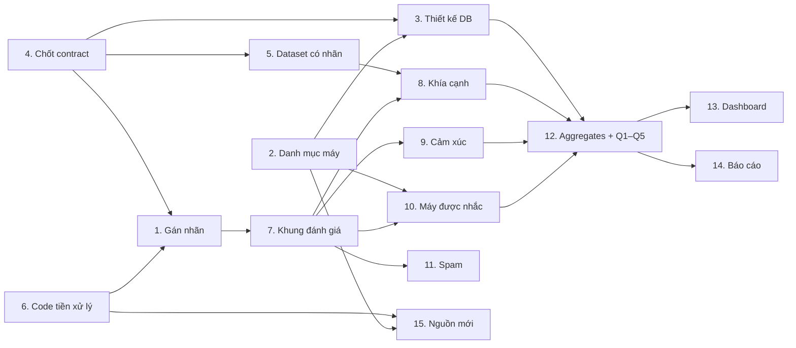

# Kế hoạch dự án: tình hình, việc tiếp theo, yêu cầu từng công việc

> Mục đích: Một chỗ duy nhất cho kế hoạch: tình hình hiện tại, việc làm tiếp, quyết định đang chờ, tiến độ và yêu cầu của 15 công việc, phân công, quy tắc làm việc; cập nhật lần cuối: 2026-11-20.

**Cách đọc:**
- Mỗi tuần đọc mục 1–3 (khoảng 5 phút).
- Nhận việc thì tìm dòng công việc của mình ở mục 4, rồi đọc yêu cầu chi tiết ở mục 6.

**Ranh giới:** file này ghi kế hoạch và tiến độ. Luật của từng tầng nằm trong đặc tả của tầng đó ([mục lục tài liệu](../README.md)). Số liệu nằm trong đặc tả và báo cáo, không chép sang đây.

Trạng thái lấy từ `main` trên máy trưởng nhóm ngày 20/11/2026 (đã gộp 6 nhánh ngày 16/11, **chưa push** lên GitHub).

## 1. Tình hình

- **Giai đoạn 0 chưa đóng.** Contract, dữ liệu crawl v4 kèm checksum, và code tầng 2 đủ bước (làm sạch, chuẩn hóa, tách mệnh đề, gắn cờ tiếng Việt và spam) đã có. Nhưng tầng 2 **chưa chạy trên v4**, chưa có file chung cho cả nhóm.
- **16/11:** gộp 6 nhánh vào `main` (CV3, 5, 8, 9, 11+13, 12).
- **20/11:** chốt **phương án A**: đơn vị phân tích là cả bình luận, đếm theo (bình luận, máy, khía cạnh) ([muc-tieu.md mục 4](muc-tieu.md#4-phạm-vi)). Chốt **chạy theo lô mỗi ngày**, streaming để sau. Code mới:
  - bước 2.4 gắn cờ (`src/processing/flags.py`, tầng 2 lên `processing-2.0`);
  - bước suy luận bằng luật mốc `rule-v1` (`src/models/run.py`, [đặc tả](../4-mo-hinh/dac-ta-suy-luan.md)), ghi `aspect_mentions` đúng contract v2 và qua được bước kiểm của Công việc 12;
  - một lệnh chạy cả chuỗi `python -m src.run` ([luồng xử lý mục 2](luong-xu-ly.md#2-giai-đoạn-1-theo-lô));
  - tài liệu gán nhãn mới: [đặc tả gán nhãn](../3-gan-nhan/dac-ta.md) (mẫu A cho chất lượng dữ liệu, mẫu B cho tập test) và [nháp guideline v1 theo bình luận](../3-gan-nhan/huong-dan-gan-nhan-binh-luan.md);
  - [AGENTS.md](../../AGENTS.md): luật bắt buộc cho trợ lý AI;
  - quy ước thống kê thêm phép kiểm sai số mô hình, độ nhạy và luật chọn mô hình ([muc-tieu.md mục 6](muc-tieu.md#6-quy-ước-dùng-chung-cho-mọi-câu)).

  Số ra từ `rule-v1` là **số liệu minh họa**: luật chưa đo trên nhãn người.
- **19/11:** tái cấu trúc repo: tài liệu xếp theo tầng ([mục lục](../README.md)), code đặt tên theo việc. Gỡ code CV11 + CV13 của nhánh `nlquan` (hỏng, nhãn do regex sinh) và file model CV8; các thứ đã gỡ vẫn còn trên nhánh gốc.
- **Ba việc đang chặn cả dự án:**
  1. Chưa có tập test gán tay (Công việc 1). Mọi điểm F1 hiện có đều đo trên nhãn LLM hoặc dataset ngoài, chưa nói được mô hình đúng hay sai trên YouTube.
  2. Quy tắc gán máy cho bình luận không nêu tên (Công việc 10) mới có bản luật mốc, chưa đo. Phần lớn bình luận không gọi tên máy nào, nên Q3 và Q4 có làm được hay không phụ thuộc vào quy tắc này.
  3. `main` trên máy trưởng nhóm đi trước GitHub nhiều commit và còn thay đổi chưa commit. Cả nhóm vẫn thấy cấu trúc cũ cho tới khi push.
- **Rủi ro chung:** nhiều phần được xây trên đầu vào chưa kiểm chứng: nhãn LLM, dữ liệu seed giả của DB, dữ liệu cũ (CV9 dùng bản 225.968 dòng). Đưa vào phân tích khi chưa kiểm thì các lỗi này đi thẳng vào kết quả Q1–Q5.

## 2. Lộ trình

Làm theo thứ tự giai đoạn; trong một giai đoạn, các việc không chờ nhau thì làm song song. Cột **Nhãn**: ✋ là cần nhãn người, chưa có nhãn thì chưa xong được. Tiêu chí "xong" chung ở mục 7. Ai nhận việc thì điền tên vào cột **Ai**.

### 2.1 Giai đoạn 0: nền móng

| # | Việc | CV | Ai | Đầu ra | Xong khi | Nhãn |
|---|---|---|---|---|---|---|
| 0.1 | Push `main` lên GitHub; báo cả nhóm đọc [mục lục tài liệu](../README.md) và [AGENTS.md](../../AGENTS.md) | — | Trưởng nhóm | `main` trên GitHub | Cả nhóm clone được, `python -m pytest tests -q` qua | |
| 0.2 | Chạy `python -m src.run --den suy_luan` trên v4; chạy notebook tầng 2; điền [báo cáo tầng 2](../2-tien-xu-ly/bao-cao.md) mục 3.2–3.7 | 6 | Trưởng nhóm | File tầng 2, `aspect_mentions` `rule-v1`, manifest | Bảng phiên bản tầng 2 có dòng `processing-2.0`; có số trong báo cáo | |

### 2.2 Giai đoạn 1: dữ liệu và nhãn người

Quy trình gán nhãn: [đặc tả gán nhãn](../3-gan-nhan/dac-ta.md). Cách gán từng bình luận: [guideline v1 (nháp)](../3-gan-nhan/huong-dan-gan-nhan-binh-luan.md).

| # | Việc | CV | Ai | Đầu ra | Xong khi | Nhãn |
|---|---|---|---|---|---|---|
| 1.1 | Chốt bộ 4 máy, sửa `config/analysis.yaml`, chạy `python -m src.run --tu phan_tich` | 2 | ___ | Q1–Q5 minh họa đầu tiên | `business_questions.json` có số, ghi "số liệu minh họa" | |
| 1.2 | Chia video train/test theo `video_id`, phân tầng theo máy | 7 | ___ | `data/labels/split.json` | Seed cố định, ~20–25% video vào test | |
| 1.3 | Duyệt nháp guideline v1 | 1 | Kiên + trưởng nhóm | Guideline `v1.0-nhap` đã duyệt | Hai người đồng ý, ghi vào lịch sử thay đổi | |
| 1.4 | Viết script lấy mẫu A/B, kiểm phiếu, tính đồng thuận, tính ước lượng (`src/labeling/`) | 1 | ___ | 4 script + test | Chạy được trên dữ liệu giả; đúng [đặc tả gán nhãn mục 9](../3-gan-nhan/dac-ta.md#9-file-và-script) | |
| 1.5 | Hiệu chỉnh: cả nhóm gán 50 bình luận, họp, sửa guideline thành `v1.0` | 1 | Cả nhóm | Guideline `v1.0` | Kappa ≥ 0,6 cho khía cạnh và cảm xúc | ✋ |
| 1.6 | Gán mẫu A (~850, 200 gán đôi): ước lượng spam, không liên quan, ngoại ngữ; đo luật gắn cờ | 1, 11 | Cả nhóm gán; CV11 phân tích | `docs/3-gan-nhan/bao-cao.md` phần mẫu A | Có tỷ lệ kèm khoảng tin cậy; precision, recall của luật | ✋ |
| 1.7 | Gán mẫu B (800, gán đôi, phân xử), đóng băng | 1 | Cả nhóm | `gold_labels` tập test + SHA-256 | Kappa ≥ 0,6; mọi chỗ lệch đã phân xử | ✋ |
| 1.8 | Nhãn train bằng LLM theo `v1.0`; người kiểm 200 bình luận | 1, 9 | CV9 | Nhãn train | Báo cáo tỷ lệ LLM đúng; `llm_label.py` đọc guideline v1, ghi đúng định dạng JSON của guideline mục 6 | ✋ |
| 1.9 | DB theo contract v2 | 3 | ___ | `init_db.py`, script nạp | Nạp được `aspect_mentions` `rule-v1`, chạy lại không sinh bản trùng | |
| 1.10 | Map UIT-ViSFD về 9 khía cạnh (cùng đơn vị bình luận) | 5 | ___ | Dữ liệu đã chuyển, data card | Bảng map có lý do cho từng nhãn | |

### 2.3 Giai đoạn 2: đo và mô hình

| # | Việc | CV | Ai | Đầu ra | Xong khi | Nhãn |
|---|---|---|---|---|---|---|
| 2.1 | `evaluate.py` dùng chung; chấm `rule-v1` trên mẫu B: F1 từng khía cạnh, macro-F1 cảm xúc, máy được nhắc, `is_owner`, `defect_type`; **ma trận nhầm lẫn theo máy × khía cạnh** | 7 | ___ | Bảng điểm `rule-v1` | Chấm trên tập test đã đóng băng | ✋ |
| 2.2 | Mô hình khía cạnh: TF-IDF, PhoBERT nếu cần | 8 | B1 | Bảng so với `rule-v1` | Chọn theo [luật chọn mô hình](muc-tieu.md#6-quy-ước-dùng-chung-cho-mọi-câu) | ✋ |
| 2.3 | Mô hình cảm xúc theo (bình luận, khía cạnh) | 9 | B2 | Như trên | Như trên; có phân tích lỗi phủ định, mỉa mai | ✋ |
| 2.4 | Máy được nhắc: đo `rule-v1`, quyết bước "máy của video" (quyết định 2), thêm câu so sánh | 10 | B3 | Luật đã đo, `compare_with` | Precision/recall, tỷ lệ `null` trên tập test | ✋ |
| 2.5 | Spam: giữ luật hay đổi (từ kết quả 1.6) | 11 | B3 | Quyết định + lý do | Có số đo từ mẫu A | ✋ |
| 2.6 | Thay luật bằng phần đã chọn trong `src/models/run.py`, đổi `MODEL_VERSION` | 8–10 | B1–B3 | Phiên bản suy luận mới | Test qua; chạy lại cả chuỗi; [đặc tả suy luận](../4-mo-hinh/dac-ta-suy-luan.md) đã sửa | |

### 2.4 Giai đoạn 3: kết quả

| # | Việc | CV | Ai | Đầu ra | Xong khi | Nhãn |
|---|---|---|---|---|---|---|
| 3.1 | Q1–Q5 chính thức với phiên bản suy luận đã chọn | 12 | C | `business_questions.json` | Ghi rõ phiên bản dữ liệu, `MODEL_VERSION` | |
| 3.2 | Phép kiểm sai số mô hình cho Q2–Q4 ([muc-tieu.md mục 6](muc-tieu.md#6-quy-ước-dùng-chung-cho-mọi-câu)) | 12, 7 | C | Bảng: kết luận × còn đứng hay không | Mỗi kết luận Q2–Q4 có kết quả kiểm | ✋ (dùng ma trận ở 2.1) |
| 3.3 | Bộ kiểm độ nhạy: bỏ video, kênh lớn nhất; mỗi tác giả một phiếu; chỉ bình luận gốc; bỏ video tặng quà; bỏ cờ Q6 | 12 | C | Bảng: kết luận × phép kiểm | Kết luận đổi chiều ở phép nào thì ghi trong báo cáo | |
| 3.4 | Q6: gắn cờ phối hợp, duyệt tay các ca bị gắn cờ, thử thêm bình luận giả xem bao nhiêu thì kết luận đảo | B8 | ___ | Bảng tỷ lệ nghi vấn, độ chính xác luật gắn cờ | Theo [muc-tieu.md Q6](muc-tieu.md#q6-có-tài-khoản-ảo-seeding-quậy-phá-không-đề-xuất-chờ-nhóm-chốt) | ✋ (duyệt tay) |
| 3.5 | Dashboard đọc kết quả Công việc 12 | 13 | C | Dashboard | Chỗ nào còn số minh họa thì ghi rõ | |
| 3.6 | Báo cáo + slide | 14 | Mỗi người phần mình | Báo cáo tổng | Mỗi kết luận kèm khoảng tin cậy, phép kiểm sai số và độ nhạy | |
| — | Streaming (để sau) | — | | | | |

**Làm được ngay, không chờ nhãn:** 0.1, 0.2, 1.1–1.4, 1.9, 1.10; viết khung `evaluate.py` (2.1) và bộ kiểm độ nhạy (3.3) trên đầu ra `rule-v1`; dựng dashboard (3.5) bằng số liệu minh họa.

## 3. Quyết định đang chờ trưởng nhóm

| # | Quyết định | Lựa chọn | Ảnh hưởng tới |
|---|---|---|---|
| 1 | Cửa sổ trước ra mắt | Q1–Q5 dùng `[0, 28)` (CV12). Phần `-7` ngày: sửa crawler rồi crawl lại, hoặc bỏ khỏi thiết kế dữ liệu | Thiết kế dữ liệu, crawler |
| 2 | Bình luận không nêu tên máy | Luật mốc `rule-v1` đang làm: mệnh đề → mệnh đề trước → cả bình luận → comment cha → máy của video → `null` ([đặc tả suy luận mục 5](../4-mo-hinh/dac-ta-suy-luan.md#5-máy-được-nhắc)). Giữ bước "máy của video", hay để `null` khi chỉ dựa vào video: chờ CV10 đo | Cỡ mẫu Q1–Q5, nhất là Q3, Q4 |
| 3 | `author_name` trong dữ liệu chia sẻ | Bỏ khỏi file chia sẻ, hoặc sửa yêu cầu trong README | Contract `comment-event` v3, quyền riêng tư |
| 4 | Baseline luật khía cạnh | Đề xuất lấy `rule-v1` (`src/models/aspect/keywords.py`) làm mốc chung; `rule-v0` của CV8 (`rule_baseline.py`) và của `seed_db` đổi tên | CV8, `seed_db`, CV12 |
| 5 | Bộ 4 máy chính thức | Chốt (CV2) | CV12 và mọi phân tích |
| 6 | Nhãn `FEATURES` của dataset ngoài | Phần cứng / phần mềm / tùy ngữ cảnh / bỏ | CV5, CV8 |
| 7 | Câu khen chê chung ("máy quá ngon") | Thêm nhãn cảm xúc chung, hay bỏ khỏi Q1 | Contract, Q1 |
| 8 | Crawl bằng 2 khóa API ở 2 project ([huong-dan-crawl-2-may.md](../1-thu-thap/huong-dan-crawl-2-may.md)) | Tiếp tục, hay về 1 khóa và xin tăng hạn mức | Chính sách YouTube API (mục III.D), tốc độ crawl |

**Đã chốt ngày 20/11:**
1. Phương án A: đơn vị là cả bình luận.
2. Chạy theo lô mỗi ngày, streaming để sau.
3. Giữ nguyên contract `aspect-mention` v2 và thiết kế dữ liệu; theo phương án A, `clause_idx`, `clause_text` là mệnh đề làm bằng chứng ([đặc tả suy luận mục 2](../4-mo-hinh/dac-ta-suy-luan.md#2-đơn-vị-và-quy-tắc-gộp)).

Quyết định riêng của tầng 2 (kiểu dấu thanh, từ điển viết tắt, video tặng quà, luật tách mệnh đề, luật gắn cờ…): [đặc tả tầng 2 mục 7](../2-tien-xu-ly/dac-ta.md#7-quyết-định-đang-chờ-nhóm).

## 4. Tiến độ

### 4.1 Từng công việc

Ký hiệu: ✅ đã có trên `main` · ⚠️ có nhưng còn vấn đề phải sửa · ❌ chưa có (hoặc bản cũ đã gỡ).

| CV | Việc | Trạng thái | Đã có (ai, ở đâu) | Còn thiếu / vấn đề |
|---|---|---|---|---|
| 1 | Gán nhãn | ⚠️ | Guideline v0.3 [huong-dan-gan-nhan.md](../3-gan-nhan/huong-dan-gan-nhan.md) (Kiên), đã chỉnh qua 2 lần thử với Gemini | Guideline v0.3 gán theo mệnh đề: phải viết **v1 theo cả bình luận** (bản v0.3 giữ nguyên vì báo cáo CV9 ghi SHA). Chưa hiệu chỉnh cả nhóm. Chưa có tập test người gán, chưa có kappa |
| 2 | Danh mục máy | ⚠️ | `config/pipeline.yaml` là đúng config đã dùng để crawl bản v4: 139 mã máy, 50 kênh; mọi máy trong dữ liệu đều có `launch_date` | Chưa ghi nguồn cho `launch_date`. Chưa có `predecessor`. 12 máy khai trong config nhưng không có dữ liệu. Bộ 4 máy chưa chốt |
| 3 | DB | ⚠️ | MongoDB 7 collection, `src/storage/` (`init_db`, `seed_db`, `verify_db`), [đặc tả](../6-luu-tru/dac-ta.md) (Việt / davebui306, 07/11) | Theo contract **v1**, trong khi contract đã lên v2 (08/11). `seed_db.py` sinh dữ liệu giả (xem ghi chú dưới bảng), chỉ dùng được làm demo cho DB |
| 4 | Contract | ✅ | `aspect-mention` v2 (08/11); `comment-event` v3 (11/11), khớp từng trường với crawler và dữ liệu v4 | `author_name` vẫn nằm trong dữ liệu và contract, trái README (quyết định 3) |
| 5 | Dataset ngoài | ⚠️ | Chuẩn hóa UIT-ViSD4SA (có span) + test + trang duyệt `FEATURES`: `src/models/external_absa.py` (phudatdam, 09/11). Bỏ ViSFD vì không có span | Chờ nhóm duyệt 50 mẫu `FEATURES`. Yêu cầu CV5 ở mục 6 còn ghi ViSFD. Ghi ra `data/external/normalized/`, trong khi CV8 đọc `data/uit_visd4sa/` |
| 6 | Tiền xử lý | ⚠️ | Tầng 2 cho v4 (`processing-2.0`): làm sạch, chuẩn hóa, tách mệnh đề, gắn cờ tiếng Việt và spam (`src/processing/`), lệnh chạy ghi file + manifest, 39 test, [đặc tả](../2-tien-xu-ly/dac-ta.md) + 4 đặc tả con, [báo cáo](../2-tien-xu-ly/bao-cao.md) (trưởng nhóm, 16–20/11). Bản cũ `cleaner/` đã gỡ, còn ở commit `59e2d16` | Chưa chạy trên v4, chưa có file chung. Luật gắn cờ là mốc, chưa đo (CV11). 8 quyết định ở đặc tả tầng 2 mục 7 |
| 7 | Khung đánh giá | ❌ | | Không có file chia tập chung hay `evaluate.py`. CV9 tự chia theo video, CV8 dùng tập test của dataset ngoài, nên điểm các mô hình không so được với nhau |
| 8 | Mô hình khía cạnh | ⚠️ | TF-IDF + LinearSVC đa nhãn, `src/models/aspect/`, [báo cáo](../4-mo-hinh/bao-cao-khia-canh.md) (Nguyễn Xuân Hồng Quân, 11/11): macro-F1 0,71 trên tập test UIT-ViSD4SA | Đo trên đánh giá Thế Giới Di Động, chưa trên YouTube. Không bao giờ đoán `SOFTWARE`. Luật `rule-v0` xếp nóng máy vào `HARDWARE_OTHER`, trái thiết kế dữ liệu. Lệnh tái lập trong báo cáo không chạy; báo cáo tả bước dùng nhãn YouTube mà code không có. File model `.pkl` đã gỡ khỏi git (không nạp được theo hướng dẫn) |
| 9 | Mô hình cảm xúc | ⚠️ | Nhãn LLM (Gemini/NVIDIA), tập train/val chia theo video, baseline TF-IDF + LR: `src/models/sentiment/`, [báo cáo](../4-mo-hinh/bao-cao-cam-xuc.md), [hướng dẫn](../4-mo-hinh/huong-dan-cam-xuc.md) (Kiên, 09/11) | Điểm mới đo trên nhãn LLM, dữ liệu cũ 225.968 dòng. Với file tầng 2 mới, `extract_clauses.py` phải chạy với `--index-base 0`. File nhãn chỉ có trên máy Kiên |
| 10 | Máy được nhắc | ⚠️ | Luật mốc `rule-v1`: nhận tên máy có chữ số theo `config/pipeline.yaml`, xét mệnh đề → mệnh đề trước → cả bình luận → comment cha → video (`src/models/target_model.py`, trưởng nhóm, 20/11) | Chưa đo. Chưa nhận câu so sánh (`compare_with` luôn `null`). Tên hãng trơn ("táo", "ss") không nhận |
| 11 | Spam | ⚠️ | Luật mốc `src/processing/flags.py` (20/11): link, số điện thoại, mời liên hệ, cờ bạc; tách `is_vietnamese` riêng ([đặc tả](../2-tien-xu-ly/dac-ta-gan-co.md)). Bản của nhánh `nlquan` (Nguyễn Lê Quân, 28/10) đã gộp rồi gỡ khỏi `main` ngày 19/11: 500 "nhãn" do regex sinh ra, ba con số F1 mâu thuẫn, phụ thuộc `cleaner/` đã xóa. Còn trên nhánh `nlquan` | Đo luật mốc bằng nhãn mẫu A (lộ trình 1.6), rồi quyết giữ luật hay đổi |
| 12 | Aggregates + Q1–Q5 | ✅ | `src/analysis/`: kiểm tra đầu vào, aggregates, Q1–Q5, bootstrap-t theo cụm video, Holm, 235 test + dữ liệu demo, [hướng dẫn](../5-phan-tich/huong-dan.md) (Hải Minh, 09/11). Từ 20/11 nhận đầu ra của bước suy luận qua `python -m src.run` (đã thử trên dữ liệu giả) | `config/analysis.yaml` vẫn là bộ máy cũ (S23U/S22U/iPhone 14 PM/Xiaomi 13U): phải đổi theo CV2 thì mới có mention để tính |
| 13 | Dashboard | ❌ | API + dashboard 4 tab của nhánh `nlquan` đã gộp rồi gỡ ngày 19/11: số Kafka/Spark viết cứng, đọc JSON tĩnh của EDA cũ. Còn trên nhánh `nlquan` | Làm lại, đọc từ kết quả CV12 |
| 14 | Báo cáo | ⚠️ | File "Đánh giá tính khả thi" (Claude Docs, 08/11). Báo cáo tầng 2 [bao-cao.md](../2-tien-xu-ly/bao-cao.md) (16–19/11); báo cáo CV8, CV9 ở `docs/4-mo-hinh/` | Báo cáo tầng 2 còn chờ số liệu mục 3.2–3.6. Chưa có báo cáo tổng |
| 15 | Nguồn ngoài YouTube | ❌ | | |
| — | Chuỗi theo lô | ✅ ⚠️ | `python -m src.run`: tầng 2 → suy luận `rule-v1` → aggregates, Q1–Q5; [luồng xử lý mục 2](luong-xu-ly.md#2-giai-đoạn-1-theo-lô) (trưởng nhóm, 20/11) | Chưa chạy trên v4. Kết quả là số liệu minh họa cho tới khi luật được đo hoặc thay bằng mô hình |
| — | Crawler | ✅ ⚠️ | Code, config và dữ liệu của lần crawl ra bản v4: schema v3 với 6 trường `author_*`, 50 kênh, chia việc cho 2 máy ([hướng dẫn](../1-thu-thap/huong-dan-crawl-2-may.md)), `state.db` và `videos.jsonl` để tra từng video; [đặc tả thu thập](../1-thu-thap/dac-ta.md) | Cửa sổ crawl bắt đầu từ `launch_date`, không phải 7 ngày trước như thiết kế dữ liệu. Hướng dẫn crawler cấm dùng nhiều project để tăng hạn mức, nhưng cách chia 2 máy dùng 2 khóa ở 2 project (quyết định 8) |

**Vì sao `seed_db.py` (CV3) không dùng được làm dữ liệu phân tích:**
- Mệnh đề không khớp từ khóa nào bị gán mặc định `PERFORMANCE`, nên khía cạnh này phồng lên.
- Mỗi mệnh đề chỉ lấy khía cạnh khớp đầu tiên.
- Mọi mệnh đề chê đều có `defect_type`.
- `clause_idx` đếm từ 1; `target_model` = máy của video.
- `compare_with` gán cứng `ip14prm`/`s22u`; `days_since_launch` gán cứng 8; `confidence` là hằng số.
- Video, aggregates, alerts, gold_labels là số viết tay; bình luận của `ip6`, `ip11` bị đổi thành `s23u`.

### 4.2 Giai đoạn

| Giai đoạn | Công việc | Điều kiện để sang giai đoạn sau | Đạt chưa |
|---|---|---|---|
| 0. Nền móng | 4, 6 | Contract đã merge; cả nhóm chạy được tiền xử lý ra cùng một file dữ liệu | ❌ Contract, dữ liệu raw v4 và code tầng 2 đủ bước có; chưa chạy trên v4, chưa phát hành file chung |
| 1. Dữ liệu & nhãn | 1, 2, 3, 5 (song song), 15 bước 1 | Có tập test gán tay với kappa ≥ 0,6; có ước lượng chất lượng dữ liệu từ mẫu A; DB nạp được dữ liệu | ❌ |
| 2. Mô hình | 7, 8, 9, 10, 11 | Mỗi mô hình có bảng F1 so với `rule-v1` trên tập test chung, kèm ma trận nhầm lẫn theo máy × khía cạnh | ❌ CV8, CV9 có bảng, nhưng đo trên dataset ngoài hoặc nhãn LLM, không trên tập test chung |
| 3. Kết quả | 12, 13, 14 | Q1–Q5 chạy lại được từ code, qua phép kiểm sai số mô hình và độ nhạy; báo cáo hoàn chỉnh | Code CV12 có, chờ đầu vào |

### 4.3 Theo bài toán

Mỗi câu hỏi ở [muc-tieu.md](muc-tieu.md) cần một số bài toán con. Bảng này cho biết bài toán nào đang thiếu thì câu hỏi nào bị chặn.

| Mã | Bài toán | Câu hỏi cần | Công việc | Trạng thái |
|---|---|---|---|---|
| B1 | Tiền xử lý: làm sạch, chuẩn hóa, tách mệnh đề, lọc spam, nhận tiếng Việt | Q1–Q6 | 6, 11 | ⚠️ Code đủ; lọc spam, nhận tiếng Việt là luật mốc chưa đo |
| B2 | Phát hiện khía cạnh | Q1–Q4 (Q6 khi đo độ nhạy) | 8 | ⚠️ Luật mốc `rule-v1` chạy trong chuỗi, chưa đo. Mô hình CV8 đo khác miền, không đoán `SOFTWARE` |
| B3 | Cảm xúc theo khía cạnh | Q1, Q2, Q3a, Q4 | 9 | ⚠️ Luật mốc `rule-v1` chạy trong chuỗi, chưa đo. Mô hình CV9 đo trên nhãn LLM |
| B4 | Máy được nhắc (nhận tên máy, nối vào danh mục) | Q1–Q5 | 10 | ⚠️ Luật mốc `rule-v1`, chưa đo |
| B5 | So sánh trực tiếp (máy A hơn máy B ở khía cạnh nào) | Q3b | 10 | ❌ |
| B6 | Người đã dùng máy (`is_owner`) | Q5 | 1 (gán nhãn) | ⚠️ Luật mốc `rule-v1` (không thấy dấu hiệu thì `null`), chưa đo |
| B7 | Loại lỗi (`defect_type`) | Q5 | 1 (gán nhãn) | ⚠️ Luật mốc `rule-v1`, chưa đo |
| B8 | Bình luận bất thường, phối hợp | Q6 | | ⚠️ Mới đếm câu trùng, đăng dồn (notebook `1_raw_audit` mục 2.9) |
| B9 | Thống kê: khoảng tin cậy, kiểm định, Holm | Q1–Q6 | 12 | ✅ Code có, chờ đầu vào |

B2, B3, B4 cần cho gần như mọi câu hỏi. B4 là chỗ rủi ro lớn nhất: gán nhầm máy là lời chê iPhone bị tính cho Samsung. Q3b (B5) và Q6 (B8) là phần mở rộng, cắt được mà không ảnh hưởng các câu còn lại.

## 5. Nhóm, thứ tự và phụ thuộc

| Nhóm | Số người | Phụ trách |
|---|---|---|
| Trưởng nhóm | 1 | Chốt contract, review PR, giữ tài liệu thống nhất |
| A. Dữ liệu & DB | 3 | Công việc 2, 3, 5, 6 |
| B. Mô hình | 6 | Công việc 8, 9, 10, 11 (chia B1/B2/B3) |
| C. Tích hợp & đánh giá | 2 | Công việc 7, 12, 13, 14 |
| Cả nhóm | 11 | Công việc 1 (gán nhãn), Công việc 4 (chốt contract) |

Công việc 15 (nguồn dữ liệu mới) giao cho 1 người sau khi Công việc 6 xong.

## 6. Yêu cầu từng công việc

Mỗi công việc điền **Phụ trách** và **Hạn** trước khi bắt đầu. Trạng thái hiện tại của từng việc ở mục 4.1.

### Công việc 1: Gán nhãn dữ liệu YouTube
- **Phụ trách:** cả nhóm (người viết guideline: ___) | **Hạn:** ___ | **Ưu tiên:** RẤT CAO
- **Mô tả:** Gán nhãn 3000 **bình luận** (phương án A). Mỗi bình luận: danh sách (máy được nhắc, khía cạnh, khen/chê/trung tính), mỗi bộ kèm mệnh đề làm bằng chứng; bình luận không có khía cạnh thì danh sách rỗng. Với tập test gán thêm: đã dùng máy chưa, loại lỗi kỹ thuật (nếu có), có so sánh máy khác không.
- **Yêu cầu:**
  - Viết guideline **v1 theo cả bình luận** trước: định nghĩa từng khía cạnh, ví dụ khen/chê/trung tính, các trường hợp khó (mỉa mai, phủ định "không lag chút nào", so sánh 2 máy, reply, một bình luận vừa khen vừa chê cùng khía cạnh). Bản v0.3 giữ nguyên từng byte (báo cáo CV9 ghi SHA); v1 là file mới hoặc tăng `guideline_version`. Cả nhóm gán thử 50 bình luận, họp thống nhất rồi mới gán thật.
  - Chọn mẫu rải đều theo video và theo máy trong phạm vi.
  - **Tập test (~800 bình luận) bắt buộc do người gán**, mỗi bình luận 2 người độc lập, tính Cohen's kappa.
  - Thêm **mẫu A** (~850 bình luận từ dữ liệu chưa lọc) để ước lượng spam, không liên quan, ngoại ngữ và đo luật gắn cờ.
  - Cách lấy hai mẫu, phiếu, đồng thuận, phân xử: [đặc tả gán nhãn](../3-gan-nhan/dac-ta.md). Nháp guideline v1: [huong-dan-gan-nhan-binh-luan.md](../3-gan-nhan/huong-dan-gan-nhan-binh-luan.md).
  - Được dùng AI hỗ trợ gán phần train, nhưng ghi `label_source = "llm"` và cho người kiểm tra lại ~200 mẫu để biết AI đúng bao nhiêu %. Không dùng nhãn AI làm test.
- **Đầu ra:** `docs/3-gan-nhan/huong-dan-gan-nhan.md`, file nhãn đúng [thiết kế dữ liệu mục 7](thiet-ke-du-lieu.md#7-gold_labels), chỉ số kappa.
- **Phụ thuộc:** 4, 6

### Công việc 2: Danh mục máy trong phạm vi
- **Phụ trách:** ___ | **Hạn:** ___ | **Ưu tiên:** trung bình
- **Mô tả:** Với mỗi máy: mã máy, tên, hãng, ngày ra mắt tại VN, đời trước, đối thủ cùng thời điểm và cùng phân khúc. Chốt bộ 4 máy cho Q1–Q5 (X, P, R1, R2).
- **Yêu cầu:**
  - Có nguồn dẫn cho ngày ra mắt.
  - Sửa lỗi trong `config/pipeline.yaml`: Note 20 Ultra khai báo 2 tên (`notefive`, `note20u`); đối thủ không cùng thời điểm (iPhone 11 Pro – Note 20 Ultra, iPhone 18 Pro Max – Vivo X100 Pro).
  - Thêm trường `predecessor` cho từng máy.
- **Đầu ra:** báo cáo danh mục + `config/pipeline.yaml` đã sửa.

### Công việc 3: Thiết kế và dựng DB
- **Phụ trách:** ___ | **Hạn:** ___ | **Ưu tiên:** cao
- **Mô tả:** Dựng các collection theo [thiết kế dữ liệu](thiet-ke-du-lieu.md): `models`, `videos`, `comments`, `aspect_mentions`, `aggregates`, `alerts`, `gold_labels`.
- **Yêu cầu:** `aggregates` lưu số đếm, không lưu %. Có index phục vụ Q3b và Q5. Script nạp dữ liệu chạy lại nhiều lần không sinh bản trùng.
- **Đầu ra:** script tạo DB + script nạp dữ liệu + cập nhật thiết kế dữ liệu nếu có thay đổi.
- **Phụ thuộc:** 2, 4

### Công việc 4: Chốt contract dữ liệu
- **Phụ trách:** trưởng nhóm | **Hạn:** 28/10 | **Ưu tiên:** RẤT CAO (làm đầu tiên)
- **Mô tả:** Chốt bản thỏa thuận định dạng dữ liệu mà mọi nhóm phải tuân theo: trường nào, kiểu gì, nhận giá trị nào. Contract: [contracts/aspect-mention.schema.json](../../contracts/aspect-mention.schema.json), mô tả trong [thiết kế dữ liệu](thiet-ke-du-lieu.md).
- **Yêu cầu:** Chốt danh sách 9 khía cạnh kèm định nghĩa, danh sách loại lỗi, cửa sổ thời gian (đề xuất 4 tuần). Sau khi chốt, đổi trường nào cũng phải tăng `schema_version` và báo cả nhóm.
- **Đầu ra:** contract đã merge vào `main`, bỏ chữ "DRAFT".

### Công việc 5: Dataset tiếng Việt đã gán nhãn
- **Phụ trách:** ___ | **Hạn:** ___ | **Ưu tiên:** cao
- **Mô tả:** Tận dụng dữ liệu đã có người gán nhãn để có thêm dữ liệu huấn luyện. Ứng viên chính: **UIT-ViSFD** (~11 nghìn đánh giá smartphone trên trang thương mại điện tử, nhãn dạng `{CAMERA#Positive};{BATTERY#Negative}`). Tham khảo thêm **ViSpamReviews** cho spam. Kiểm tra lại số liệu trên bài báo và trang gốc.
- **Yêu cầu:** Kiểm tra giấy phép. Lập bảng map khía cạnh về 9 khía cạnh của nhóm (xem [đặc tả mô hình mục 3](../4-mo-hinh/dac-ta.md#3-dữ-liệu-có-nhãn-từ-bên-ngoài)). Viết script chuyển về định dạng của nhóm.
- **Đầu ra:** data card (nguồn, kích thước, phân bố nhãn), bảng map, dữ liệu đã chuyển đổi.
- **Phụ thuộc:** 4

### Công việc 6: Code tiền xử lý + phiên bản dữ liệu
- **Phụ trách:** ___ | **Hạn:** ___ | **Ưu tiên:** RẤT CAO
- **Mô tả:** Code tầng 2 ghi `data/processed/comments.jsonl`: làm sạch, chuẩn hóa, tách mệnh đề, gắn cờ tiếng Việt và spam. Code đã có (`processing-2.0`); việc còn lại là chạy trên v4 và phát hành.
- **Yêu cầu:** Commit toàn bộ code vào `src/processing/`. Ghi số dòng + checksum mỗi phiên bản dữ liệu. Cả nhóm dùng chung một phiên bản.
- **Đầu ra:** một lệnh chạy ra `data/processed/comments.jsonl` (`python -m src.processing.run`, hoặc cả chuỗi `python -m src.run`); bảng phiên bản dữ liệu ở [đặc tả tầng 2 mục 6](../2-tien-xu-ly/dac-ta.md#6-phiên-bản).

### Công việc 7: Khung đánh giá chung
- **Phụ trách:** ___ | **Hạn:** ___ | **Ưu tiên:** cao
- **Mô tả:** Một cách chia train/test và một script tính điểm dùng chung cho mọi mô hình.
- **Yêu cầu:** Chia theo `video_id`, xong **trước** khi lấy mẫu B (mẫu B chỉ lấy từ video test). Test set cố định, không dùng để chọn tham số. Metric: precision, recall, F1 theo nhãn + macro-F1. Thêm **ma trận nhầm lẫn theo máy × khía cạnh** cho Công việc 12 kiểm sai số mô hình. Chấm `rule-v1` trước tiên.
- **Đầu ra:** `data/labels/split.json` + `evaluate.py`.
- **Phụ thuộc:** 1

### Công việc 8: Mô hình phân loại khía cạnh
- **Phụ trách:** B1 (2 người: ___) | **Hạn:** ___ | **Ưu tiên:** cao
- **Mô tả:** Phân loại **đa nhãn có giám sát** trên **cả bình luận**. Phân cụm chỉ để khám phá, không làm mô hình chính.
- **Yêu cầu:** Baseline = luật từ khóa `rule-v1` (`src/models/aspect/keywords.py`). Thử TF-IDF + Logistic Regression/SVM; PhoBERT nếu đủ điều kiện. Mô hình xong thì thay vào bước suy luận theo [đặc tả suy luận mục 9](../4-mo-hinh/dac-ta-suy-luan.md#9-thay-luật-bằng-mô-hình).
- **Đầu ra:** model + bảng F1 từng khía cạnh so với baseline.
- **Phụ thuộc:** 4, 5, 7

### Công việc 9: Mô hình cảm xúc theo khía cạnh
- **Phụ trách:** B2 (2 người: ___) | **Hạn:** ___ | **Ưu tiên:** cao
- **Mô tả:** Dự đoán `pos/neg/neu` cho từng cặp (bình luận, khía cạnh), mô hình đọc cả bình luận. Không chấm một cảm xúc chung cho cả bình luận. Một bình luận có thể vừa khen vừa chê cùng khía cạnh.
- **Yêu cầu:** Baseline = luật `rule-v1` (`src/models/sentiment/rules.py`). Macro-F1, confusion matrix, phân tích lỗi trên phủ định và mỉa mai. Sửa `llm_label.py` để gán theo guideline v1 (cả bình luận, định dạng JSON ở guideline mục 6); nhãn LLM cũ theo mệnh đề không dùng lại. TF-IDF không tách được "camera đẹp, pin yếu" khi đọc cả bình luận: cần mô hình đọc theo khía cạnh (PhoBERT với đầu vào "khía cạnh + bình luận"), hoặc giữ cách chấm từng mệnh đề như luật mốc.
- **Đầu ra:** model + báo cáo đánh giá.
- **Phụ thuộc:** 4, 5, 7

### Công việc 10: Nhận diện máy được nhắc
- **Phụ trách:** B3 (___) | **Hạn:** ___ | **Ưu tiên:** cao
- **Mô tả:** Xác định `target_model` của mỗi nhận xét, xét cả bình luận. Bản nháp gán lời chê iPhone cho S23U vì thiếu bước này.
- **Yêu cầu:** Luật mốc đã có (`src/models/target_model.py`): tên máy có chữ số trong mệnh đề → mệnh đề đứng trước → cả bình luận → comment cha → máy của video. Việc còn: đo precision/recall và tỷ lệ `null` trên tập test; quyết có giữ bước "máy của video" (quyết định 2); thêm tên gọi tắt; phát hiện câu so sánh (`compare_with`, `compare_winner`).
- **Đầu ra:** module + kết quả đánh giá.
- **Phụ thuộc:** 2, 4, 7

### Công việc 11: Phát hiện spam
- **Phụ trách:** B3 (___) | **Hạn:** ___ | **Ưu tiên:** trung bình
- **Mô tả:** Đo bộ luật spam mốc `src/processing/flags.py` ([đặc tả](../2-tien-xu-ly/dac-ta-gan-co.md)) rồi so với một mô hình ML. Bộ luật cũ (~6% bị gắn cờ) đã bỏ vì gộp tiếng nước ngoài và bình luận chỉ có emoji vào spam.
- **Yêu cầu:** Dùng nhãn **mẫu A** ([đặc tả gán nhãn mục 3](../3-gan-nhan/dac-ta.md#3-mẫu-a-chất-lượng-dữ-liệu)): ước lượng tỷ lệ spam cho cả dữ liệu kèm khoảng tin cậy; precision, recall của luật. Không dùng accuracy. Tách "không phải tiếng Việt" ra khỏi "spam". Mô hình ML chỉ làm nếu luật kém rõ rệt: spam hiếm nên mẫu nhỏ không đủ train.
- **Đầu ra:** so sánh luật và mô hình, chọn một phương án.
- **Phụ thuộc:** 7

### Công việc 12: Tính aggregates + trả lời Q1–Q5
- **Phụ trách:** C (___) | **Hạn:** ___ | **Ưu tiên:** trung bình
- **Mô tả:** Tính `aggregates`, trả lời Q1–Q5 theo [muc-tieu.md](muc-tieu.md), từ `aspect_mentions` do bước suy luận ghi ra (`src/models/run.py`). Cả chuỗi chạy bằng `python -m src.run`.
- **Yêu cầu:** Khoảng tin cậy (bootstrap theo video). Hiệu chỉnh Holm cho từng câu hỏi. Chỉ kết luận khi có ý nghĩa thống kê. Không dùng dự báo tuyến tính 4 điểm. Thêm **phép kiểm sai số mô hình** và **bộ kiểm độ nhạy** theo [muc-tieu.md mục 6](muc-tieu.md#6-quy-ước-dùng-chung-cho-mọi-câu) (lộ trình 3.2, 3.3).
- **Phụ thuộc:** 3, 8, 9, 10

### Công việc 13: Dashboard
- **Phụ trách:** C (___) | **Hạn:** ___ | **Ưu tiên:** trung bình
- **Mô tả:** Chuyển dashboard từ JSON tĩnh sang đọc từ DB/API.
- **Yêu cầu:** Chỗ nào còn số liệu minh họa phải ghi rõ "số liệu minh họa".
- **Phụ thuộc:** 3, 12

### Công việc 14: Báo cáo + slide
- **Phụ trách:** C + mỗi người viết phần của mình | **Hạn:** ___ | **Ưu tiên:** trung bình (làm liên tục)
- **Mô tả:** Mỗi công việc xong nộp 1 đoạn: đã làm gì, kết quả, hạn chế. Không dồn vào tuần cuối.

### Công việc 15: Bổ sung nguồn dữ liệu ngoài YouTube
- **Phụ trách:** ___ | **Hạn:** ___ | **Ưu tiên:** trung bình (bước 1), thấp (bước 2)
- **Mô tả:** Mục tiêu chính là có thêm bình luận từ **người đã dùng máy** cho Q5 và Q2 (YouTube có rất ít). Ưu tiên mục đánh giá sản phẩm trên trang bán hàng (TGDĐ, CellphoneS, FPT Shop), sau đó diễn đàn (Tinh tế, Voz). Không làm Facebook, TikTok, Shopee.
  - **Bước 1 – khảo sát (1 tuần):** với mỗi nguồn: điều khoản/robots.txt có cho phép không; có dữ liệu trong cửa sổ ra mắt của 4 máy không; bao nhiêu bình luận mỗi máy; có nhãn "đã mua"/số sao không. Chốt **1** nguồn.
  - **Bước 2 – thu thập:** crawler cho nguồn đã chốt, ghi đúng schema comment hiện có.
- **Yêu cầu:** `source = "tgdd"`/`"tinhte"`…; `video_id` hiểu là "id trang/bài gốc"; dùng chung `AUTHOR_SALT`. Trường riêng của nguồn (số sao, "đã mua") để trong trường mở rộng; đổi schema thì tăng `schema_version`. Crawl có giới hạn tốc độ. Khi phân tích, báo cáo theo từng nguồn trước rồi mới gộp.
- **Đầu ra:** báo cáo khảo sát; crawler + dữ liệu đúng schema + thống kê số bình luận mỗi máy.
- **Phụ thuộc:** 2, 4, 6

### Để sau: Demo streaming
Chốt 20/11: làm chạy theo lô trước, streaming để sau, khi Công việc 12 đã ra Q1–Q5 trên dữ liệu thật: replay dữ liệu qua Kafka, xử lý bằng Spark, ghi vào DB. Xem [luồng xử lý mục 3](luong-xu-ly.md#3-giai-đoạn-2-streaming-để-sau).

## 7. Quy tắc chung

**Làm việc:**
- Dùng trợ lý AI (Claude, ChatGPT, Copilot…) thì AI phải theo [AGENTS.md](../../AGENTS.md); người dùng AI chịu trách nhiệm kiểm lại kết quả.
- Mỗi người làm trên branch riêng, mở PR vào `main`, có ít nhất 1 người review.
- Mọi số liệu đưa vào báo cáo phải chạy lại được từ code trên repo, với phiên bản dữ liệu ghi rõ.
- Không sửa file raw. Dữ liệu đã xử lý luôn có phiên bản mới.
- Đổi định dạng dữ liệu = sửa contract + tăng `schema_version` + báo cả nhóm.
- Biểu đồ dùng số liệu chưa qua mô hình đã đánh giá phải ghi "số liệu minh họa". Đầu ra của luật mốc `rule-v1` là số liệu minh họa.

**Tiêu chí nghiệm thu** (một công việc chỉ tính là xong khi đủ cả):
1. Chạy lại được bằng một lệnh từ repo, trên phiên bản dữ liệu chung.
2. Việc có mô hình hay luật: có số đo trên tập test chung của Công việc 7, so với mốc `rule-v1`.
3. Đặc tả, test và dòng ở mục 4.1 được sửa trong cùng PR.
4. Gán nhãn: tính theo số bình luận đã gán và kappa của từng người.
- Phiên bản dữ liệu (số dòng, checksum): [đặc tả thu thập mục 7](../1-thu-thap/dac-ta.md#7-phiên-bản-dữ-liệu) cho dữ liệu raw, [đặc tả tầng 2 mục 6](../2-tien-xu-ly/dac-ta.md#6-phiên-bản) cho dữ liệu đã xử lý.

**Cập nhật file này:**
- Ai mở PR thì sửa dòng công việc của mình ở mục 4.1 **trong cùng PR**: trạng thái, "đã có", "còn thiếu".
- Trưởng nhóm cập nhật mục 1, 2 (lộ trình), 3, 4.2, 4.3 sau mỗi lần merge, ít nhất mỗi tuần một lần, và đổi ngày ở dòng "Mục đích".
- Không thêm bảng tiến độ ở chỗ khác. Thấy chỗ khác ghi trạng thái thì thay bằng link tới file này.
