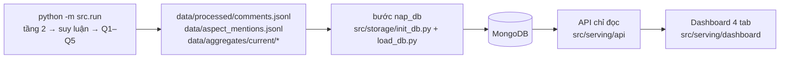

# Hướng dẫn tầng 7: API và dashboard

> Mục đích: Cách chạy API và dashboard 4 tab đọc từ MongoDB, mỗi tab lấy dữ liệu ở đâu, quy tắc hiển thị số liệu minh họa; cập nhật lần cuối: 2026-11-26.

Dashboard không nhúng số liệu tĩnh. Trang web gọi API; API đọc MongoDB theo [thiết kế dữ liệu](../0-chung/thiet-ke-du-lieu.md) (contract aspect-mention v3). Dữ liệu vào DB bằng bước `nap_db` của chuỗi theo lô.



## 1. Chạy thử

Cần Python 3.11, Docker (cho MongoDB) và dữ liệu thô v4 ở `src/ingest/data/raw/` ([cài đặt](../0-chung/cai-dat.md)). Chạy từ gốc repo.

```powershell
python -m pip install -r src/analysis/requirements.txt -r src/serving/requirements.txt
docker run -d --rm --name mongodb-dev -p 27017:27017 mongo:7.0

python -m src.run --den nap_db                  # cả chuỗi rồi nạp DB; đã chạy chuỗi thì: --tu nap_db --den nap_db
python -m src.storage.verify_db                 # kiểm DB vừa nạp
python -m src.serving.api.app --port 8000       # mở http://localhost:8000/
```

Kết nối khác mặc định thì đặt `MONGO_URI`, `MONGO_DB` (mặc định `mongodb://localhost:27017`, `smartphone_analytics`). Xong thì tắt: `Ctrl+C` cho API, `docker stop mongodb-dev`.

Nạp từng phần riêng (ví dụ kết quả của một mô hình mới) bằng `python -m src.storage.load_db --mentions … --aggregates … --analysis …`. Mọi bản ghi được upsert theo khóa nên chạy lại không sinh bản trùng. Hai điều cần biết:

- **Phạm vi thay thế.** Với mention và aggregates, file được coi là toàn bộ dữ liệu của từng cặp (`model_version`, máy) có trong file: dòng cũ của cặp đó mà file mới không còn sẽ bị xóa. Máy khác và phiên bản khác không bị đụng tới.
- **Mỗi mention chỉ giữ được một phiên bản nhãn**, vì `mention_id` là khóa và không chứa `model_version`. File mới trùng `mention_id` với phiên bản khác đang có trong DB thì script dừng, không ghi gì; muốn thay hẳn thì thêm `--replace-other-versions`.

Khi nạp bình luận, `author_name` bị bỏ ([AGENTS.md mục 3](../../AGENTS.md)).

## 2. Mỗi tab đọc gì

| Tab | Endpoint | Nguồn | Nội dung |
|---|---|---|---|
| Theo dõi ra mắt | `/api/launch` | `aggregates`, `aspect_mentions`, `alerts`, `analysis_results` | Q1: Net theo tuần của X, đời trước, đối thủ. Q2: khen, chê theo 11 khía cạnh, bình luận mẫu. Q5: lời chê của người đã dùng máy, theo khía cạnh. Cảnh báo |
| So sánh mẫu máy | `/api/compare` | như trên | Q3a: ma trận khía cạnh × máy. Q3b: so sánh trực tiếp (thái độ `so_sanh`). Q4: đời trước → đời này |
| Sức khỏe hệ thống | `/api/system` | mọi collection | Số bản ghi, kết quả lọc spam theo lý do của `src/processing/flags.py`, nguồn nhãn đang phục vụ, độ trễ đo thật của API |
| Tổng quan dữ liệu | `/api/overview` | `comments`, `models` | Số bình luận, video, theo hãng, theo máy, theo giờ Việt Nam |

Ngoài ra: `/api/meta` (máy, phiên bản nhãn, tên 11 khía cạnh), `/api/health`, tài liệu tự sinh ở `/api/docs`. Tham số chung của hai tab đầu: `model` (máy X) và `model_version`.

Tên khía cạnh lấy từ `src/labeling/final_labels.py`, không chép tay. Q5 hiển thị theo khía cạnh vì bộ loại lỗi chưa chốt (kế hoạch tổng thể bước 2.6).

## 3. Quy tắc hiển thị

- **Một công thức.** Mọi tỷ lệ đi qua `src/serving/api/metrics.py`: % khen = khen / (khen + chê), Net = % khen − % chê. Không đánh giá (`n_neu`) và so sánh (`n_cmp`) không vào mẫu số. Gộp nhiều video bằng cách cộng số đếm rồi mới chia.
- **Ít dữ liệu.** Ô có khen + chê < 30 được vẽ mờ, ghi "ít dữ liệu", không kèm kết luận ([muc-tieu.md mục 6](../0-chung/muc-tieu.md)).
- **Cửa sổ.** Chỉ tính tuần 1–4 kể từ `launch_date` của từng máy. Mention của chủ kênh không tính.
- **Số liệu minh họa.** Trang hiện băng "SỐ LIỆU MINH HỌA" và gắn chip lên từng biểu đồ khi có bất kỳ điều nào sau: nhãn có nguồn `rule` hoặc `llm` (luật mốc `rule-v1.1` hiện là `rule`); có mention không ghi nguồn nhãn, hoặc không có mention nào; chưa có kết quả kiểm định; kết quả kiểm định không khớp số đếm trong DB; Công việc 12 nêu lý do chặn công bố; dữ liệu là fixture. Băng luôn liệt kê đúng các lý do đó.
- **Kiểm định không tính ở đây.** Khoảng tin cậy, p-value và câu kết luận lấy nguyên từ kết quả Công việc 12, và chỉ gắn vào khi số đếm khớp với DB.
- **Kết luận.** Không có ý nghĩa thống kê thì ghi "Chưa đủ bằng chứng", không ghi "bằng nhau".
- **Không bịa số.** Chưa có luồng Kafka/Spark thì tab hệ thống ghi rõ là chưa triển khai, không hiện thông lượng hay consumer lag giả.

## 4. File

| File | Vai trò |
|---|---|
| `src/serving/api/app.py` | Ứng dụng FastAPI: các endpoint, đo độ trễ, phục vụ trang dashboard |
| `src/serving/api/store.py` | Đọc MongoDB, dựng dữ liệu từng tab, đối chiếu với kết quả Công việc 12 |
| `src/serving/api/metrics.py` | Công thức tỷ lệ dùng chung |
| `src/serving/api/settings.py` | Cấu hình, tên khía cạnh (từ bộ nhãn chốt) |
| `src/serving/dashboard/` | `index.html`, `app.js`, `styles.css`. Không dùng thư viện ngoài nên chạy được khi mất mạng |
| `src/storage/load_db.py`, `init_db.py`, `verify_db.py` | Nạp, tạo collection và index, kiểm DB ([tầng 6](../6-luu-tru/huong-dan.md)) |

## 5. Kiểm thử

```powershell
python -m pytest tests/test_serving_api.py -q                 # dùng mongomock, không cần MongoDB
$env:TEST_MONGO_URI = "mongodb://localhost:27017"             # chạy lại đúng các test đó trên MongoDB thật
python -m pytest tests/test_serving_api.py -q
```

Với `TEST_MONGO_URI`, mỗi test dùng một database tạm tên `test_cv13_…` và xóa sau khi chạy.

## 6. Chưa làm

- Word cloud của bản nháp EDA: không có trong DB nên không đưa vào tab tổng quan.
- Sinh cảnh báo: tab chỉ đọc collection `alerts`; phần tính cảnh báo thuộc luồng streaming (để sau).
- Q1–Q5 vẫn theo bộ 4 máy ở `config/analysis.yaml` cho tới khi Công việc 12 bỏ phụ thuộc này (kế hoạch tổng thể bước 4.2).
- Xác thực người dùng: API chỉ đọc, dùng trong mạng nội bộ của nhóm.
