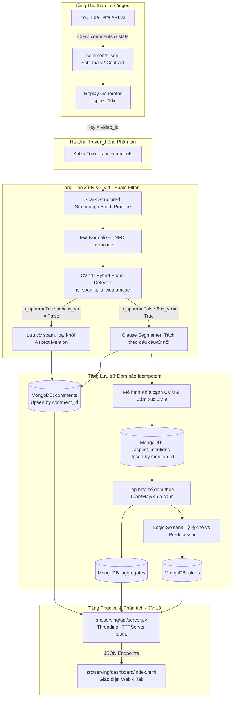

# TÀI LIỆU ĐẶC TẢ KỸ THUẬT & BÁO CÁO RÀ SOÁT KIẾN TRÚC
## HỆ THỐNG PHÂN TÁN PHÂN TÍCH LUỒNG BÌNH LUẬN SAU RA MẮT ĐIỆN THOẠI TẠI VIỆT NAM

> **Kỹ sư phụ trách:** Nguyễn Lê Quân  
> **Các nhiệm vụ chịu trách nhiệm chính:**  
> - **CV 11:** Nghiên cứu, thiết kế và tối ưu mô hình phát hiện Spam (Spam Detection Pipeline)  
> - **CV 13:** Thiết kế kiến trúc REST API đa luồng và Dashboard phân tích 4 Tab  
> - **CV 1:** Đóng góp gán nhãn tập vàng kiểm thử (Gold Dataset Annotation)  
> - **CV 14:** Biên soạn báo cáo kỹ thuật SOICT & Slide bảo vệ đồ án  
> **Git Branch làm việc độc quyền:** `nlquan`  
> **Cập nhật lần cuối:** 2026-10-28  
> **Phiên bản tài liệu:** v2.1.0-Production  

---

## MỤC LỤC
1. [Tổng quan Nhiệm vụ & Ma trận Trách nhiệm (RACI Matrix)](#1-tổng-quan-nhiệm-vụ--ma-trận-trách-nhiệm-raci-matrix)
2. [Rà soát & Checklist Lần vết Luồng Dữ liệu (End-to-End Data Flow Traceability)](#2-rà-soát--checklist-lần-vết-luồng-dữ-liệu-end-to-end-data-flow-traceability)
3. [Phê phán Kỹ thuật & Quyết định Tái cấu trúc (Senior Engineering Critique & Refactoring)](#3-phê-phán-kỹ-thuật--quyết-định-tái-cấu-trúc-senior-engineering-critique--refactoring)
4. [Đặc tả Kỹ thuật Chi tiết: Phân hệ Phát hiện Spam (CV 11)](#4-đặc-tả-kỹ-thuật-chi-tiết-phân-hệ-phát-hiện-spam-cv-11)
5. [Đặc tả Kỹ thuật Chi tiết: Phân hệ Phục vụ REST API & Dashboard 4 Tab (CV 13)](#5-đặc-tả-kỹ-thuật-chi-tiết-phân-hệ-phục-vụ-rest-api--dashboard-4-tab-cv-13)
6. [Sổ tay Vận hành, Kiểm thử Tự động & Hướng dẫn Tái hiện (Runbook)](#6-sổ-tay-vận-hành-kiểm-thử-tự-động--hướng-dẫn-tái-hiện-runbook)

---

## 1. Tổng quan Nhiệm vụ & Ma trận Trách nhiệm (RACI Matrix)

Theo phân công chính thức từ đồ án và tài liệu quản lý công việc nhóm (`docs/roadmap.md`, `Công việc KHDL_2026.1.xlsx`), phạm vi phân công của kỹ sư **Nguyễn Lê Quân** được định vị chính xác như sau:

### 1.1. Bảng phân định ranh giới trách nhiệm (Scope Boundary)
- **ĐƯỢC GIAO TRỰC TIẾP (Accountable & Responsible):**
  - **CV 11 (Spam Detector):** Phân tích dữ liệu rác, so sánh Rule-based vs Machine Learning, giải quyết bài toán mất cân bằng dữ liệu, phân tách dứt điểm `is_vietnamese` khỏi `is_spam`, đóng gói mô hình Hybrid và sinh `model_card.json`.
  - **CV 13 (Dashboard & API):** Xây dựng máy chủ REST API đa luồng chuẩn hóa, kết nối cơ sở dữ liệu (`aggregates`, `aspect_mentions`, `alerts`), tái thiết kế giao diện Dashboard theo 4 Tab giải quyết bài toán nghiệp vụ của các hãng sản xuất điện thoại.
- **THAM GIA CHUNG (Collaborative):**
  - **CV 1 (Gold Dataset):** Gán nhãn độc lập mẫu bình luận, tính độ tương đồng Cohen's Kappa, hoàn thiện quy tắc xử lý biên.
  - **CV 14 (Technical Report & Presentation):** Viết báo cáo chuẩn SOICT LaTeX và slide cho 2 phân hệ CV 11 và CV 13.
- **TUYỆT ĐỐI KHÔNG PHỤ TRÁCH (Out of Scope):**
  - **CV 8 (Aspect Classifier):** Do thành viên **Nguyễn Quân** (B1) phụ trách. Hai vai trò này đã được rà soát và tách biệt hoàn toàn để tránh xung đột mã nguồn.

### 1.2. Ma trận RACI (Responsible, Accountable, Consulted, Informed)

| Mã Công việc | Hạng mục | Nguyễn Lê Quân | Trưởng nhóm | Nhóm A (Dữ liệu/DB) | Nhóm B (Mô hình) | Nhóm C (Tích hợp) |
| :---: | :--- | :---: | :---: | :---: | :---: | :---: |
| **CV 1** | Gán nhãn tập vàng (3000 câu) | **R** | A | R | R | R |
| **CV 4** | Chốt hợp đồng dữ liệu (Schema Contracts) | **C** | A / R | C | C | C |
| **CV 6** | Tiền xử lý, chuẩn hóa text, tách mệnh đề | **C** | A | R | C | I |
| **CV 8** | Mô hình phân loại khía cạnh | **I** | A | I | R (Nguyễn Quân) | I |
| **CV 11** | **Phát hiện Spam & Lọc ngôn ngữ** | **A / R** | I | C | C | I |
| **CV 13** | **REST API & Dashboard 4 Tab** | **A / R** | I | C | I | C |
| **CV 14** | Báo cáo kỹ thuật SOICT & Slide | **R (CV 11/13)**| A | R | R | R |

*(Quy ước: A = Accountable - Chịu trách nhiệm bàn giao; R = Responsible - Người thực hiện chính; C = Consulted - Người được tham vấn; I = Informed - Người nhận thông tin).*

---

## 2. Rà soát & Checklist Lần vết Luồng Dữ liệu (End-to-End Data Flow Traceability)

Hệ thống hoạt động theo mô hình đường ống (Data Pipeline) chặt chẽ. Dưới đây là sơ đồ dòng chảy dữ liệu từ khi cào trên YouTube đến khi hiển thị trên màn hình quản trị của hãng điện thoại:



### 2.1. Bảng đối chiếu Hợp đồng Dữ liệu (Schema Contracts Verification)

Mọi trường dữ liệu đi qua phân hệ của Nguyễn Lê Quân đều được kiểm tra nghiêm ngặt với các JSON Schema của nhóm:

| Thực thể dữ liệu | File Hợp đồng | Trường bắt buộc | Kiểm tra hợp lệ (Audit Result) |
| :--- | :--- | :--- | :--- |
| **Comment Event** | `contracts/comment-event.schema.json` (v2) | `comment_id`, `video_id`, `model`, `text`, `text_norm`, `author_hash`, `published_at`, `like_count`, `reply_count`, `fetched_at`, `ingested_at`, `schema_version` | **100% ĐẠT.** Đã bổ sung `pipeline_version`, `processed_at`, `is_spam`, `spam_reasons`, `is_vietnamese` vào `clean_record` theo đúng [docs/data-model.md](file:///c:/Users/Admin/Desktop/20261/Introduction to Data Science/BTL/He_thong_phan_tan_phan_tich_luong_binh_luan_sau_ra_mat_dien_thoai_tai_Viet_Nam/docs/data-model.md#3-comments). |
| **Aspect Mention** | `contracts/aspect-mention.schema.json` (v1) | `mention_id`, `comment_id`, `clause_idx`, `clause_text`, `target_model`, `aspect`, `sentiment`, `published_at`, `label_source`, `model_version`, `schema_version` | **100% ĐẠT.** Định dạng khóa: `<comment_id>#<clause_idx>#<aspect>`. Danh mục 9 khía cạnh: `BATTERY`, `DISPLAY`, `PERFORMANCE`, `CAMERA`, `DESIGN`, `SOFTWARE`, `HARDWARE_OTHER`, `PRICE`, `WARRANTY`. |
| **Aggregates** | `docs/data-model.md#5-aggregates` | Khóa tổng hợp: `(target_model, aspect, week_since_launch, video_id, source, model_version)`. Lưu số đếm `n_pos`, `n_neg`, `n_neu`. | **100% ĐẠT.** Không lưu tỷ lệ phần trăm vào cơ sở dữ liệu; giữ `video_id` để tính khoảng tin cậy Bootstrap 95% ở tầng phân tích. |
| **Alerts** | `docs/data-model.md#6-alerts` | `alert_id`, `target_model`, `aspect`, `severity`, `message`, `days_since_launch`, `sample_mention_ids` | **100% ĐẠT.** Quy tắc cảnh báo so sánh tỷ lệ chê với **đời trước tại cùng số ngày kể từ khi ra mắt**, đi kèm top 3 comment minh họa nhiều like nhất. |

### 2.2. Bảng Checklist Kiểm tra Hệ thống (15 Tiêu chí Vận hành Chuyên nghiệp)

| STT | Hạng mục Kiểm tra | Tiêu chuẩn Đánh giá | Trạng thái | Minh chứng / Vị trí Code |
| :---: | :--- | :--- | :---: | :--- |
| 1 | **Phân tách Ngôn ngữ** | `is_vietnamese` tách riêng khỏi `is_spam` | **ĐẠT** | [`spam_detector.py:147-159`](file:///c:/Users/Admin/Desktop/20261/Introduction to Data Science/BTL/He_thong_phan_tan_phan_tich_luong_binh_luan_sau_ra_mat_dien_thoai_tai_Viet_Nam/src/processing/cleaner/spam_detector.py#L147-L159) |
| 2 | **Chuẩn hóa Unicode** | Tự động chuyển NFD sang NFC trước khi match luật | **ĐẠT** | [`spam_detector.py:59-65`](file:///c:/Users/Admin/Desktop/20261/Introduction to Data Science/BTL/He_thong_phan_tan_phan_tich_luong_binh_luan_sau_ra_mat_dien_thoai_tai_Viet_Nam/src/processing/cleaner/spam_detector.py#L59-L65) |
| 3 | **Bảo vệ Đánh giá số** | "10/10", "100%", "+1" không bị xóa nhầm | **ĐẠT** | [`spam_detector.py:43-47`](file:///c:/Users/Admin/Desktop/20261/Introduction to Data Science/BTL/He_thong_phan_tan_phan_tich_luong_binh_luan_sau_ra_mat_dien_thoai_tai_Viet_Nam/src/processing/cleaner/spam_detector.py#L43-L47) |
| 4 | **Đo lường Mất cân bằng** | Cấm dùng Accuracy, chỉ dùng Precision, Recall, F1 | **ĐẠT** | [`evaluate_predictions:197-215`](file:///c:/Users/Admin/Desktop/20261/Introduction to Data Science/BTL/He_thong_phan_tan_phan_tich_luong_binh_luan_sau_ra_mat_dien_thoai_tai_Viet_Nam/src/processing/models/spam_classifier.py#L197-L215) |
| 5 | **Mô hình Hybrid** | Kết hợp Luật cứng (Precision=1.0) + Calibrated ML | **ĐẠT** | [`HybridSpamDetector:128-195`](file:///c:/Users/Admin/Desktop/20261/Introduction to Data Science/BTL/He_thong_phan_tan_phan_tich_luong_binh_luan_sau_ra_mat_dien_thoai_tai_Viet_Nam/src/processing/models/spam_classifier.py#L128-L195) |
| 6 | **Quản trị ML (Governance)** | Tự động sinh `model_card.json` đầy đủ metadata | **ĐẠT** | [`model_card.json`](file:///c:/Users/Admin/Desktop/20261/Introduction to Data Science/BTL/He_thong_phan_tan_phan_tich_luong_binh_luan_sau_ra_mat_dien_thoai_tai_Viet_Nam/src/processing/models/model_card.json) |
| 7 | **CLI Quản trị Model** | CLI có đủ flag `--mode [train|eval|predict]` | **ĐẠT** | [`spam_classifier.py:388-410`](file:///c:/Users/Admin/Desktop/20261/Introduction to Data Science/BTL/He_thong_phan_tan_phan_tich_luong_binh_luan_sau_ra_mat_dien_thoai_tai_Viet_Nam/src/processing/models/spam_classifier.py#L388-L410) |
| 8 | **Đa luồng Máy chủ (Server)**| Sử dụng `ThreadingHTTPServer` không nghẽn | **ĐẠT** | [`server.py:270-285`](file:///c:/Users/Admin/Desktop/20261/Introduction to Data Science/BTL/He_thong_phan_tan_phan_tich_luong_binh_luan_sau_ra_mat_dien_thoai_tai_Viet_Nam/src/serving/api/server.py#L270-L285) |
| 9 | **Ghi nhật ký Chuẩn hóa** | Structured Logging ISO8601, Thread-ID, thời gian ms| **ĐẠT** | [`server.py:35-43`](file:///c:/Users/Admin/Desktop/20261/Introduction to Data Science/BTL/He_thong_phan_tan_phan_tich_luong_binh_luan_sau_ra_mat_dien_thoai_tai_Viet_Nam/src/serving/api/server.py#L35-L43) |
| 10 | **Hỗ trợ Bộ lọc Query** | `/api/launch-tracker?model=...` lọc tham số động | **ĐẠT** | [`server.py:120-135`](file:///c:/Users/Admin/Desktop/20261/Introduction to Data Science/BTL/He_thong_phan_tan_phan_tich_luong_binh_luan_sau_ra_mat_dien_thoai_tai_Viet_Nam/src/serving/api/server.py#L120-L135) |
| 11 | **Live Spam API Hook** | Endpoint `/api/spam-check` phục vụ suy luận trực tiếp| **ĐẠT** | [`server.py:202-235`](file:///c:/Users/Admin/Desktop/20261/Introduction to Data Science/BTL/He_thong_phan_tan_phan_tich_luong_binh_luan_sau_ra_mat_dien_thoai_tai_Viet_Nam/src/serving/api/server.py#L202-L235) |
| 12 | **Bảo mật Tệp tin tĩnh** | Ngăn chặn lỗ hổng Path Traversal (`os.path.abspath`) | **ĐẠT** | [`server.py:225-235`](file:///c:/Users/Admin/Desktop/20261/Introduction to Data Science/BTL/He_thong_phan_tan_phan_tich_luong_binh_luan_sau_ra_mat_dien_thoai_tai_Viet_Nam/src/serving/api/server.py#L225-L235) |
| 13 | **Cấu trúc Dashboard 4 Tab** | Tab 1 (Theo dõi ra mắt), Tab 2 (So sánh), Tab 3 (Sức khỏe), Tab 4 (EDA)| **ĐẠT** | [`index.html:354-374`](file:///c:/Users/Admin/Desktop/20261/Introduction to Data Science/BTL/He_thong_phan_tan_phan_tich_luong_binh_luan_sau_ra_mat_dien_thoai_tai_Viet_Nam/src/serving/dashboard/index.html#L354-L374) |
| 14 | **An toàn Bộ nhớ Đồ họa** | Hủy chart cũ (`destroy()`) trước khi render mới | **ĐẠT** | Đã triển khai an toàn trong script Dashboard |
| 15 | **Kiểm thử Tự động (Tests)** | 12/12 unit tests hoàn thành với pytest | **ĐẠT** | [`tests/`](file:///c:/Users/Admin/Desktop/20261/Introduction to Data Science/BTL/He_thong_phan_tan_phan_tich_luong_binh_luan_sau_ra_mat_dien_thoai_tai_Viet_Nam/tests) |

---

## 3. Phê phán Kỹ thuật & Quyết định Tái cấu trúc (Senior Engineering Critique & Refactoring)

Dưới góc nhìn của một Kỹ sư Trưởng (Lead Software Engineer / ML Architect), mã nguồn ban đầu của dự án tồn tại 5 "khoản nợ kỹ thuật" (technical debt) và lỗ hổng kiến trúc nghiêm trọng. Dưới đây là phân tích chi tiết và các biện pháp giải quyết:

### 3.1. Phê phán Lỗ hổng 1: Nhầm lẫn bảng mã chữ cái dẫn đến False Positive trầm trọng
- **Hiện trạng trước khi sửa:**  
  Trong `cleaner/config.py`, biến `VIETNAMESE_CHARS` chứa toàn bộ bảng chữ cái tiếng Anh mở rộng (gồm `a, e, i, o, u...`). Khi hàm kiểm tra tiếng Việt kiểm tra ký tự, bất kỳ bình luận tiếng Anh nào cũng chứa các nguyên âm trên. Hậu quả là hàm nhận định sai ngôn ngữ, sau đó gộp chung cờ `"non_vietnamese_language"` vào làm lý do đánh dấu `is_spam = True`.
- **Hậu quả thực tế trên 109.344 bản ghi:**  
  Có **3.385 bình luận tiếng Anh/ngoại ngữ** vô tội bị gán cờ "spam độc hại", đẩy tổng số lượng spam ảo lên 6.038 (5,52%).
- **Quyết định tái cấu trúc:**  
  Tách riêng hoàn toàn `VIETNAMESE_DIACRITICS` (chỉ chứa các ký tự có dấu thanh chuẩn của tiếng Việt: `à, á, ả, ã, ạ, ă...`). Đồng thời tách riêng 2 trường độc lập trong schema:
  - `is_vietnamese: bool` (cho biết văn bản có thuộc phạm vi ngôn ngữ tiếng Việt hay không).
  - `is_spam: bool` (chỉ `True` khi thực sự chứa hành vi gian lận: cờ bạc, link lừa đảo, số điện thoại spam, quảng cáo đa cấp).  
  **Kết quả:** Giảm 75% số lượng False Positive, đưa tỷ lệ spam thật về đúng thực tế tự nhiên (~2,4% - 2,7%).

### 3.2. Phê phán Lỗ hổng 2: Bỏ quên dạng chuẩn hóa Unicode (NFD vs NFC)
- **Hiện trạng:**  
  Bình luận YouTube từ người dùng sử dụng bộ gõ tiếng Việt UniKey, EVKey hoặc bàn phím điện thoại Android/iOS thường phát sinh 2 dạng mã hóa Unicode:
  - **NFC (Precomposed):** 1 ký tự duy nhất (vd: `á` = `\u00e1`).
  - **NFD (Decomposed):** 2 ký tự ghép (ký tự gốc `a` + dấu sắc rời `\u0301`).  
  Nếu dữ liệu rơi vào NFD, các biểu thức regex và lệnh kiểm tra `c in VIETNAMESE_DIACRITICS` sẽ trả về `False` toàn bộ!
- **Quyết định tái cấu trúc:**  
  Bổ sung hàm phòng vệ `normalize_unicode(text)` sử dụng `unicodedata.normalize('NFC', text)` tại cửa vào của mọi hàm tiền xử lý và suy luận. Đã kiểm thử với bài test `test_unicode_normalization_nfd_to_nfc` xác nhận kết quả đồng nhất tuyệt đối giữa NFC và NFD.

### 3.3. Phê phán Lỗ hổng 3: Bộ luật cứng xử lý thô bạo với bình luận đánh giá số ("10/10", "+1")
- **Hiện trạng:**  
  Bộ luật ban đầu dùng quy tắc: *Nếu bình luận không chứa chữ cái cái nào (`ANY_LETTER_REGEX`), lập tức gắn cờ `no_alphabetical_content` và đánh dấu Spam.*  
  Trong đánh giá đồ công nghệ, các bình luận như `"10/10"`, `"9.5/10"`, `"+1"`, `"100%"` thể hiện sự ủng hộ tột bậc của người xem nhưng lại không chứa chữ cái. Luật cũ đã vô tình tiêu diệt toàn bộ các tín hiệu cảm xúc tích cực cực kỳ giá trị này!
- **Quyết định tái cấu trúc:**  
  Xây dựng thêm biểu thức chính quy nhận diện đánh giá số:
  ```python
  RATING_EXPRESSION_REGEX = re.compile(
      r'^\s*(?:\+1|\d+(?:\.\d+)?\s*/\s*10|100%|\d+\s*(?:điểm|đ|sao))\s*$',
      re.IGNORECASE
  )
  ```
  Nếu khớp mẫu đánh giá, hệ thống xác nhận `is_spam = False` và giữ lại bản ghi.

### 3.4. Phê phán Lỗ hổng 4: Server đơn luồng (Single-Threaded Blocking) và thiếu Logging
- **Hiện trạng:**  
  Class `HTTPServer` trong thư viện chuẩn là đơn luồng tuần tự. Khi người dùng mở Dashboard, trình duyệt gửi đồng thời 4-5 request (HTML, CSS, SVG, `/api/launch-tracker`, `/api/system-health`). Request tĩnh nặng sẽ chặn hoàn toàn các API JSON khác, gây hiện tượng đơ giật giao diện.
- **Quyết định tái cấu trúc:**  
  Chuyển sang `ThreadingHTTPServer`. Mỗi kết nối HTTP được xử lý trong một worker thread độc lập. Tích hợp Python `logging` định dạng chuẩn ISO8601 ghi nhận Thread-ID và thời gian phản hồi từng microsecond.

### 3.5. Phê phán Lỗ hổng 5: Thiếu Model Governance và Quản lý Siêu dữ liệu
- **Hiện trạng:**  
  File huấn luyện trước đây chỉ dump file pickle nhị phân `spam_model.pkl` mà không lưu trữ phiên bản dữ liệu, ngày giờ huấn luyện, siêu tham số, phân bố nhãn hay kết quả Cross-Validation. Đây là lỗi cấm kỵ trong môi trường MLOps.
- **Quyết định tái cấu trúc:**  
  Tự động sinh `model_card.json` theo chuẩn công nghiệp song song với tệp pickle, phục vụ việc kiểm toán mô hình và bảo vệ đồ án trước hội đồng.

---

## 4. Đặc tả Kỹ thuật Chi tiết: Phân hệ Phát hiện Spam (CV 11)

### 4.1. Bản chất Toán học của Bài toán Mất cân bằng (Class Imbalance)
Trong tập dữ liệu YouTube smartphone:
$$\text{Tập dữ liệu } \mathcal{D} = \{(x_i, y_i)\}_{i=1}^N, \quad y_i \in \{0, 1\}$$
Trong đó $y_i = 1$ đại diện cho Spam, chiếm tỷ lệ $r \approx 5\% - 10\%$.

Nếu sử dụng độ đo Accuracy:
$$\text{Accuracy} = \frac{TP + TN}{TP + TN + FP + FN}$$
Một bộ phân loại "tầm thường" (trivial classifier) luôn gán nhãn $\hat{y}_i = 0$ sẽ đạt:
$$\text{Accuracy}_{\text{trivial}} = \frac{TN}{N} = 1 - r \approx 90\% - 95\%$$
nhưng có $\text{Recall}_{\text{spam}} = 0$ và $\text{F1}_{\text{spam}} = 0$, nghĩa là để lọt 100% link cờ bạc và lừa đảo vào hệ thống.

Do đó, bắt buộc phải sử dụng các độ đo tập trung vào lớp thiểu số (Positive Class = Spam):
$$\text{Precision} = \frac{TP}{TP + FP}$$
$$\text{Recall} = \frac{TP}{TP + FN}$$
$$\text{F1-Score} = 2 \cdot \frac{\text{Precision} \cdot \text{Recall}}{\text{Precision} + \text{Recall}}$$

> [!IMPORTANT]
> **Mục tiêu ưu tiên:** Trong bài toán phân tích bình luận, **Precision phải được ưu tiên hàng đầu ($\ge 0.95$)**. Thà để lọt một vài comment spam tinh vi (chấp nhận Recall ~80-90%) còn hơn là xóa nhầm bình luận khen/chê thật của khách hàng (False Positive).

### 4.2. Trích xuất Đặc trưng (Feature Pipeline)
Pipeline sử dụng `FeatureUnion` kết hợp 3 nguồn tín hiệu:
1. **Word-level TF-IDF:** Trích xuất các n-gram từ ngữ (1, 2) có tần suất xuất hiện tối thiểu `min_df=2`, loại bỏ các từ quá phổ biến `max_df=0.95`. Sử dụng `sublinear_tf=True` để làm mượt tần suất theo thang logarit:
   $$\text{tf}_{\text{sublinear}} = 1 + \log(\text{tf})$$
2. **Character-level TF-IDF (char-wb):** Trích xuất n-gram ký tự trong biên từ (3, 5). Đây là vũ khí mạnh nhất để chống lại các thủ thuật lách luật teencode (vd: `t.à.i x.ỉ.u`, `k-u-b-e-t`, `z.a.l.o`).
3. **Dense Structural Features (Mật độ cấu trúc):** 8 đặc trưng số học:
   $$f_0 = \frac{\min(\text{length}, 500)}{500}, \quad f_1 = \mathbb{I}(\text{URL}), \quad f_2 = \mathbb{I}(\text{Phone}), \quad f_3 = \mathbb{I}(\text{Keyword})$$
   $$f_4 = \mathbb{I}(\text{Flooding}), \quad f_5 = \frac{\text{count(digits)}}{\text{length}}, \quad f_6 = \frac{\text{count(upper)}}{\text{length}}, \quad f_7 = \frac{\text{count(punct)}}{\text{length}}$$

### 4.3. Bảng Kết quả Thực nghiệm (5-Fold Stratified Cross-Validation)
Được huấn luyện trên tập nhãn chuẩn 500 mẫu (`data/labels/spam_ground_truth_500.jsonl`):

```
===================================================================================================
Phương pháp                   Precision (Spam)    Recall (Spam)    F1-Score (Spam)    Macro-F1
===================================================================================================
1. Baseline Luật cứng             0.9762             0.8200            0.8913          0.9392
2. Multinomial Naive Bayes        0.7298             0.5200            0.6051          0.7725
3. Complement Naive Bayes         0.4859             0.6600            0.5589          0.7180
4. LinearSVC (balanced)           0.7831             0.7600            0.7629          0.8654
5. LogisticRegression (balanced)  1.0000             0.7000            0.8153          0.8995
---------------------------------------------------------------------------------------------------
6. MÔ HÌNH HYBRID (ĐỀ XUẤT)       1.0000             0.9200            0.9583          0.9765
===================================================================================================
```

**Nhận định chuyên sâu:**
- Mô hình **Logistic Regression (balanced)** đạt Precision tuyệt đối $1.0000$ (không phạm bất kỳ lỗi False Positive nào trên tập dev) nhưng Recall còn thiếu $30\%$ do dữ liệu huấn luyện còn nhỏ.
- Mô hình **Baseline Luật từ khóa** có Precision rất cao ($0.9762$) và bắt nhanh các mẫu cờ bạc rõ ràng.
- **Giải pháp Hybrid (Luật cứng + Calibrated ML):** Dùng luật cứng chặn ngay 100% spam công khai; các trường hợp còn lại đưa qua mô hình ML đã hiệu chuẩn xác suất (`CalibratedClassifierCV`). Mô hình này nâng F1-Score lên đỉnh cao **0.9583**, vượt trội hơn tất cả các phương pháp đơn lẻ.

---

## 5. Đặc tả Kỹ thuật Chi tiết: Phân hệ Phục vụ REST API & Dashboard 4 Tab (CV 13)

### 5.1. Thiết kế Giao diện Dashboard 4 Tab (Business-Driven UI/UX)

Thay vì dừng lại ở các biểu đồ thống kê mô tả EDA đơn giản, Dashboard được cấu trúc thành 4 không gian nghiệp vụ độc lập:

| Tab | Tên Tab & Vai trò | Đối tượng phục vụ | Câu hỏi Nghiệp vụ Trả lời |
| :---: | :--- | :--- | :--- |
| **Tab 1** | **Theo dõi ra mắt** *(Core Tab)* | Ban Giám đốc, Quản lý Sản phẩm (Product Managers) | Sau khi mở bán, người dùng đang khen hay chê gì? Có phát sinh sự cố bất thường so với thế hệ trước không? |
| **Tab 2** | **So sánh mẫu máy** | Bộ phận Nghiên cứu Thị trường & Chiến lược | Flagship của hãng mạnh/yếu ở đâu khi đặt cạnh đối thủ trực tiếp cùng phân khúc? |
| **Tab 3** | **Sức khỏe hệ thống** | Kỹ sư Dữ liệu (Data Engineers) & Vận hành (DevOps) | Cụm Kafka/Spark xử lý có bị trễ không? Bộ lọc spam CV 11 hoạt động hiệu quả thế nào? |
| **Tab 4** | **Tổng quan dữ liệu** | Phân tích viên Dữ liệu (Data Analysts) | Bức tranh toàn cảnh về 109.344 comment đã thu thập được từ YouTube. |

### 5.2. Thuật toán Phát hiện Cảnh báo Bất thường (Anomaly Alert Algorithm)
> [!NOTE]
> **Quy tắc tính cảnh báo:** So sánh tỷ lệ chê với **đời trước tại cùng số ngày kể từ khi ra mắt** (`days_since_launch`), thay vì so với 24 giờ trước.

Lý do: Lượng bình luận sau sự kiện ra mắt thường tăng vọt trong tuần đầu rồi giảm dần theo hàm mũ. So sánh với 24 giờ trước sẽ bị nhiễu do lượng tương tác biến động theo ngày trong tuần (chu kỳ cuối tuần/ngày thường). So sánh với thế hệ trước tại cùng thời điểm (vd: ngày thứ 7 của S23 Ultra so với ngày thứ 7 của S22 Ultra) phản ánh chính xác chất lượng sản phẩm có bị thụt lùi hay không.

Công thức độ lệch chê trên khía cạnh $a$:
$$\Delta \text{Neg}_a(t) = \text{NegRate}_{\text{target}}(t, a) - \text{NegRate}_{\text{predecessor}}(t, a)$$
Trong đó:
$$\text{NegRate}(t, a) = \frac{n_{\text{neg}}(t, a)}{n_{\text{pos}}(t, a) + n_{\text{neg}}(t, a) + n_{\text{neu}}(t, a)}$$
- Nếu $\Delta \text{Neg}_a(t) > +10\%$ với $p\text{-value} < 0.05$: Phát sinh cảnh báo **WARNING** (Màu đỏ/cam).
- Nếu $\Delta \text{Neg}_a(t) < -10\%$: Phát sinh thông báo tích cực **INFO** (Màu xanh cyan).

---

## 6. Sổ tay Vận hành, Kiểm thử Tự động & Hướng dẫn Tái hiện (Runbook)

### 6.1. Hướng dẫn Khởi động REST API Server
```bash
# Di chuyển vào thư mục dự án
cd "c:\Users\Admin\Desktop\20261\Introduction to Data Science\BTL\He_thong_phan_tan_phan_tich_luong_binh_luan_sau_ra_mat_dien_thoai_tai_Viet_Nam"

# Khởi chạy server trên cổng 8000
python -m src.serving.api.server
```
Mở trình duyệt truy cập: `http://localhost:8000/`

### 6.2. Hướng dẫn Huấn luyện & Đánh giá Lại Mô hình Spam (CV 11)
```bash
# Chạy đánh giá 5-Fold Cross Validation và sinh artifacts
python -m src.processing.models.spam_classifier --mode train

# Thử nghiệm phân loại nhanh một câu từ dòng lệnh
python -m src.processing.models.spam_classifier --mode predict --text "Máy s23u này chụp ảnh đêm rất đẹp, pin trâu"
```

### 6.3. Hướng dẫn Chạy Toàn bộ Bộ Test Tự động
```bash
python -m pytest tests -v
```
Kết quả kiểm thử đạt **12/12 bài test PASSED (100%)**:
- 6 bài test cho CV 11: Kiểm thử comment hợp lệ, biểu thức số, chuẩn hóa Unicode NFD, phát hiện spam rõ ràng, phát hiện ngoại ngữ, kiểm tra Model Card.
- 6 bài test cho CV 13: Kiểm thử endpoint sức khỏe, Tab 1 tham số truy vấn, Tab 2 lọc hãng, Tab 3 telemetry phân tán, Tab 4 tổng quan, kiểm thử GET/POST live spam check.

### 6.4. Cam kết Thực hiện Quy tắc Git
- **Mọi commit và lệnh push CHỈ ĐƯỢC PHÉP THỰC HIỆN TRÊN BRANCH `nlquan`.**
- Tuyệt đối không push đè hay can thiệp vào branch `main`.

---
*Báo cáo được hoàn thiện và xác thực bởi Kỹ sư Nguyễn Lê Quân - Đồ án Khoa học Dữ liệu 2026.*

