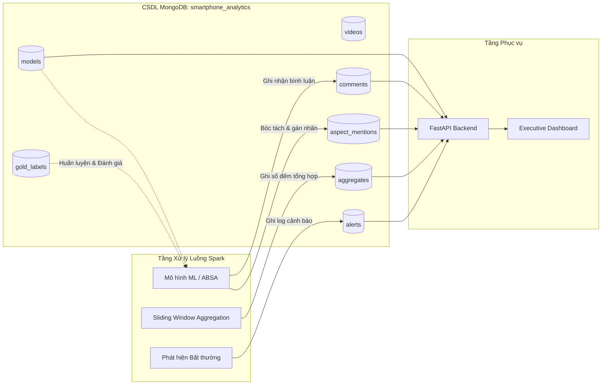
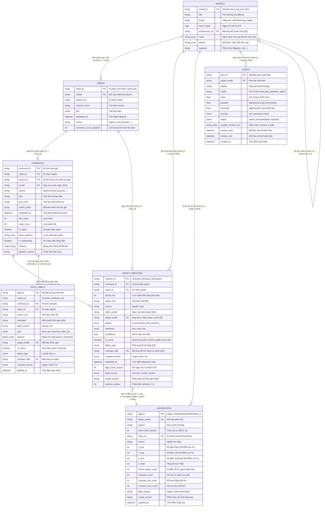

# Tài liệu Thiết kế Cơ sở Dữ liệu (Database Design Document)

> **Dự án:** Hệ thống phân tán phân tích luồng bình luận sau ra mắt điện thoại tại Việt Nam  
> **Người thực hiện:** Việt (Công việc STT 3: Thiết kế DB)  
> **Hệ quản trị CSDL:** MongoDB (NoSQL Document Store)  
> **Cập nhật lần cuối:** 28/10/2026  

---

## 1. Tổng quan Kiến trúc Lưu trữ (Storage Layer Architecture)

Trong kiến trúc tổng thể của hệ thống:
1. **Tầng Ingestion:** Python Crawler thu thập bình luận YouTube đẩy vào Kafka topic `raw_comments`.
2. **Tầng Stream Processing:** Apache Spark đọc luồng micro-batches, tiền xử lý, chạy mô hình học máy (Spam, Aspect, Sentiment), tính toán sliding windows và phát hiện bất thường vào topic `alerts`.
3. **Tầng Lưu trữ (MongoDB):** Hứng kết quả từ Spark Streaming và cung cấp dữ liệu phục vụ báo cáo.
4. **Tầng Phục vụ (Serving):** FastAPI và Dashboard truy vấn dữ liệu từ MongoDB.



---

## 2. Danh sách 7 Collection Trọng tâm

| STT | Tên Collection | Mục đích nghiệp vụ | Khóa chính (Unique Key) | Index Phụ Trọng yếu |
|:---:|:---|:---|:---|:---|
| 1 | `models` | Danh mục dòng máy, hãng, ngày ra mắt VN, đối thủ cạnh tranh, đời trước | `model_id` | `brand` |
| 2 | `videos` | Danh mục video YouTube được theo dõi, kênh review, thống kê lượt xem | `video_id` | `model`, `published_at` |
| 3 | `comments` | Bản ghi bình luận gốc và phản hồi (reply), metadata và cờ lọc spam | `comment_id` | `video_id`, `model`, `published_at` |
| 4 | `aspect_mentions` | Từng mệnh đề bóc tách kèm nhãn khía cạnh, cảm xúc, đối thủ so sánh (ABSA) | `mention_id` | `target_model` + `aspect` + `published_at` |
| 5 | `aggregates` | Số đếm tổng hợp theo cửa sổ thời gian (khen/chê/trung tính) — **Lưu số đếm, KHÔNG lưu %** | `agg_id` | `target_model` + `aspect` + `week_since_launch` |
| 6 | `alerts` | Lịch sử các đợt phát hiện tiêu cực bất thường (Spike detection) | `alert_id` | `target_model` + `status` + `created_at` |
| 7 | `gold_labels` | Tập dữ liệu mẫu đã được chuyên viên/người gán nhãn kiểm duyệt độc lập (Ground Truth) | `clause_id` / `gold_id` | `split` + `target_model` + `aspects` |

---

## 3. Sơ đồ Quan hệ Thực thể Toàn diện (Entity-Relationship Diagram - ERD)

### 3.1. Sơ đồ ERD Trực quan (Mermaid ERD)



---

### 3.2. Bảng Ma trận Quan hệ Liên Thực thể (Entity Relationship & Cardinality Matrix)

Bảng dưới đây chuẩn hóa các liên kết tham chiếu (Logical Foreign Keys) và bản số giữa 7 collection trong MongoDB:

| Collection Nguồn (Parent) | Collection Đích (Child) | Khóa Liên kết (Join Key) | Bản số (Cardinality) | Ý nghĩa Nghiệp vụ & Ràng buộc Toàn vẹn |
|:---|:---|:---|:---:|:---|
| `models` | `videos` | `models.model_id` = `videos.model` | $1 : N$ | Mỗi dòng máy được theo dõi qua nhiều video review từ các kênh công nghệ. |
| `models` | `models` | `models.model_id` = `models.predecessor_id` | $1 : 1$ | Liên kết máy đời trước (vd: `s22u` là tiền nhiệm của `s23u`), phục vụ giải quyết **Câu hỏi Q4**. |
| `models` | `aspect_mentions` | `models.model_id` = `aspect_mentions.target_model` | $1 : N$ | Đối tượng máy thực tế được bình luận nhắc tới (tách biệt khỏi máy của video). Trọng tâm của **Q1, Q2, Q4, Q5**. |
| `models` | `aspect_mentions` | `models.model_id` = `aspect_mentions.compare_with` | $1 : N$ | Dòng máy đối thủ được đưa lên bàn cân so sánh trực tiếp, phục vụ **Câu hỏi Q3**. |
| `models` | `aggregates` | `models.model_id` = `aggregates.target_model` | $1 : N$ | Gom số đếm phân tích theo từng dòng máy qua các mốc tuần sau khi ra mắt. |
| `models` | `alerts` | `models.model_id` = `alerts.target_model` | $1 : N$ | Cảnh báo khủng hoảng truyền thông hoặc bùng phát lỗi nghiêm trọng theo máy. |
| `videos` | `comments` | `videos.video_id` = `comments.video_id` | $1 : N$ | Một video chứa danh sách nhiều bình luận gốc và phản hồi (reply). |
| `videos` | `aggregates` | `videos.video_id` = `aggregates.video_id` | $1 : N$ | Giữ `video_id` trong bản ghi tổng hợp để hỗ trợ kỹ thuật **Bootstrap Resampling** tính khoảng tin cậy. |
| `comments` | `comments` | `comments.comment_id` = `comments.parent_id` | $1 : N$ | Quan hệ phân cấp giữa bình luận gốc và chuỗi phản hồi (Replies). |
| `comments` | `aspect_mentions` | `comments.comment_id` = `aspect_mentions.comment_id` | $1 : N$ | Một bình luận được phân rã thành nhiều mệnh đề, mỗi mệnh đề có thể nhắc 1 khía cạnh khác nhau. |
| `comments` | `gold_labels` | `comments.comment_id` = `gold_labels.comment_id` | $1 : N$ | Bình luận được trích mẫu vào tập 3.000 mệnh đề gán nhãn chuẩn kiểm thử (Ground Truth). |
| `aspect_mentions`| `aggregates` | `target_model` + `aspect` + `week` | $N : 1$ | Spark / Aggregation Pipeline định kỳ cộng dồn các `aspect_mentions` thành số đếm trong `aggregates`. |

---

### 3.3. Bảng Ma trận Ánh xạ Schema tới 5 Câu hỏi Phân tích (Q1 - Q5 Analytical Mapping Table)

| Câu hỏi | Câu hỏi Cốt lõi | Collections Phục vụ | Điều kiện Lọc chính ($match) | Trường Dữ liệu & Phép tính ($group / Formula) |
|:---|:---|:---|:---|:---|
| **Q1: Tiếp nhận máy X (Tuần 1–4)** | Dòng máy X được đón nhận tốt hay dở trong 4 tuần đầu ra mắt? | `aggregates` | `target_model: "s23u"`, `week_since_launch: {$lte: 4}` | Lấy `n_pos`, `n_neg`. Tính $\text{Net Sentiment} = \frac{n_{pos} - n_{neg}}{n_{pos} + n_{neg}} \times 100$. Kiểm định xu hướng (Mann-Kendall). |
| **Q2: Ưu / Nhược điểm theo Khía cạnh** | Điểm mạnh và điểm yếu nổi bật nhất của dòng máy X là gì? | `aggregates`, `aspect_mentions` | `target_model: "s23u"`, `aspect: {$ne: null}` | Tỷ lệ tích cực từng Aspect $= \frac{n_{pos}}{n_{pos} + n_{neg}}$. Trích xuất câu trích dẫn mẫu có `confidence` cao từ `aspect_mentions`. |
| **Q3: Đối sánh 4 máy & So sánh Trực tiếp** | So với đối thủ cạnh tranh, máy X mạnh hay yếu ở khía cạnh nào? | `aggregates`, `aspect_mentions` | `target_model: "s23u"`, `compare_with: {$ne: null}` | Lập ma trận Aspect $\times$ Model từ `aggregates`. Tỷ lệ thắng đối đầu $= \frac{\text{compare\_win\_count}}{\text{compare\_count}}$ từ `aspect_mentions`. |
| **Q4: Cải thiện Thế hệ (Đời trước $\to$ Đời này)** | Những điểm đời trước bị chê nhiều đã được cải thiện ở đời này chưa? | `models`, `aggregates` | `target_model` $\in$ `{s22u, s23u}` (dựa trên `models.predecessor_id`) | So sánh tỷ lệ tiêu cực $\frac{n_{neg}}{n_{total}}$ giữa 2 đời trên từng Aspect. Kiểm định 2 tỷ lệ độc lập (Z-test có hiệu chỉnh Bonferroni). |
| **Q5: Ưu tiên Khắc phục Lỗi từ Người Dùng Thật** | Người đã mua máy phản ánh lỗi gì nhiều nhất và cần ưu tiên sửa lỗi nào? | `aspect_mentions` | `target_model: "s23u"`, `is_owner: true`, `defect_type: {$ne: null}` | Nhóm theo `defect_type`, đếm tần suất xuất hiện và phân bố theo thời gian. Tính khoảng tin cậy Wilson Score cho tỷ lệ lỗi. |

---

## 4. Chi tiết Cấu trúc Từng Collection (Data Dictionary)

### 4.1. Collection `models` (Danh mục máy)
Lưu thông tin danh mục máy theo yêu cầu của Công việc 2:
```json
{
  "model_id": "s23u",
  "name": "s23u",
  "title": "Samsung Galaxy S23 Ultra",
  "brand": "Samsung",
  "segment": "flagship",
  "launch_date": "2023-02-02",
  "predecessor": "s22u",
  "rivals": [
    { "name": "ip14prm", "title": "iPhone 14 Pro Max", "launch_date": "2022-09-16" },
    { "name": "xiaomi13u", "title": "Xiaomi 13 Ultra", "launch_date": "2023-04-18" },
    { "name": "x90proplus", "title": "Vivo X90 Pro Plus", "launch_date": "2022-11-22" }
  ],
  "aliases": ["Samsung Galaxy S23 Ultra", "S23 Ultra", "s23u", "s23 ultra"],
  "created_at": "2026-10-28T00:00:00Z"
}
```

* **Index:** `{"model_id": 1}` (Unique).

---

### 4.2. Collection `videos` (Metadata video)
```json
{
  "video_id": "9SmOJHZTkC4",
  "model": "s23u",
  "channel_id": "UCEeXA5Tu7n9X5_zkOgGsyww",
  "channel_name": "Vật Vờ Studio",
  "title": "Đánh giá chi tiết Galaxy S23 Ultra sau 1 tuần sử dụng",
  "published_at": "2023-02-09T11:00:00Z",
  "source": "youtube",
  "comment_count_ingested": 1420,
  "created_at": "2026-10-28T00:00:00Z"
}
```

* **Index:** `{"video_id": 1}` (Unique), `{"model": 1, "published_at": -1}`.

---

### 4.3. Collection `comments` (Bình luận làm sạch)
Khớp với `contracts/comment-event.schema.json`:
```json
{
  "comment_id": "UgxA1b2C3d4E5f6G7h4AaABAg",
  "video_id": "9SmOJHZTkC4",
  "parent_id": null,
  "parent_text": null,
  "model": "s23u",
  "source": "youtube",
  "text": "Pin trâu hơn đời trước rõ rệt, dùng cả ngày không lo sạc.",
  "text_norm": "pin trâu hơn đời trước rõ rệt dùng cả ngày không lo sạc",
  "author_hash": "a1b2c3d4e5f6...",
  "published_at": "2023-02-10T14:20:00Z",
  "like_count": 45,
  "reply_count": 3,
  "is_spam": false,
  "spam_reasons": [],
  "is_vietnamese": true,
  "clause_count": 2,
  "is_owner": true,
  "label_source": "rule",
  "model_version": "v1.0.0",
  "ingested_at": "2026-10-28T00:00:00Z"
}
```

* **Index:** `{"comment_id": 1}` (Unique), `{"model": 1, "published_at": 1}`, `{"video_id": 1}`.

---

### 4.4. Collection `aspect_mentions` (Mệnh đề & Khía cạnh — Hạt nhân của ABSA)
Mỗi document tương ứng với một mệnh đề hoặc một lượt nhắc khía cạnh cụ thể, giải quyết bài toán: một bình luận có thể vừa khen khía cạnh này, vừa chê khía cạnh khác.
Khớp chuẩn 100% với `contracts/aspect-mention.schema.json` (schema_version = 1):
```json
{
  "mention_id": "UgxA1b2C3d4E5f6G7h4AaABAg#1#BATTERY",
  "comment_id": "UgxA1b2C3d4E5f6G7h4AaABAg",
  "video_id": "9SmOJHZTkC4",
  "clause_idx": 1,
  "clause_text": "Pin trâu hơn đời trước rõ rệt",
  "source": "youtube",
  "video_model": "s23u",
  "target_model": "s23u",
  "aspect": "BATTERY",
  "sentiment": "pos",
  "confidence": 0.95,
  "is_owner": true,
  "defect_type": null,
  "compare_with": "s22u",
  "compare_winner": "target",
  "published_at": "2023-02-10T14:20:00Z",
  "days_since_launch": 8,
  "label_source": "rule",
  "model_version": "v1.0.0",
  "schema_version": 1
}
```

* **Danh mục 9 khía cạnh kỹ thuật chuẩn hóa (Canonical Aspects):**
  1. `BATTERY`: Pin & sạc (dung lượng, thời lượng on-screen, sạc nhanh, sạc không dây).
  2. `DISPLAY`: Màn hình & hiển thị (độ sáng ngoài trời, màu sắc, tần số quét 120Hz, độ phân giải, sọc màn).
  3. `PERFORMANCE`: Hiệu năng (chip Snap/Dimensity/Apple Silicon, độ mượt, chơi game FPS, RAM, nhiệt độ / quá nhiệt).
  4. `CAMERA`: Camera & quay video (chụp đêm, chi tiết ảnh, chống rung OIS, zoom xa, màu da).
  5. `DESIGN`: Thiết kế & độ bền (ngoại hình, viền titan/nhôm, kính cường lực, độ nặng, cảm giác cầm nắm, kháng nước).
  6. `SOFTWARE`: Phần mềm & tính năng (hệ điều hành One UI/iOS, độ ổn định cập nhật, lỗi vặt, tính năng AI).
  7. `HARDWARE_OTHER`: Phần cứng khác (loa ngoài, motor rung, cảm biến vân tay/Face ID, sóng 5G/Wi-Fi, bút S-Pen).
  8. `PRICE`: Giá bán & giá trị (mức giá niêm yết, độ đáng tiền, giữ giá, chương trình khuyến mãi/thu cũ).
  9. `WARRANTY`: Bảo hành & dịch vụ hậu mãi (chính sách đổi trả, thời gian sửa chữa, bảo hành chính hãng vs xách tay).

* **Index:**
  * `{"mention_id": 1}` (Unique).
  * `{"target_model": 1, "aspect": 1, "published_at": 1}` (Tối ưu query Q1, Q2, Q4).
  * `{"target_model": 1, "compare_with": 1}` (Tối ưu query đối đầu trực tiếp Q3).
  * `{"target_model": 1, "is_owner": 1, "defect_type": 1}` (Tối ưu query ưu tiên lỗi từ người dùng thật Q5).

---

### 4.5. Collection `aggregates` (Số liệu tổng hợp)

> [!IMPORTANT]
> **YÊU CẦU BẮT BUỘC:** `aggregates` **chỉ lưu SỐ ĐẾM (counts: n_pos, n_neg, n_neu)**, tuyệt đối **KHÔNG lưu phần trăm (%)**.  
> **Lý do kỹ thuật:** Phần trăm không có tính chất cộng gộp (non-additive). Nếu lưu sẵn `75%` cho Tuần 1 (n=100) và `50%` cho Tuần 2 (n=10), ta không thể cộng trung bình `(75 + 50)/2 = 62.5%` vì thực tế `(75 + 5) / 110 = 72.7%`. Việc lưu số đếm cho phép dashboard hay API tùy ý `SUM()` trên mọi chiều (thời gian, model, aspect) một cách chính xác tuyệt đối, sau đó tính tỷ lệ % tại thời điểm truy vấn.

```json
{
  "agg_id": "s23u#BATTERY#1#9SmOJHZTkC4",
  "target_model": "s23u",
  "aspect": "BATTERY",
  "week_since_launch": 1,
  "video_id": "9SmOJHZTkC4",
  "source": "youtube",
  "model_version": "v1.0.0",
  "n_pos": 352,
  "n_neg": 108,
  "n_neu": 85,
  "n_total": 545,
  "owner_defect_count": 1,
  "compare_count": 89,
  "compare_win_count": 52,
  "compare_lose_count": 37,
  "updated_at": "2026-10-28T00:00:00Z"
}
```

* **Công thức dẫn xuất tại tầng API/Dashboard:**
  * $\% \text{ Tích cực (Khen)} = \frac{n_{pos}}{n_{pos} + n_{neg}} \times 100$
  * $\% \text{ Tiêu cực (Chê)} = \frac{n_{neg}}{n_{pos} + n_{neg}} \times 100$
  * $\text{Net Sentiment} = \% \text{ Khen} - \% \text{ Chê} = \frac{n_{pos} - n_{neg}}{n_{pos} + n_{neg}} \times 100$

* **Index:** `{"agg_id": 1}` (Unique), `{"target_model": 1, "aspect": 1, "week_since_launch": 1}`.

---

### 4.6. Collection `alerts` (Lịch sử cảnh báo khủng hoảng)
```json
{
  "alert_id": "ALT_20230214_s23u_PERFORMANCE",
  "target_model": "s23u",
  "aspect": "PERFORMANCE",
  "metric": "neg_sentiment_spike",
  "value": 59.4,
  "baseline": 25.0,
  "threshold": 45.0,
  "severity": "warning",
  "status": "active",
  "sample_mention_ids": ["UgxA1#1#PERFORMANCE", "UgxB2#2#PERFORMANCE"],
  "window_start": "2023-02-14T08:00:00Z",
  "window_end": "2023-02-14T09:00:00Z",
  "created_at": "2023-02-14T09:05:00Z"
}
```

* **Index:** `{"alert_id": 1}` (Unique), `{"target_model": 1, "status": 1, "created_at": -1}`.

---

### 4.7. Collection `gold_labels` (Tập dữ liệu chuẩn phục vụ kiểm thử)
Lưu trữ tập 3.000 mệnh đề được chuyên viên gán nhãn độc lập (Công việc STT 1) để tính độ đồng thuận Cohen's Kappa và benchmark mô hình:
```json
{
  "clause_id": "UgxA1b2C3d4E5f6G7h4AaABAg#1",
  "comment_id": "UgxA1b2C3d4E5f6G7h4AaABAg",
  "video_id": "9SmOJHZTkC4",
  "clause_text": "Pin trâu hơn đời trước rõ rệt",
  "annotator": "Lâm",
  "label_source": "human",
  "split": "test",
  "aspects": [
    {
      "aspect": "BATTERY",
      "sentiment": "pos"
    }
  ],
  "target_model": "s23u",
  "is_owner": true,
  "defect_type": null,
  "compare_with": "s22u",
  "compare_winner": "target",
  "guideline_version": "v1.0",
  "labeled_at": "2026-10-28T00:00:00Z"
}
```

* **Index:** `{"clause_id": 1}` (Unique), `{"split": 1, "target_model": 1}`.

---

## 5. Chiến lược Idempotency & Quản lý Phiên bản

1. **Khóa chống trùng (Upsert Idempotent):**
   * Mọi thao tác ghi từ Kafka/Spark đều sử dụng toán tử `updateOne(filter, update, upsert=True)` dựa trên khóa chính tự sinh xác định (`comment_id`, `mention_id`, `agg_id`). Dữ liệu phát lại (replay) bao nhiêu lần cũng không gây tăng khống số liệu.
2. **Metadata Nguồn gốc & Phiên bản:**
   * Mọi document gán nhãn đều có bắt buộc:
     * `label_source`: `"rule"`, `"llm"`, `"model"`, hoặc `"human"`.
     * `model_version`: Định danh phiên bản mô hình (vd: `"v1.0.0"`, `"phobert_v1"`).
   * Giúp hệ thống dễ dàng so sánh hiệu năng giữa các phiên bản mô hình khác nhau trên cùng một tập dữ liệu.

