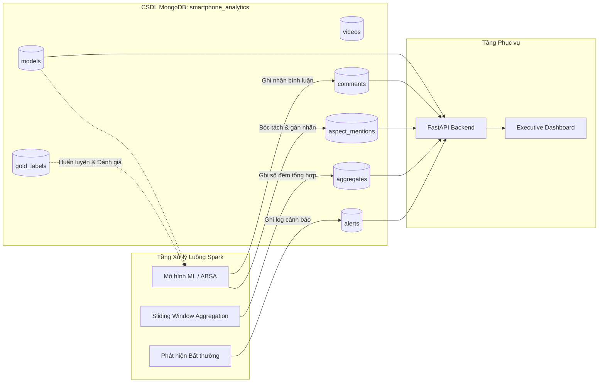

# Tài liệu Thiết kế Cơ sở Dữ liệu (Database Design Document)

> **Dự án:** Hệ thống phân tán phân tích luồng bình luận sau ra mắt điện thoại tại Việt Nam  
> **Người thực hiện:** Việt (Công việc STT 3: Thiết kế DB)  
> **Hệ quản trị CSDL:** MongoDB (NoSQL Document Store)  
> **Cập nhật lần cuối:** 28/10/2026  

---

## 1. Tổng quan Kiến trúc Lưu trữ (Storage Layer Architecture)

Trong kiến trúc tổng thể của hệ thống:
1. **Tầng Ingestion:** Python Crawler thu thập bình luận YouTube đẩy vào Kafka topic `raw_comments`.
2. **Tầng Stream Processing:** Apache Spark đọc luồng micro-batches, tiền xử lý, chạy mô hình học máy (Spam, Aspect, Sentiment), tính toán sliding windows và phát hiện bất thường vào topic `alerts`.
3. **Tầng Lưu trữ (MongoDB):** Hứng kết quả từ Spark Streaming và cung cấp dữ liệu phục vụ báo cáo.
4. **Tầng Phục vụ (Serving):** FastAPI và Dashboard truy vấn dữ liệu từ MongoDB.



---

## 2. Danh sách 7 Collection Trọng tâm

| STT | Tên Collection | Mục đích nghiệp vụ | Khóa chính (Unique Key) |
|:---:|:---|:---|:---|
| 1 | `models` | Danh mục dòng máy, hãng, ngày ra mắt VN, đối thủ cạnh tranh, đời trước | `model_id` |
| 2 | `videos` | Danh mục video YouTube được theo dõi, kênh review, thống kê lượt xem | `video_id` |
| 3 | `comments` | Bản ghi bình luận gốc và phản hồi (reply), metadata và cờ lọc spam | `comment_id` |
| 4 | `aspect_mentions` | Từng mệnh đề bóc tách kèm nhãn khía cạnh, cảm xúc, đối thủ so sánh (ABSA) | `mention_id` |
| 5 | `aggregates` | Số đếm tổng hợp theo cửa sổ thời gian (khen/chê/trung tính) — **Lưu số đếm, KHÔNG lưu %** | `agg_id` |
| 6 | `alerts` | Lịch sử các đợt phát hiện tiêu cực bất thường (Spike detection) | `alert_id` |
| 7 | `gold_labels` | Tập dữ liệu mẫu đã được chuyên viên/người gán nhãn kiểm duyệt độc lập (Ground Truth) | `gold_id` |

---

## 3. Chi tiết Cấu trúc Từng Collection (Data Dictionary)

### 3.1. Collection `models` (Danh mục máy)
Lưu thông tin danh mục máy theo yêu cầu của Công việc 2:
```json
{
  "model_id": "s23u",
  "name": "s23u",
  "title": "Samsung Galaxy S23 Ultra",
  "brand": "Samsung",
  "segment": "flagship",
  "launch_date": "2023-02-02",
  "predecessor": "s22u",
  "rivals": [
    { "name": "ip14prm", "title": "iPhone 14 Pro Max", "launch_date": "2022-09-16" },
    { "name": "xiaomi13u", "title": "Xiaomi 13 Ultra", "launch_date": "2023-04-18" },
    { "name": "x90proplus", "title": "Vivo X90 Pro Plus", "launch_date": "2022-11-22" }
  ],
  "aliases": ["Samsung Galaxy S23 Ultra", "S23 Ultra", "s23u", "s23 ultra"],
  "created_at": "2026-10-28T00:00:00Z"
}
```

* **Index:** `{"model_id": 1}` (Unique).

---

### 3.2. Collection `videos` (Metadata video)
```json
{
  "video_id": "9SmOJHZTkC4",
  "model": "s23u",
  "channel_id": "UCEeXA5Tu7n9X5_zkOgGsyww",
  "channel_name": "Vật Vờ Studio",
  "title": "Đánh giá chi tiết Galaxy S23 Ultra sau 1 tuần sử dụng",
  "published_at": "2023-02-09T11:00:00Z",
  "source": "youtube",
  "comment_count_ingested": 1420,
  "created_at": "2026-10-28T00:00:00Z"
}
```

* **Index:** `{"video_id": 1}` (Unique), `{"model": 1, "published_at": -1}`.

---

### 3.3. Collection `comments` (Bình luận làm sạch)
Khớp với `contracts/comment-event.schema.json`:
```json
{
  "comment_id": "UgxA1b2C3d4E5f6G7h4AaABAg",
  "video_id": "9SmOJHZTkC4",
  "parent_id": null,
  "parent_text": null,
  "model": "s23u",
  "source": "youtube",
  "text": "Pin trâu hơn đời trước rõ rệt, dùng cả ngày không lo sạc.",
  "text_norm": "pin trâu hơn đời trước rõ rệt dùng cả ngày không lo sạc",
  "author_hash": "a1b2c3d4e5f6...",
  "published_at": "2023-02-10T14:20:00Z",
  "like_count": 45,
  "reply_count": 3,
  "is_spam": false,
  "spam_reasons": [],
  "is_vietnamese": true,
  "clause_count": 2,
  "is_owner": true,
  "label_source": "rule",
  "model_version": "v1.0.0",
  "ingested_at": "2026-10-28T00:00:00Z"
}
```

* **Index:** `{"comment_id": 1}` (Unique), `{"model": 1, "published_at": 1}`, `{"video_id": 1}`.

---

### 3.4. Collection `aspect_mentions` (Mệnh đề & Khía cạnh — Hạt nhân của ABSA)
Mỗi document tương ứng với một mệnh đề hoặc một lượt nhắc khía cạnh cụ thể, giải quyết bài toán: một bình luận có thể vừa khen khía cạnh này, vừa chê khía cạnh khác.
Khớp với `contracts/aspect-mention.schema.json`:
```json
{
  "mention_id": "UgxA1b2C3d4E5f6G7h4AaABAg_c1_BATTERY",
  "comment_id": "UgxA1b2C3d4E5f6G7h4AaABAg",
  "video_id": "9SmOJHZTkC4",
  "clause_id": 1,
  "clause_text": "Pin trâu hơn đời trước rõ rệt",
  "target_model": "s23u",
  "aspect": "BATTERY",
  "sentiment": "positive",
  "sentiment_score": 1,
  "confidence": 0.95,
  "is_comparison": true,
  "compared_model": "s22u",
  "comparison_target": "better",
  "defect_category": null,
  "is_owner_mention": true,
  "label_source": "phobert_v1",
  "model_version": "v1.0.0",
  "published_at": "2023-02-10T14:20:00Z"
}
```

* **Quy chuẩn 9 khía cạnh kỹ thuật:**
  1. `BATTERY` (Pin & sạc)
  2. `CAMERA` (Camera & quay video)
  3. `PRICE` (Giá bán & giá trị)
  4. `PERFORMANCE` (Hiệu năng, chip, giật lag, FPS)
  5. `DISPLAY` (Màn hình, độ sáng, tần số quét)
  6. `THERMAL` (Nhiệt độ, nóng máy, tản nhiệt)
  7. `DESIGN` (Thiết kế, khung viền, màu sắc, cảm giác cầm)
  8. `SOFTWARE` (Phần mềm, hệ điều hành, cập nhật, One UI, iOS)
  9. `SERVICE` (Bảo hành, nơi bán, khuyến mãi, đổi trả)
* **Index:**
  * `{"mention_id": 1}` (Unique).
  * `{"target_model": 1, "aspect": 1, "published_at": 1}` (Tối ưu query Q1, Q2, Q4).
  * `{"target_model": 1, "is_comparison": 1, "compared_model": 1}` (Tối ưu query đối đầu Q3).
  * `{"is_owner_mention": 1, "defect_category": 1}` (Tối ưu query ưu tiên lỗi Q5).

---

### 3.5. Collection `aggregates` (Số liệu tổng hợp)

> [!IMPORTANT]
> **YÊU CẦU BẮT BUỘC:** `aggregates` **chỉ lưu SỐ ĐẾM (counts)**, tuyệt đối **KHÔNG lưu phần trăm (%)**.  
> **Lý do kỹ thuật:** Phần trăm không có tính chất cộng gộp (non-additive). Nếu lưu sẵn `75%` cho Tuần 1 (n=100) và `50%` cho Tuần 2 (n=10), ta không thể cộng trung bình `(75 + 50)/2 = 62.5%` vì thực tế `(75 + 5) / 110 = 72.7%`. Việc lưu số đếm cho phép dashboard hay API tùy ý `SUM()` trên mọi chiều (thời gian, model, aspect) một cách chính xác tuyệt đối, sau đó tính tỷ lệ % tại thời điểm truy vấn.

```json
{
  "agg_id": "s23u_BATTERY_weekly_w1",
  "model": "s23u",
  "aspect": "BATTERY",
  "window_type": "weekly",
  "window_index": 1,
  "window_start": "2023-02-02T00:00:00Z",
  "window_end": "2023-02-08T23:59:59Z",
  "counts": {
    "pos_count": 352,
    "neg_count": 108,
    "neu_count": 85,
    "total_count": 545,
    "spam_count": 32,
    "owner_defect_count": 1,
    "comparison_count": 89,
    "compared_win_count": 52,
    "compared_lose_count": 37
  },
  "label_source": "phobert_v1",
  "model_version": "v1.0.0",
  "calculated_at": "2026-10-28T00:00:00Z"
}
```

* **Công thức dẫn xuất tại tầng API/Dashboard:**
  * $\% \text{ Khen} = \frac{\text{pos\_count}}{\text{pos\_count} + \text{neg\_count}} \times 100$
  * $\% \text{ Chê} = \frac{\text{neg\_count}}{\text{pos\_count} + \text{neg\_count}} \times 100$
  * $\text{Net Sentiment} = \% \text{ Khen} - \% \text{ Chê}$

* **Index:** `{"agg_id": 1}` (Unique), `{"model": 1, "aspect": 1, "window_type": 1, "window_start": 1}`.

---

### 3.6. Collection `alerts` (Lịch sử cảnh báo khủng hoảng)
```json
{
  "alert_id": "ALT_20230214_s23u_THERMAL",
  "model": "s23u",
  "aspect": "THERMAL",
  "metric_name": "neg_sentiment_spike",
  "current_value": 59.4,
  "baseline_value": 25.0,
  "threshold": 45.0,
  "severity": "warning",
  "status": "active",
  "sample_comment_ids": ["UgxA1...", "UgxB2..."],
  "sample_quotes": [
    "Máy test Genshin Impact nóng ran ở cụm camera sau 20 phút."
  ],
  "window_start": "2023-02-14T08:00:00Z",
  "window_end": "2023-02-14T09:00:00Z",
  "triggered_at": "2023-02-14T09:05:00Z"
}
```

* **Index:** `{"alert_id": 1}` (Unique), `{"model": 1, "status": 1, "triggered_at": -1}`.

---

### 3.7. Collection `gold_labels` (Tập dữ liệu chuẩn phục vụ kiểm thử)
Lưu trữ tập 3.000 mệnh đề được người gán nhãn độc lập (Công việc STT 1) để tính độ đồng thuận Cohen's Kappa và benchmark mô hình:
```json
{
  "gold_id": "GL_UgxA1_c1",
  "comment_id": "UgxA1b2C3d4E5f6G7h4AaABAg",
  "clause_id": 1,
  "clause_text": "Pin trâu hơn đời trước rõ rệt",
  "annotator_1": {
    "annotator_id": "Lâm",
    "aspect": "BATTERY",
    "sentiment": "positive",
    "target_model": "s23u"
  },
  "annotator_2": {
    "annotator_id": "Tiến",
    "aspect": "BATTERY",
    "sentiment": "positive",
    "target_model": "s23u"
  },
  "consensus": {
    "aspect": "BATTERY",
    "sentiment": "positive",
    "target_model": "s23u",
    "is_owner": true,
    "defect_category": null
  },
  "agreement_score": 1.0,
  "verified_by_lead": true,
  "split": "test",
  "label_source": "human",
  "model_version": "ground_truth_v1",
  "created_at": "2026-10-28T00:00:00Z"
}
```

* **Index:** `{"gold_id": 1}` (Unique), `{"split": 1, "consensus.aspect": 1}`.

---

## 4. Ánh xạ Truy vấn CSDL tới 5 Câu hỏi Nghiệp vụ

| Câu hỏi | Collections sử dụng | Mệnh đề MongoDB Aggregation chính |
|:---|:---|:---|
| **Q1: Tiếp nhận máy X (Tuần 1–4)** | `aggregates` | `db.aggregates.find({model: "s23u", window_type: "weekly", aspect: "ALL"})` -> Lấy `counts.pos_count` và `counts.neg_count` tính Net Sentiment theo tuần. |
| **Q2: Ưu/nhược điểm theo Aspect** | `aggregates`, `aspect_mentions` | `db.aggregates.find({model: "s23u", window_type: "launch_4weeks", aspect: {$ne: "ALL"}})` -> So sánh `counts.pos_count` vs `counts.neg_count` theo Aspect. Kèm trích dẫn mẫu từ `aspect_mentions`. |
| **Q3: Đối sánh 4 máy & So sánh trực tiếp** | `aggregates`, `aspect_mentions` | Bảng ma trận từ `aggregates` (Aspect × Model). Tỷ lệ so sánh trực tiếp từ `counts.compared_win_count` vs `counts.compared_lose_count`. |
| **Q4: Cải thiện thế hệ (S22U → S23U)** | `aggregates` | Lấy `counts.neg_count / (pos + neg)` của `s22u` và `s23u` trên từng Aspect -> Tính độ chênh lệch điểm phần trăm. |
| **Q5: Ưu tiên lỗi từ người dùng thật** | `aspect_mentions` | `db.aspect_mentions.aggregate([{$match: {is_owner_mention: true, defect_category: {$ne: null}}}, {$group: {_id: "$defect_category", count: {$sum: 1}}}])`. |

---

## 5. Chiến lược Idempotency & Quản lý Phiên bản

1. **Khóa chống trùng (Upsert Idempotent):**
   * Mọi thao tác ghi từ Kafka/Spark đều sử dụng toán tử `updateOne(filter, update, upsert=True)` dựa trên khóa chính tự sinh xác định (`comment_id`, `mention_id`, `agg_id`). Dữ liệu phát lại (replay) bao nhiêu lần cũng không gây tăng khống số liệu.
2. **Metadata Nguồn gốc & Phiên bản:**
   * Mọi document gán nhãn đều có bắt buộc:
     * `label_source`: `"rule"`, `"llm"`, `"phobert_v1"`, hoặc `"human"`.
     * `model_version`: Định danh phiên bản mô hình (vd: `"v1.0.0"`, `"v1.1.0"`).
   * Giúp hệ thống dễ dàng so sánh hiệu năng giữa các phiên bản mô hình khác nhau trên cùng một tập dữ liệu.
