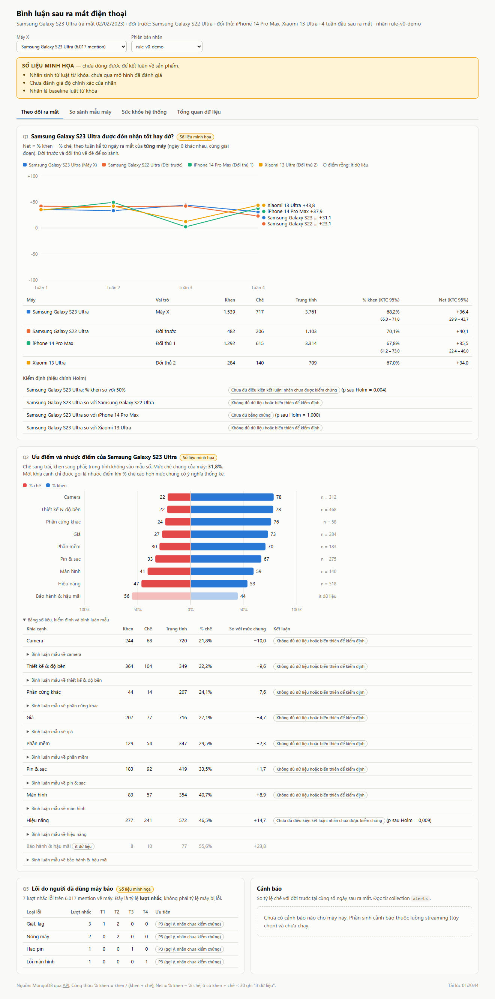
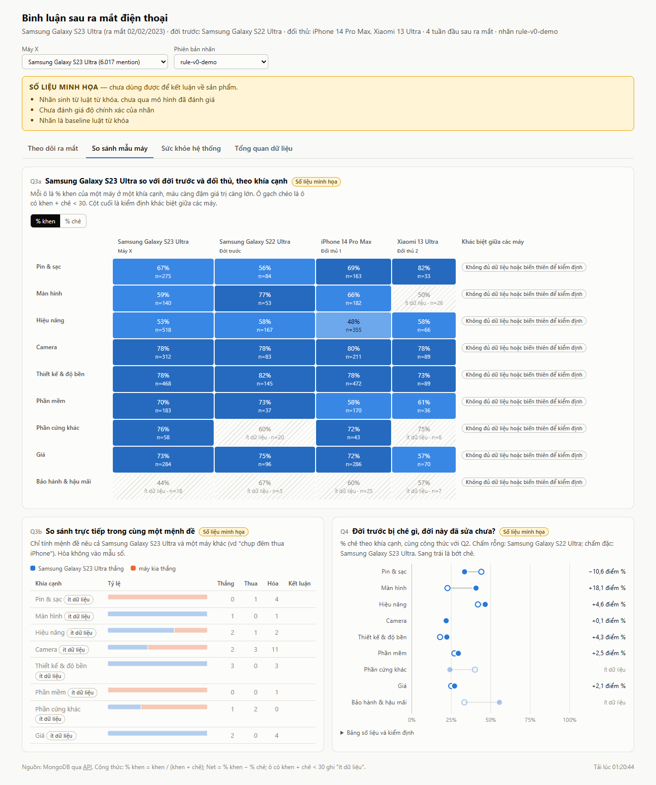
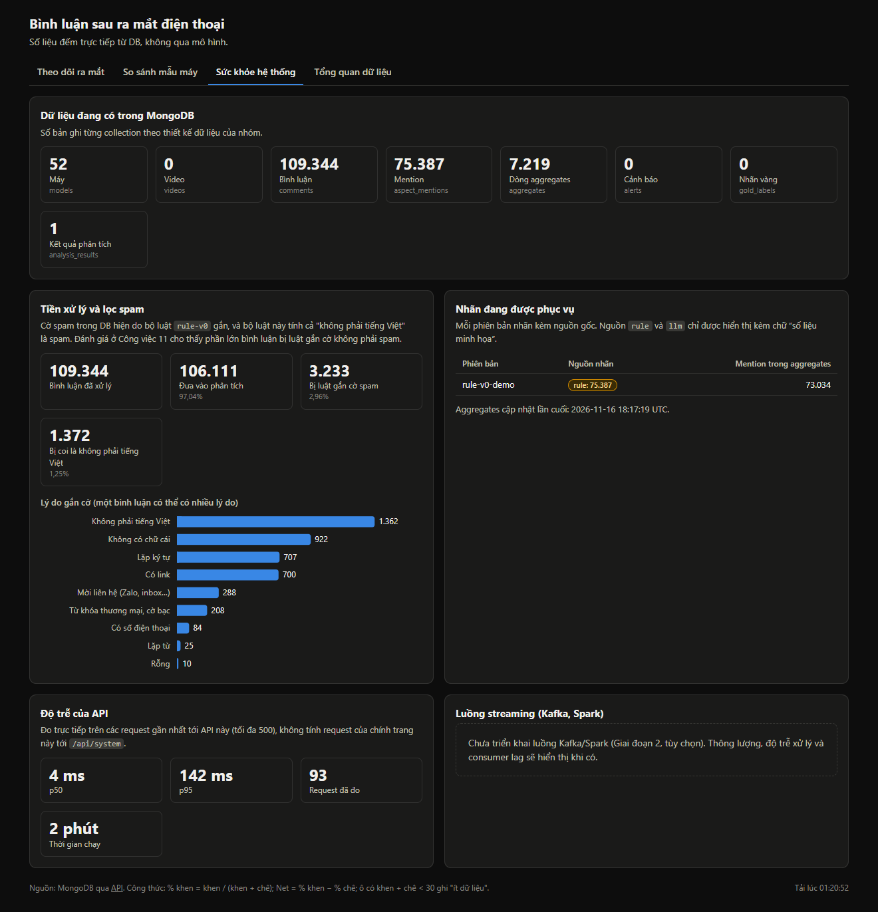

# Công việc 13: Dashboard đọc từ DB qua API

> Mục đích: Báo cáo việc chuyển dashboard từ file JSON tĩnh sang đọc MongoDB qua API: đã làm gì, kiểm chứng thế nào, còn hạn chế gì; cập nhật lần cuối: 2026-11-17.

Người thực hiện: Nguyễn Lê Quân. Cách chạy và mô tả kỹ thuật: [src/serving/README.md](../../src/serving/README.md).

## 1. Đã làm gì

| Trước | Sau |
|---|---|
| Một file `index.html` 161 KB nhúng sẵn số liệu sinh từ luật từ khóa | Trang web gọi API; API đọc MongoDB theo [data-model.md](../data-model.md). Không còn số nào nằm trong mã nguồn trang |
| Số liệu minh họa không được đánh dấu trên từng biểu đồ | API tự xác định số liệu có phải minh họa không từ nguồn nhãn và kết quả Công việc 12; trang hiện băng cảnh báo kèm lý do và gắn chip lên từng biểu đồ |
| % khen, % chê tính ở nhiều chỗ | Một hàm duy nhất tính mọi tỷ lệ từ số đếm |
| Có "dự báo tuần 8" và phân cụm | Đã bỏ; không có ngoại suy |
| Phụ thuộc Google Fonts | Không dùng thư viện hay font ngoài, chạy được khi mất mạng lúc demo |

Bốn tab theo kế hoạch của nhóm: **Theo dõi ra mắt** (Q1, Q2, Q5, cảnh báo), **So sánh mẫu máy** (Q3a, Q3b, Q4), **Sức khỏe hệ thống**, **Tổng quan dữ liệu**.

Ba ảnh trên chụp khi DB chứa **số liệu minh họa** do [demo_data.py](../../src/serving/demo_data.py) sinh bằng luật từ khóa. Chúng cho thấy giao diện, không phải kết quả phân tích.

## 2. Cách xử lý số liệu minh họa

Yêu cầu của công việc: chỗ nào còn số liệu minh họa phải ghi rõ. Thay vì gắn nhãn bằng tay, API quyết định từ dữ liệu. Số liệu chỉ được coi là **không** minh họa khi đủ cả bốn điều kiện:

1. mọi nhãn của phiên bản đang xem có nguồn `model` hoặc `human` (không có `rule`, `llm`);
2. có kết quả kiểm định của Công việc 12 cho máy và phiên bản đó;
3. số đếm trong kết quả đó khớp với số đếm trong DB;
4. Công việc 12 cho phép công bố và dữ liệu không phải fixture.

Thiếu điều kiện nào thì băng cảnh báo nêu đúng lý do đó. Hiện chưa có bộ nhãn nào qua được điều kiện 1, nên mọi biểu đồ ở hai tab phân tích đều mang chữ "Số liệu minh họa".

## 3. Kiểm chứng

| Kiểm chứng | Kết quả |
|---|---|
| 45 test tự động cho API, script nạp DB, bộ sinh số liệu minh họa (mongomock) | Đạt |
| Chạy lại đúng 45 test đó trên MongoDB 7.0 thật | Đạt |
| Nạp dữ liệu thật vào MongoDB 7.0: 109.344 bình luận, 75.387 mention minh họa (mỗi mention được kiểm theo contract v2), 7.219 dòng aggregates | Đạt |
| Chạy code Công việc 12 (nhánh `task12`) trên cùng mentions, so với số đếm của phần này | 1.573/1.573 dòng aggregates trùng khóa và trùng số đếm |
| Nạp `business_questions.json` do code Công việc 12 sinh ra, để API đối chiếu | Khớp 56/56 ô; khoảng tin cậy và kiểm định hiển thị được |
| Số lượt so sánh trực tiếp (Q3b) và số lượt nhắc lỗi (Q5) API đếm từ `aspect_mentions` so với Công việc 12 | Trùng ở cả 9 khía cạnh và 9 loại lỗi |
| Mở 4 tab bằng Chrome, giao diện sáng và tối, rộng 1320 px và 390 px | Không có lỗi console, không tràn ngang |
| Bảng màu biểu đồ qua công cụ kiểm tra khả năng phân biệt cho người mù màu | Đạt ở cả hai giao diện |

Một test đã bắt được lỗi trong lúc làm: dữ liệu fixture có cờ "được công bố" từng không bị gắn nhãn minh họa. Đã sửa và giữ test.

## 4. Phát hiện cần cả nhóm xử lý

1. **`clean_data.jsonl` v1.0 không có trường `author_is_creator`.** Contract v2 bắt buộc trường này. Code Công việc 12 từ chối cả 75.387 mention với lỗi `REFERENCE_MISMATCH` cho tới khi bình luận nguồn có trường đó. Để chạy được phép đối chiếu ở mục 3, tôi dùng một bản sao tạm của dữ liệu có thêm `author_is_creator = false`; bản sao này không nằm trong repo. Dữ liệu chuẩn cần được bổ sung trường này ở crawler hoặc tiền xử lý.
2. **Chưa có nơi chuẩn để dashboard đọc kết quả Công việc 12 từ DB.** Phần này dùng tạm collection `analysis_results`; cần đưa vào data-model.md hoặc chọn nơi khác.
3. **`predecessor` chưa có trong `config/pipeline.yaml`** (Công việc 2). Khi không có cấu hình phân tích cho một máy, Q4 không vẽ được và trang ghi rõ lý do.

## 5. Hạn chế

- Chưa có đầu ra mô hình thật để hiển thị; mọi số ở hai tab phân tích hiện là minh họa.
- Tab hệ thống chỉ đo độ trễ của chính API. Thông lượng, độ trễ xử lý và consumer lag thuộc luồng Kafka/Spark chưa dựng, nên trang ghi "chưa triển khai" thay vì hiện số.
- Tab cảnh báo chỉ đọc collection `alerts`; chưa có thành phần nào ghi vào đó.
- Tab tổng quan quét toàn bộ `comments` mỗi 30 giây khi có người xem (khoảng 2 giây với 109 nghìn bình luận). Dữ liệu lớn hơn nhiều thì cần bảng đếm sẵn.
- Không có word cloud vì DB không lưu tần suất từ.
- `index.html` cũ bị thay hoàn toàn. Nhánh `task12` cũng sửa file này (bỏ phần dự báo), nên khi hai nhánh cùng vào `main` sẽ có xung đột ở file đó; cách giải quyết là giữ bản mới.
