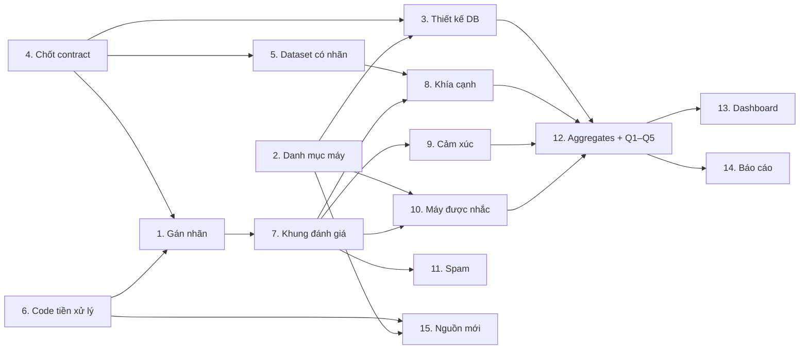

# Kế hoạch và phân công

> Mục đích: Danh sách công việc, thứ tự phụ thuộc, đầu ra và quy tắc làm việc của nhóm; cập nhật lần cuối: 2026-10-28.

## 1. Nhóm và vai trò

| Nhóm | Số người | Phụ trách |
|---|---|---|
| Trưởng nhóm | 1 | Chốt contract, review PR, giữ tài liệu thống nhất |
| A. Dữ liệu & DB | 3 | Công việc 2, 3, 5, 6 |
| B. Mô hình | 6 | Công việc 8, 9, 10, 11 (chia B1/B2/B3) |
| C. Tích hợp & đánh giá | 2 | Công việc 7, 12, 13, 14 |
| Cả nhóm | 11 | Công việc 1 (gán nhãn), Công việc 4 (chốt contract) |

Công việc 15 (nguồn dữ liệu mới) giao cho 1 người sau khi Công việc 6 xong.

## 2. Thứ tự và phụ thuộc

| Giai đoạn | Công việc | Điều kiện để sang giai đoạn sau |
|---|---|---|
| 0. Nền móng | 4, 6 | Contract đã merge; cả nhóm chạy được tiền xử lý ra cùng một file dữ liệu |
| 1. Dữ liệu & nhãn | 1, 2, 3, 5 (song song), 15 bước 1 | Có tập test gán tay với kappa ≥ 0,6; DB nạp được dữ liệu |
| 2. Mô hình | 7, 8, 9, 10, 11 | Mỗi mô hình có bảng F1 so với baseline luật từ khóa |
| 3. Kết quả | 12, 13, 14 | Q1–Q5 chạy lại được từ code; báo cáo hoàn chỉnh |

## 3. Danh sách công việc

Mỗi công việc điền **Phụ trách** và **Hạn** trước khi bắt đầu.

### Công việc 1: Gán nhãn dữ liệu YouTube
- **Phụ trách:** cả nhóm (người viết guideline: ___) | **Hạn:** ___ | **Ưu tiên:** RẤT CAO
- **Mô tả:** Gán nhãn 3000 mệnh đề. Mỗi mệnh đề: khía cạnh (có thể nhiều hoặc không có), khen/chê/trung tính cho từng khía cạnh, máy được nhắc. Với tập test gán thêm: đã dùng máy chưa, loại lỗi kỹ thuật (nếu có), có so sánh máy khác không.
- **Yêu cầu:**
  - Viết guideline trước: định nghĩa từng khía cạnh, ví dụ khen/chê/trung tính, các trường hợp khó (mỉa mai, phủ định "không lag chút nào", so sánh 2 máy, reply). Cả nhóm gán thử 50 mệnh đề, họp thống nhất rồi mới gán thật.
  - Chọn mẫu rải đều theo video và theo máy trong phạm vi.
  - **Tập test (~800 mệnh đề) bắt buộc do người gán**, mỗi mệnh đề 2 người độc lập, tính Cohen's kappa.
  - Được dùng AI hỗ trợ gán phần train, nhưng ghi `label_source = "llm"` và cho người kiểm tra lại ~200 mẫu để biết AI đúng bao nhiêu %. Không dùng nhãn AI làm test.
- **Đầu ra:** `docs/labeling-guideline.md`, file nhãn đúng [data-model.md#gold_labels](data-model.md#7-gold_labels), chỉ số kappa.
- **Phụ thuộc:** 4, 6

### Công việc 2: Danh mục máy trong phạm vi
- **Phụ trách:** ___ | **Hạn:** ___ | **Ưu tiên:** trung bình
- **Mô tả:** Với mỗi máy: mã máy, tên, hãng, ngày ra mắt tại VN, đời trước, đối thủ cùng thời điểm và cùng phân khúc. Chốt bộ 4 máy cho Q1–Q5 (X, P, R1, R2).
- **Yêu cầu:**
  - Có nguồn dẫn cho ngày ra mắt.
  - Sửa lỗi trong `config/pipeline.yaml`: Note 20 Ultra khai báo 2 tên (`notefive`, `note20u`); đối thủ không cùng thời điểm (iPhone 11 Pro – Note 20 Ultra, iPhone 18 Pro Max – Vivo X100 Pro).
  - Thêm trường `predecessor` cho từng máy.
- **Đầu ra:** báo cáo danh mục + `config/pipeline.yaml` đã sửa.

### Công việc 3: Thiết kế và dựng DB
- **Phụ trách:** ___ | **Hạn:** ___ | **Ưu tiên:** cao
- **Mô tả:** Dựng các collection theo [data-model.md](data-model.md): `models`, `videos`, `comments`, `aspect_mentions`, `aggregates`, `alerts`, `gold_labels`.
- **Yêu cầu:** `aggregates` lưu số đếm, không lưu %. Có index phục vụ Q3b và Q5. Script nạp dữ liệu chạy lại nhiều lần không sinh bản trùng.
- **Đầu ra:** script tạo DB + script nạp dữ liệu + cập nhật data-model.md nếu có thay đổi.
- **Phụ thuộc:** 2, 4

### Công việc 4: Chốt contract dữ liệu
- **Phụ trách:** trưởng nhóm + đại diện mỗi nhóm | **Hạn:** ___ | **Ưu tiên:** RẤT CAO (làm đầu tiên)
- **Mô tả:** Chốt bản thỏa thuận định dạng dữ liệu mà mọi nhóm phải tuân theo: trường nào, kiểu gì, nhận giá trị nào. Bản nháp đã có ở [contracts/aspect-mention.schema.json](../contracts/aspect-mention.schema.json) và [data-model.md](data-model.md).
- **Yêu cầu:** Chốt danh sách 9 khía cạnh kèm định nghĩa, danh sách loại lỗi, cửa sổ thời gian (đề xuất 4 tuần). Sau khi chốt, đổi trường nào cũng phải tăng `schema_version` và báo cả nhóm.
- **Đầu ra:** contract đã merge vào `main`, bỏ chữ "DRAFT".

### Công việc 5: Dataset tiếng Việt đã gán nhãn
- **Phụ trách:** ___ | **Hạn:** ___ | **Ưu tiên:** cao
- **Mô tả:** Tận dụng dữ liệu đã có người gán nhãn để có thêm dữ liệu huấn luyện. Ứng viên chính: **UIT-ViSFD** (~11 nghìn đánh giá smartphone trên trang thương mại điện tử, nhãn dạng `{CAMERA#Positive};{BATTERY#Negative}`). Tham khảo thêm **ViSpamReviews** cho spam. Kiểm tra lại số liệu trên bài báo và trang gốc.
- **Yêu cầu:** Kiểm tra giấy phép. Lập bảng map khía cạnh về 9 khía cạnh của nhóm (xem [ml-training.md](ml-training.md#3-dữ-liệu-có-nhãn-từ-bên-ngoài)). Viết script chuyển về định dạng của nhóm.
- **Đầu ra:** data card (nguồn, kích thước, phân bố nhãn), bảng map, dữ liệu đã chuyển đổi.
- **Phụ thuộc:** 4

### Công việc 6: Code tiền xử lý + phiên bản dữ liệu
- **Phụ trách:** ___ | **Hạn:** ___ | **Ưu tiên:** RẤT CAO
- **Mô tả:** Code tạo `clean_data.jsonl` (lọc spam, nhận diện tiếng Việt, tách mệnh đề) và code tạo bundle dashboard hiện chưa có trong repo.
- **Yêu cầu:** Commit toàn bộ code vào `src/processing/`. Ghi số dòng + checksum mỗi phiên bản dữ liệu. Cả nhóm dùng chung một phiên bản. Bổ sung model còn thiếu trong `MODEL_INFO` của notebook (`ip15prm`, `s24u`, `s5`, `mi5`, `findx5pro`, `realme8pro`, `ip6|note4`).
- **Đầu ra:** một lệnh chạy ra `clean_data.jsonl`; bảng phiên bản dữ liệu.

### Công việc 7: Khung đánh giá chung
- **Phụ trách:** ___ | **Hạn:** ___ | **Ưu tiên:** cao
- **Mô tả:** Một cách chia train/test và một script tính điểm dùng chung cho mọi mô hình.
- **Yêu cầu:** Chia theo `video_id`. Test set cố định, không dùng để chọn tham số. Metric: precision, recall, F1 theo nhãn + macro-F1.
- **Đầu ra:** file chia tập + `evaluate.py`.
- **Phụ thuộc:** 1

### Công việc 8: Mô hình phân loại khía cạnh
- **Phụ trách:** B1 (2 người: ___) | **Hạn:** ___ | **Ưu tiên:** cao
- **Mô tả:** Phân loại **đa nhãn có giám sát**. Phân cụm chỉ để khám phá, không làm mô hình chính.
- **Yêu cầu:** Baseline = luật từ khóa hiện tại. Thử TF-IDF + Logistic Regression/SVM; PhoBERT nếu đủ điều kiện.
- **Đầu ra:** model + bảng F1 từng khía cạnh so với baseline.
- **Phụ thuộc:** 4, 5, 7

### Công việc 9: Mô hình cảm xúc theo khía cạnh
- **Phụ trách:** B2 (2 người: ___) | **Hạn:** ___ | **Ưu tiên:** cao
- **Mô tả:** Dự đoán `pos/neg/neu` cho từng cặp (mệnh đề, khía cạnh), không chấm cả bình luận.
- **Yêu cầu:** Có baseline. Macro-F1, confusion matrix, phân tích lỗi trên phủ định và mỉa mai.
- **Đầu ra:** model + báo cáo đánh giá.
- **Phụ thuộc:** 4, 5, 7

### Công việc 10: Nhận diện máy được nhắc
- **Phụ trách:** B3 (___) | **Hạn:** ___ | **Ưu tiên:** cao
- **Mô tả:** Xác định `target_model` của mỗi mệnh đề. Bản nháp gán lời chê iPhone cho S23U vì thiếu bước này.
- **Yêu cầu:** Bắt đầu bằng luật khớp alias ("ip14prm", "táo", "ss"…). Mệnh đề không nêu tên thì xét comment cha, rồi máy của video. Phát hiện mệnh đề so sánh (`compare_with`, `compare_winner`). Đo precision/recall.
- **Đầu ra:** module + kết quả đánh giá.
- **Phụ thuộc:** 2, 4, 7

### Công việc 11: Phát hiện spam
- **Phụ trách:** B3 (___) | **Hạn:** ___ | **Ưu tiên:** trung bình
- **Mô tả:** So sánh bộ luật spam hiện tại (~6% bị gắn cờ) với một mô hình ML.
- **Yêu cầu:** Gán nhãn ~500 bình luận spam/không spam. Dùng precision/recall, không dùng accuracy. Tách "không phải tiếng Việt" ra khỏi "spam".
- **Đầu ra:** so sánh luật và mô hình, chọn một phương án.
- **Phụ thuộc:** 7

### Công việc 12: Tính aggregates + trả lời Q1–Q5
- **Phụ trách:** C (___) | **Hạn:** ___ | **Ưu tiên:** trung bình
- **Mô tả:** Chạy mô hình trên toàn bộ dữ liệu, ghi `aspect_mentions`, tính `aggregates`, trả lời Q1–Q5 theo [EDA_requirement.md](EDA_requirement.md).
- **Yêu cầu:** Khoảng tin cậy (bootstrap theo video). Hiệu chỉnh Holm cho từng câu hỏi. Chỉ kết luận khi có ý nghĩa thống kê. Không dùng dự báo tuyến tính 4 điểm.
- **Phụ thuộc:** 3, 8, 9, 10

### Công việc 13: Dashboard
- **Phụ trách:** C (___) | **Hạn:** ___ | **Ưu tiên:** trung bình
- **Mô tả:** Chuyển dashboard từ JSON tĩnh sang đọc từ DB/API.
- **Yêu cầu:** Chỗ nào còn số liệu minh họa phải ghi rõ "số liệu minh họa".
- **Phụ thuộc:** 3, 12

### Công việc 14: Báo cáo + slide
- **Phụ trách:** C + mỗi người viết phần của mình | **Hạn:** ___ | **Ưu tiên:** trung bình (làm liên tục)
- **Mô tả:** Mỗi công việc xong nộp 1 đoạn: đã làm gì, kết quả, hạn chế. Không dồn vào tuần cuối.

### Công việc 15: Bổ sung nguồn dữ liệu ngoài YouTube
- **Phụ trách:** ___ | **Hạn:** ___ | **Ưu tiên:** trung bình (bước 1), thấp (bước 2)
- **Mô tả:** Mục tiêu chính là có thêm bình luận từ **người đã dùng máy** cho Q5 và Q2 (YouTube có rất ít). Ưu tiên mục đánh giá sản phẩm trên trang bán hàng (TGDĐ, CellphoneS, FPT Shop), sau đó diễn đàn (Tinh tế, Voz). Không làm Facebook, TikTok, Shopee.
  - **Bước 1 – khảo sát (1 tuần):** với mỗi nguồn: điều khoản/robots.txt có cho phép không; có dữ liệu trong cửa sổ ra mắt của 4 máy không; bao nhiêu bình luận mỗi máy; có nhãn "đã mua"/số sao không. Chốt **1** nguồn.
  - **Bước 2 – thu thập:** crawler cho nguồn đã chốt, ghi đúng schema comment hiện có.
- **Yêu cầu:** `source = "tgdd"`/`"tinhte"`…; `video_id` hiểu là "id trang/bài gốc"; dùng chung `AUTHOR_SALT`. Trường riêng của nguồn (số sao, "đã mua") để trong trường mở rộng; đổi schema thì tăng `schema_version`. Crawl có giới hạn tốc độ. Khi phân tích, báo cáo theo từng nguồn trước rồi mới gộp.
- **Đầu ra:** báo cáo khảo sát; crawler + dữ liệu đúng schema + thống kê số bình luận mỗi máy.
- **Phụ thuộc:** 2, 4, 6

### Tùy chọn: Demo streaming
Chỉ làm nếu giảng viên yêu cầu phần hệ thống phân tán và Công việc 12 đã xong: replay dữ liệu qua Kafka, xử lý bằng Spark, ghi vào DB. Xem [pipeline.md](pipeline.md#3-giai-đoạn-2-streaming-tùy-chọn).

## 4. Quy tắc chung

- Mỗi người làm trên branch riêng, mở PR vào `main`, có ít nhất 1 người review.
- Mọi số liệu đưa vào báo cáo phải chạy lại được từ code trên repo, với phiên bản dữ liệu ghi rõ.
- Không sửa file raw. Dữ liệu đã xử lý luôn có phiên bản mới.
- Đổi định dạng dữ liệu = sửa contract + tăng `schema_version` + báo cả nhóm.
- Biểu đồ dùng số liệu chưa qua mô hình đã đánh giá phải ghi "số liệu minh họa".
