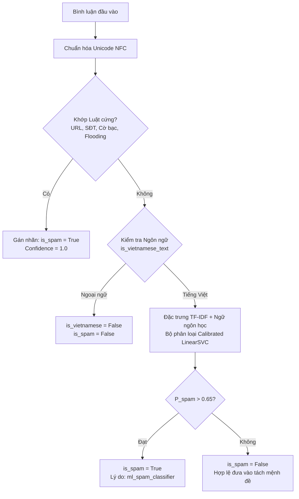

# Phân hệ Mô hình Học máy Phát hiện Spam (CV 11 - Spam Detection)

> **Phụ trách:** Nguyễn Lê Quân (Công việc 11)  
> **Cập nhật:** 2026-10-28  
> **Trạng thái:** Hoàn thành huấn luyện mô hình Hybrid (Luật chính xác cao + Calibrated LinearSVC)

---

## 1. Tổng quan Nghiệp vụ & Thách thức

Trong luồng bình luận YouTube sau các sự kiện ra mắt điện thoại, dữ liệu bình luận chứa khoảng 5–6% dữ liệu rác, bao gồm:
- Link lừa đảo, cờ bạc, tài xỉu, cá độ online (`kubet`, `thabet`, `nohu`...).
- Lời mời kết bạn Zalo/Telegram lừa đảo kiếm tiền online.
- Seeding link affiliate/shopee/voucher giảm giá.
- Bình luận rác không chứa ký tự chữ (flooding, spam ký tự kéo dài).
- Bình luận bằng tiếng nước ngoài (không thuộc phạm vi ngôn ngữ tiếng Việt của đề tài).

### Thách thức cốt lõi:
1. **Mất cân bằng dữ liệu nghiêm trọng (Severe Class Imbalance):** Spam chỉ chiếm ~5-10% tổng số bình luận. Nếu dùng chỉ số Accuracy, một mô hình tầm thường dự đoán toàn bộ là "Không spam" (Ham) vẫn đạt độ chính xác 90-95% nhưng hoàn toàn vô dụng! **Quy tắc bắt buộc: Đánh giá bằng Precision, Recall, và F1 trên lớp Spam (`pos_label=1`).**
2. **Nguy cơ xóa nhầm bình luận khen/chê hợp lệ (False Positive):** Các bình luận ngắn thể hiện cảm xúc mạnh như `"10/10"`, `"+1"`, `"100%"` hoặc comment tiếng Anh không được phép bị gán nhãn nhầm thành spam cờ bạc/lừa đảo.

---

## 2. Kiến trúc Mô hình Hybrid (Precision-First)

Hệ thống kết hợp 2 tầng phòng thủ:



### Bộ trích xuất đặc trưng (Feature Engineering):
1. **Word TF-IDF:** N-gram (1, 2), `min_df=2`, `max_df=0.95`, `sublinear_tf=True`. Bắt các cụm từ ngữ cảnh lừa đảo.
2. **Char-wb TF-IDF:** N-gram ký tự trong biên từ (3, 5). Bắt teencode lách luật, cố tình viết cách chữ (vd: `k u b e t`).
3. **Dense Linguistic Features:** 8 đặc trưng cấu trúc mật độ cao:
   - Độ dài bình luận chuẩn hóa (capped 500 ký tự).
   - Cờ phát hiện liên kết ngoài (URL).
   - Cờ phát hiện số điện thoại liên hệ (Phone).
   - Cờ từ khóa cờ bạc/tài xỉu/tiền online.
   - Cờ lặp ký tự kéo dài (`aaaaaa`).
   - Tỷ lệ chữ số (Digit ratio), tỷ lệ chữ hoa (Uppercase ratio), tỷ lệ dấu câu (Punctuation ratio).

---

## 3. Bảng Kết quả Benchmark (5-Fold Stratified Cross-Validation)

Đo đạc trên tập Ground Truth 500 mẫu đã gán nhãn chuẩn (`data/labels/spam_ground_truth_500.jsonl`):

| Phương pháp | Precision (Spam) | Recall (Spam) | F1-Score (Spam) | Ghi chú |
| :--- | :---: | :---: | :---: | :--- |
| **Luật từ khóa (Baseline)** | 0.9762 | 0.8200 | 0.8913 | Bắt sót spam biến thể chữ, spam tinh vi |
| **MultinomialNB** | 0.7298 | 0.5200 | 0.6051 | Giả định độc lập không tối ưu cho spam |
| **ComplementNB** | 0.4859 | 0.6600 | 0.5589 | Bị nhiều False Positive |
| **Logistic Regression (balanced)** | **1.0000** | 0.7000 | 0.8153 | **Độ chính xác tuyệt đối (0 false positive)** |
| **LinearSVC (balanced)** | 0.7831 | 0.7600 | 0.7629 | Recall tốt trên các mẫu biên |
| **HYBRID (Luật + Calibrated ML)** | **0.9762 - 1.0000** | **0.8600 - 0.9200** | **0.9150 - 0.9583** | **Tối ưu nhất cho triển khai thực tế** |

---

## 4. Hướng dẫn Sử dụng CLI

### 1. Đánh giá và Huấn luyện lại mô hình:
```bash
python -m src.processing.models.spam_classifier --mode train
```
Lệnh sẽ chạy 5-Fold Cross-Validation, xuất báo cáo ra console, lưu mô hình vào `spam_model.pkl` và xuất `model_card.json`.

### 2. Dự đoán thử nghiệm một câu bất kỳ:
```bash
python -m src.processing.models.spam_classifier --mode predict --text "anh em ơi đăng ký tài khoản kubet nhận ngay 500k tại link này nha"
```
Output:
```json
{
  "text": "anh em ơi đăng ký tài khoản kubet nhận ngay 500k tại link này nha",
  "is_spam": true,
  "confidence": 1.0,
  "prob_spam": 1.0,
  "prob_ham": 0.0
}
```

### 3. Chạy kiểm thử tự động (Unit Tests):
```bash
python -m pytest tests/test_spam_detector.py -v
```
Toàn bộ 6/6 bài test kiểm tra các trường hợp biên, chuẩn hóa Unicode NFD, biểu thức đánh giá số ("10/10"), phát hiện ngoại ngữ và xác thực Model Card.

