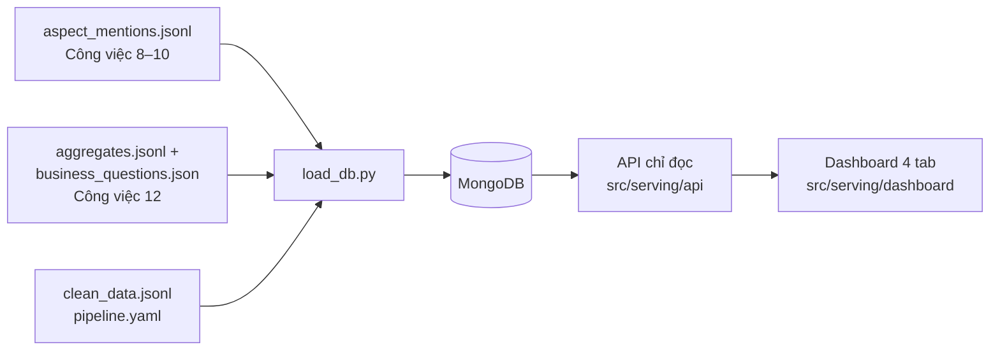

# Serving: API và dashboard (Công việc 13)

> Mục đích: Hướng dẫn chạy API và dashboard đọc từ MongoDB, và mô tả dữ liệu mỗi tab lấy từ đâu; cập nhật lần cuối: 2026-11-17.

Dashboard không còn nhúng số liệu tĩnh. Trang web gọi API; API đọc MongoDB theo [docs/data-model.md](../../docs/data-model.md).



## Chạy thử trong 5 phút

Cần Python 3.10 trở lên, Docker, và `data/clean_data.jsonl` bản chuẩn (xem [src/processing/README.md](../processing/README.md)). Chạy từ thư mục gốc repo.

```powershell
python -m pip install -r src/serving/requirements.txt
docker run -d --name mongodb-dev -p 27017:27017 mongo:7.0

# Chưa có đầu ra của mô hình thật: sinh SỐ LIỆU MINH HỌA bằng luật từ khóa
python -m src.serving.demo_data
python -m src.serving.load_db --models config/pipeline.yaml --comments data/clean_data.jsonl `
    --mentions data/demo/aspect_mentions.jsonl --aggregates data/demo/aggregates.jsonl

python -m src.serving.api.app --port 8000      # mở http://localhost:8000/
```

Nếu đã dựng MongoDB bằng `docker compose` của Công việc 3 thì bỏ dòng `docker run`. Kết nối khác mặc định: đặt biến môi trường `MONGO_URI` và `MONGO_DB` (mặc định `mongodb://localhost:27017`, `smartphone_analytics`, cùng tên biến với `src/storage`).

## Nạp dữ liệu thật

Khi các công việc khác có đầu ra, nạp thẳng file của họ; không cần sửa dashboard.

```powershell
python -m src.serving.load_db `
    --mentions data/aspect_mentions.jsonl `
    --aggregates data/aggregates/current/aggregates.jsonl `
    --analysis data/aggregates/current/business_questions.json
```

| Tham số | File | Vào collection | Kiểm tra khi nạp |
|---|---|---|---|
| `--models` | `config/pipeline.yaml` | `models` | Làm phẳng mẫu chính và đối thủ khai báo lồng nhau |
| `--comments` | `clean_data.jsonl` | `comments` | Có `comment_id` |
| `--mentions` | mention đúng contract v2 | `aspect_mentions` | Từng dòng theo [aspect-mention.schema.json](../../contracts/aspect-mention.schema.json); sai một dòng thì không ghi gì |
| `--aggregates` | số đếm của Công việc 12 | `aggregates` | Số nguyên không âm, không có trường tỷ lệ, không trùng khóa |
| `--analysis` | `business_questions.json` của Công việc 12 | `analysis_results` | Có máy X và phiên bản nhãn trong `config` |

Mọi bản ghi được upsert theo khóa nên chạy lại không sinh bản trùng. Với mentions và aggregates, file được coi là toàn bộ dữ liệu của các `model_version` có trong file: dòng cũ của phiên bản đó mà file mới không còn sẽ bị xóa, phiên bản khác không bị đụng tới.

## Mỗi tab đọc gì

| Tab | Endpoint | Nguồn | Nội dung |
|---|---|---|---|
| Theo dõi ra mắt | `/api/launch` | `aggregates`, `aspect_mentions`, `alerts`, `analysis_results` | Q1: Net theo tuần của X, đời trước, đối thủ. Q2: khen/chê theo khía cạnh, bình luận mẫu. Q5: lỗi do người đã dùng báo. Cảnh báo |
| So sánh mẫu máy | `/api/compare` | như trên | Q3a: ma trận khía cạnh × máy. Q3b: so sánh trực tiếp. Q4: đời trước → đời này |
| Sức khỏe hệ thống | `/api/system` | mọi collection | Số bản ghi, kết quả lọc spam, nguồn nhãn đang phục vụ, độ trễ đo thật của API |
| Tổng quan dữ liệu | `/api/overview` | `comments`, `models` | Số bình luận, video, theo hãng, theo máy, theo giờ Việt Nam |

Ngoài ra: `/api/meta` (máy và phiên bản nhãn có dữ liệu), `/api/health`, tài liệu tự sinh ở `/api/docs`. Tham số chung của hai tab đầu: `model` (máy X) và `model_version`.

## Quy tắc hiển thị

- **Một công thức.** Mọi tỷ lệ đi qua [metrics.py](api/metrics.py): % khen = khen / (khen + chê), Net = % khen − % chê, trung tính không vào mẫu số. Gộp nhiều video bằng cách cộng số đếm rồi mới chia.
- **Ít dữ liệu.** Ô có khen + chê < 30 được vẽ mờ hoặc gạch chéo, ghi "ít dữ liệu", không kèm kết luận.
- **Cửa sổ.** Chỉ tính tuần 1–4 kể từ `launch_date` của từng máy. Mention của chủ kênh không tính.
- **Số liệu minh họa.** Trang hiện băng "SỐ LIỆU MINH HỌA" và gắn chip lên từng biểu đồ khi có bất kỳ điều nào sau đây: nhãn có nguồn `rule` hoặc `llm`; không xác định được nguồn nhãn; chưa có kết quả kiểm định; Công việc 12 chưa cho phép công bố (`can_publish_business_conclusions = false`); dữ liệu là fixture. Lý do được liệt kê ngay trong băng.
- **Kiểm định không tính ở đây.** Khoảng tin cậy, p-value và câu kết luận lấy nguyên từ kết quả Công việc 12. API chỉ gắn chúng vào khi số đếm trong kết quả đó khớp với số đếm đang có trong DB; lệch thì bỏ toàn bộ phần kiểm định và báo lý do, để không ghép kiểm định của lần chạy cũ với số liệu mới.
- **Kết luận.** Không có ý nghĩa thống kê thì ghi "Chưa đủ bằng chứng", không ghi "bằng nhau".
- **Không bịa số.** Chưa có luồng Kafka/Spark thì tab hệ thống ghi rõ là chưa triển khai, không hiện thông lượng hay consumer lag giả.

## Điểm cần cả nhóm quyết định

1. **Collection `analysis_results` chưa có trong data-model.md.** Dashboard cần nơi đọc kết quả kiểm định của Công việc 12 từ DB. Hiện mỗi cặp (máy X, phiên bản nhãn) là một document chứa nguyên `business_questions.json`. Đề nghị bổ sung vào data-model.md, hoặc chỉ định nơi khác.
2. **`clean_data.jsonl` v1.0 không có `author_is_creator`.** Contract v2 bắt buộc trường này và Công việc 12 từ chối mọi mention khi bình luận nguồn thiếu nó. Cần bổ sung ở crawler hoặc tiền xử lý rồi phát hành phiên bản dữ liệu mới; nếu không thì chưa có mention thật nào qua được bước kiểm tra của Công việc 12.
3. **`predecessor_id` đang trống** trong `config/pipeline.yaml` (Công việc 2). Khi chưa có cấu hình phân tích cho một máy, tab so sánh không vẽ được Q4.
4. **Trùng việc nạp DB với Công việc 3.** `src/storage/seed_db.py` nạp dữ liệu mẫu; [load_db.py](load_db.py) nạp đầu ra thật của pipeline. Nên gộp về một chỗ khi cả hai đã vào `main`.

## File

| File | Vai trò |
|---|---|
| [api/app.py](api/app.py) | Ứng dụng FastAPI: các endpoint, đo độ trễ, phục vụ trang dashboard |
| [api/store.py](api/store.py) | Đọc MongoDB, dựng dữ liệu từng tab, đối chiếu với kết quả Công việc 12 |
| [api/metrics.py](api/metrics.py) | Công thức tỷ lệ dùng chung |
| [api/settings.py](api/settings.py) | Cấu hình, tên khía cạnh và loại lỗi |
| [load_db.py](load_db.py) | Nạp file vào MongoDB, có kiểm tra |
| [demo_data.py](demo_data.py) | Sinh số liệu minh họa bằng luật từ khóa (`rule-v0-demo`) |
| [dashboard/](dashboard/) | `index.html`, `app.js`, `styles.css`. Không dùng thư viện ngoài nên chạy được khi không có mạng |

`dashboard/eda_smartphone_outputs/` là đầu ra của notebook EDA cũ; dashboard mới không đọc thư mục này.

## Kiểm thử

```powershell
python -m pytest tests/test_serving_dashboard.py -q            # dùng mongomock, không cần MongoDB
$env:TEST_MONGO_URI = "mongodb://localhost:27017"              # chạy lại đúng các test đó trên MongoDB thật
python -m pytest tests/test_serving_dashboard.py -q
```

Với `TEST_MONGO_URI`, mỗi test dùng một database tạm tên `test_cv13_…` và xóa sau khi chạy.

## Đã kiểm chứng

- 45 test qua trên mongomock và trên MongoDB 7.0 thật.
- Chạy code Công việc 12 (nhánh `task12`) trên mentions minh họa: 1.573 dòng aggregates của họ trùng khóa và trùng số đếm với `demo_data.py`; nạp `business_questions.json` của họ thì API đối chiếu khớp 56/56 ô và hiển thị được khoảng tin cậy, kiểm định.
- Số lượt so sánh trực tiếp (Q3b) và số lượt nhắc lỗi (Q5) API đếm từ `aspect_mentions` trùng với số của Công việc 12 trên cùng dữ liệu.

## Chưa làm

- Word cloud của bản nháp EDA: không có trong DB nên không đưa vào tab tổng quan.
- Sinh cảnh báo: tab chỉ đọc collection `alerts`; phần tính cảnh báo thuộc luồng streaming tùy chọn.
- Xác thực người dùng và phân quyền: API chỉ đọc, dùng trong mạng nội bộ của nhóm.
