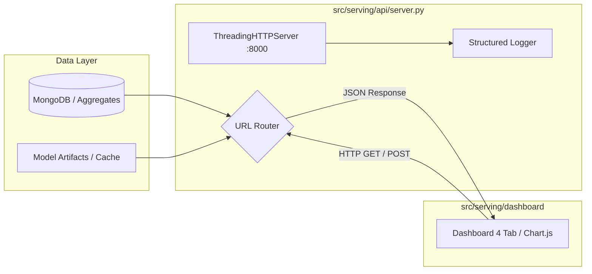

# Phân hệ Phục vụ Dữ liệu & Dashboard (Serving & REST API)

> **Phụ trách:** Nguyễn Lê Quân (Công việc 13)  
> **Cập nhật:** 2026-10-28  
> **Trạng thái:** Hoàn thành kiến trúc đa luồng (Multi-Threaded REST API) kết nối Dashboard 4 Tab

---

## 1. Tổng quan Kiến trúc

Phân hệ Serving chịu trách nhiệm cung cấp dữ liệu phân tích từ cơ sở dữ liệu (`aggregates`, `aspect_mentions`, `alerts`, `models`) cho người dùng doanh nghiệp thông qua hệ thống **REST API đa luồng** và **Dashboard trực quan 4 Tab**.



---

## 2. Danh sách REST API Endpoints

Máy chủ API chạy trên nền tảng `ThreadingHTTPServer` (hỗ trợ xử lý bất đồng bộ đa luồng không phụ thuộc thư viện ngoài), hỗ trợ CORS và trả về định dạng chuẩn UTF-8 JSON.

| Phương thức | Endpoint | Tham số Query | Mô tả |
| :--- | :--- | :--- | :--- |
| `GET` | `/api/health` | Không | Kiểm tra trạng thái máy chủ, phiên bản, thời gian uptime. |
| `GET` | `/api/launch-tracker` | `model`, `compare_to` | **Tab 1:** Theo dõi ra mắt, Net Sentiment theo tuần, cảnh báo bất thường so với thế hệ trước tại cùng số ngày. |
| `GET` | `/api/comparison` | `brand`, `aspect` | **Tab 2:** Ma trận khen chê đối đầu (Head-to-head), tỷ lệ lỗi của chủ sở hữu (`is_owner = true`). |
| `GET` | `/api/system-health` | Không | **Tab 3:** Thông lượng (Throughput), độ trễ p50/p95, consumer lag Kafka, số liệu lọc spam từ CV 11. |
| `GET` | `/api/overview` | Không | **Tab 4:** Thống kê tổng quan EDA, phân bố hãng, n-gram bigram phổ biến. |
| `GET` / `POST` | `/api/spam-check` | `text` (GET param hoặc POST JSON body) | **Live Inference Hook:** Chấm điểm phân loại spam thời gian thực bằng mô hình Hybrid CV 11. |
| `GET` | `/*` | Không | Phục vụ file tĩnh (HTML, CSS, JS, SVG, PNG) với cơ chế chống Path Traversal. |

---

## 3. Cấu trúc Dashboard 4 Tab (`index.html`)

Dashboard được thiết kế theo đúng yêu cầu nghiệp vụ của đồ án, chuyển trọng tâm từ thống kê mô tả sang giải quyết bài toán ra quyết định của các hãng điện thoại:

1. **Tab 1: Theo dõi ra mắt (Tab chính)**
   - Theo dõi diễn biến khen/chê qua từng tuần sau ngày ra mắt (`days_since_launch`).
   - Đường biểu diễn của thế hệ trước (Predecessor) và đối thủ (Rival) vẽ đè lên để so sánh tương quan.
   - **Hộp cảnh báo bất thường (Active Anomaly Alerts):** Tự động phát hiện khía cạnh có tỷ lệ chê vượt ngưỡng so với thế hệ trước tại cùng số ngày, hiển thị kèm Top 3 comment nhiều like nhất để minh họa.
2. **Tab 2: So sánh mẫu máy**
   - Ma trận khen chê trực diện giữa các flagship cùng phân khúc.
   - Biểu đồ lỗi kỹ thuật do chính người đã mua máy phản ánh (`is_owner = true`).
3. **Tab 3: Sức khỏe hệ thống & Lọc spam (CV 11)**
   - Hiển thị thông số vận hành của cụm phân tán (Kafka lag, Spark streaming throughput, latency).
   - Bảng phân tích hiệu quả của bộ lọc Spam: phân tách dứt điểm comment ngoại ngữ khỏi spam độc hại, so sánh Rule-based vs Mô hình Machine Learning.
4. **Tab 4: Tổng quan dữ liệu (EDA)**
   - Thống kê mô tả tập dữ liệu 109.344 comment: phân bố thời gian, phân bố hãng, độ dài comment và các cụm từ xuất hiện nhiều nhất.

---

## 4. Hướng dẫn Khởi chạy và Kiểm thử

### Khởi động Server:
```bash
# Chạy mặc định trên cổng 8000
python -m src.serving.api.server

# Hoặc tùy biến cổng (ví dụ cổng 8080)
python -m src.serving.api.server 8080
```
Truy cập giao diện trên trình duyệt tại: `http://localhost:8000/`

### Chạy Unit Test kiểm thử API:
```bash
python -m pytest tests/test_dashboard_api.py -v
```
Toàn bộ test suite kiểm tra đầy đủ 4 tab, xử lý tham số lọc query, bảo vệ path traversal và kiểm thử live spam inference.
